# The BelType architecture

This chapter is for someone who wants to understand or change the tool rather than use it. It explains how the repository is put together, what each part is responsible for, and how a Markdown file becomes pages, a website or a PDF. If you only want to make documents, the [guide](#the-beltype-guide) is the door you want. For exact signatures see the [reference](#the-beltype-reference); for the story of how a piece came to be the way it is, see `CHANGELOG.md` and the decision records under `.claude/decisions/project/`.

The chapter stays high-level on purpose. Each package has its own chapter further on, written beside its code, and every section here ends by pointing at the one that goes deeper.

## The shape of the problem

BelType has one job: turn Markdown into a paginated document. Three things make that job harder than it sounds, and most of the design follows from them.

**The web has no pages.** An HTML document is one long scroll, and "page 7" does not exist in it. Producing real pages, with sensible breaks, running headers and numbering, means teaching a web engine to think in pages. CSS already has a vocabulary for this (the Paged Media specifications: `@page`, margin boxes, `break-before`), but browsers implement little of it on screen. So BelType hands the document to an *engine*: a piece of browser-side code that reads that CSS and builds the page boxes.

**Pagination happens late.** It happens in a browser, at layout time, long after the Markdown was compiled. The number a cross-reference shows, or the page a contents entry points to, cannot be known when the HTML is generated. BelType does not try to know them. It emits standard CSS (`counter()`, `target-counter()`) and lets the engine fill the numbers in at the one moment they can be computed.

**A build must be accountable.** BelType is local-first: you can build on a train, and you can enumerate what a build depended on. Every library that takes part in rendering (Paged.js, KaTeX, Mermaid, the default fonts) is an installed, pinned dependency served by the tool itself. BelType's own code never crosses the network to render or print.

Underneath sits an identity the rest of the chapter keeps returning to. BelType is **web technology oriented to documents**, and it is stratified:

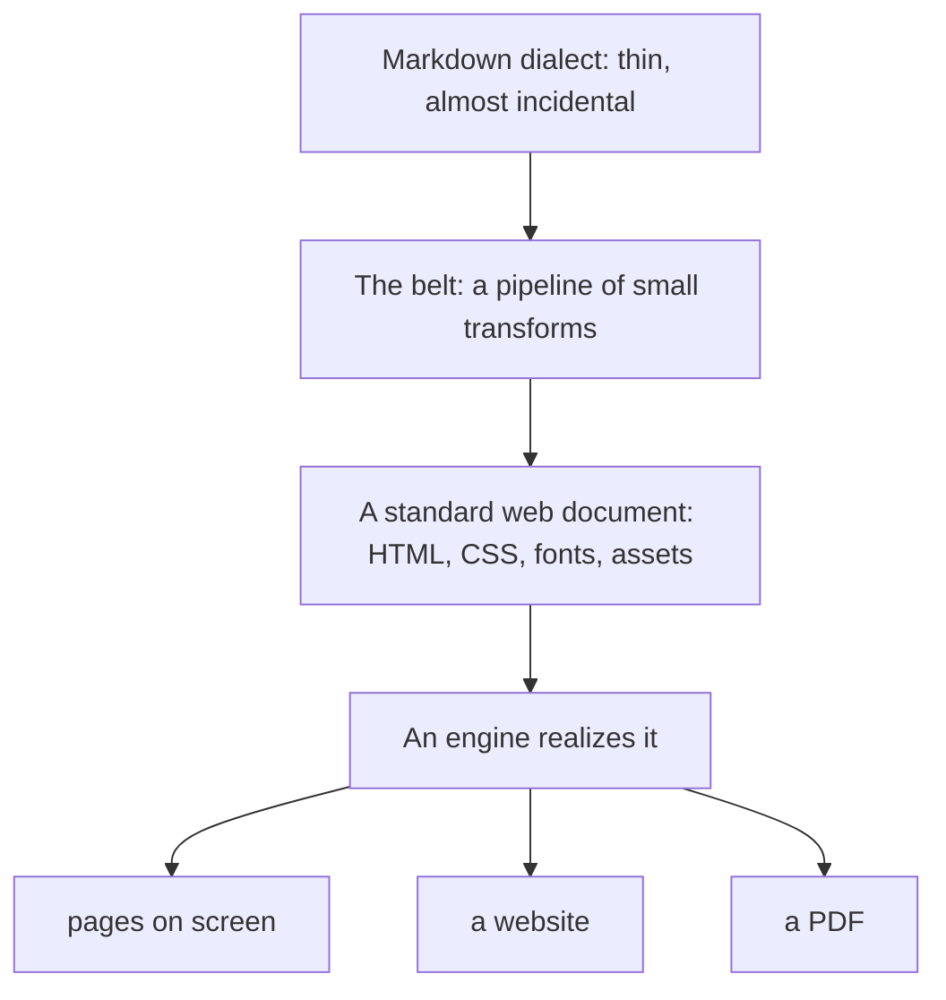

The product is the third box, not the first. A feature earns its place by *binding* these strata (a piece of syntax to an element, a name in the source to a selector in a stylesheet), never by growing a private language above the web. `TABLET.md` states that test, and `VISION.md` says what the whole thing is for.

## One run, from command to page

Before the parts, the whole. This is what happens when you run `beltype report.md`:

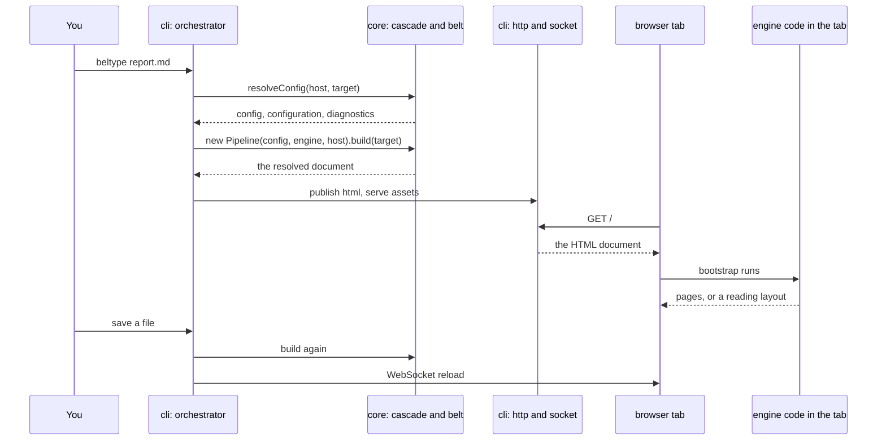

Three things in that picture are the architecture. The CLI **owns the machine**: files, ports, the change feed. Core **owns meaning** and returns one value. The engine **owns the medium** and runs in the browser. The next section makes that division exact.

## Three roles, and what each may touch

Every module in the repository plays one of three roles, and the role decides what it is allowed to touch.

| Role | Who | Owns | May touch |
| :--- | :--- | :--- | :--- |
| **Backbone** | `cli`, the `editing-tools` server, the test harness | the run: when a document is built, what is served | filesystem, network, Chromium, the process |
| **Core** | `core` | meaning: config resolution, the transforms, the assembled document | nothing; it is handed a *host* and asks it |
| **Engine** | `engine-pagedjs`, `engine-cicero`, `engine-site` | the medium: pages or a website, in a browser realm | the live DOM of the document it was given |

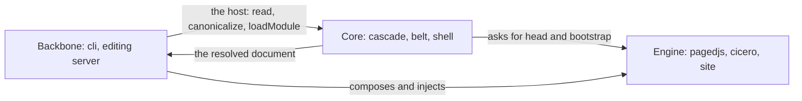

Two seams keep the roles honest. **The host** is how core reaches the world: an object with a handful of verbs that the backbone injects. **The engine seam** is how core reaches a medium: an object with four members that the backbone also injects. Core and the engines never import each other; the orchestrator composes them.

The payoff of the discipline is concrete. Because core imports no `fs`, no `module` and reads no `process`, the same compiler runs unmodified inside a browser tab, and that is what the editing tools are built on. A sweep in `test/host.test.js` checks the property, so a regression fails a test instead of surviving as a habit.

## The eleven packages at a glance

The repository is an npm workspaces monorepo. Dependencies run one way.

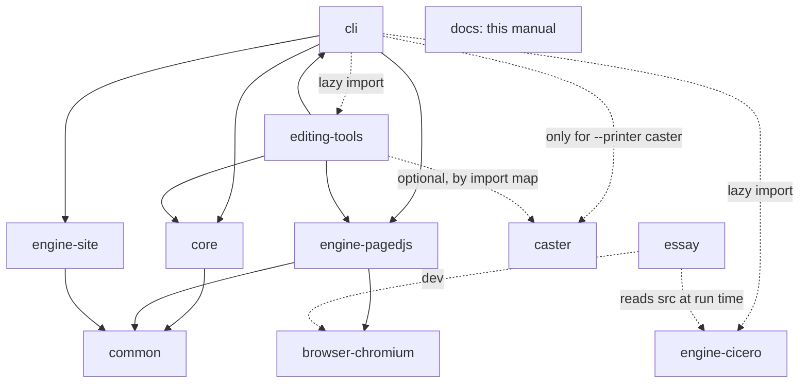

| Package | In one sentence | Goes deeper |
| :--- | :--- | :--- |
| `common` | Paths, errors, logger, mime, escaping, and the engine seam's types; zero dependencies. | [the common package](#the-common-package) |
| `core` | The compiler: resolves config, runs the belt, wraps the shell, computes the closure. | [the core package](#the-core-package) |
| `cli` | The application: flags, orchestrator, node host, dev server, change feed, `build --pdf`. | [the cli package](#the-cli-package) |
| `engine-pagedjs` | The default paged engine: adapts Paged.js and prints PDFs through Chromium. | [the engine-pagedjs package](#the-engine-pagedjs-package) |
| `engine-site` | The same document as a website: sidebar, tabs, live cross-references. | [the engine-site package](#the-engine-site-package) |
| `engine-cicero` | BelType's own paged-media engine, in beta, on screen only. | [the engine-cicero package](#the-engine-cicero-package) |
| `browser-chromium` | The one place headless Chromium is launched, and the pin on which build. | [the browser-chromium package](#the-browser-chromium-package) |
| `editing-tools` | A server and a browser app in which the belt runs in the tab, live. | [the editing-tools package](#the-editing-tools-package) |
| `caster` | A browser-side PDF 2.0 / PDF/UA-2 printer that reads the pages an engine presented. | [the caster package](#the-caster-package) |
| `essay` | The venue that proves Cicero against Chromium's own print, and the book about it. | [the essay package](#the-essay-package) |
| `docs` | This manual, itself a BelType document. | you are reading it |

Who is published, how versions move and how a new engine gets a seat is the business of [the repos chapter](#repos-packages-and-the-publish-posture).

## The kernel in six concepts

Everything else elaborates six load-bearing ideas. The list is also a discipline: a file that serves none of them is fat by definition, and a feature proposal names the one it passes through.

| Concept | What it is | Lives in |
| :--- | :--- | :--- |
| **The cascade** | Configuration as a pedigree of schemas ending in the document's own frontmatter, resolved fresh on every render by [Cascata](https://github.com/egildo/cascata). | `core/src/cascade.js`, `core/schema/document.yaml` |
| **The belt** | include-merge → remark → rehype → shell: one pass, rebuilt per render, ending in one frozen value. | `core/src/pipeline.js`, `core/src/plugins/` |
| **The host** | The injected object through which core reads anything at all. | `core/src/host.js`, `cli/src/host-node.js` |
| **The three style strata** | Mechanics, addendum, author sheets: a default look that always loses to yours. | `core/src/shell.js`, `core/assets/beltype-ua.css` |
| **The closure** | Every resource the emitted document reaches for, discovered on every render. | `core/src/closure.js`, `core/src/linker.js` |
| **The engine seam** | Four members through which any rendering engine is composed. | `common/src/engine.js`, each engine's `seam/index.js` |

The sections below take them in the order a render meets them.

## The host, or how core touches nothing

Core needs bytes: the target file, included chapters, the venue's config, a stylesheet to scan. A compiler that calls `fs.readFile` for them can only ever run on node. So core calls nothing. It is handed a **host** and asks it.

```js
// The shape of a host (Cascata's Host, plus BelType's one addition, loadModule)
const host = {
  read(location),         // → { ok: true, bytes } or { ok: false, reason }
  canonicalize(location), // one spelling per resource
  cacheRead(key), cacheWrite(key, value),
  locate(uri),            // optional: answers a scheme the host owns, e.g. beltype:document
  paths,                  // optional: how this realm does paths — Cascata's own facility on node
  loadModule(specifier, { from }) // optional: resolve AND evaluate → { namespace, location }
};
```

Three rules make the seam trustworthy:

- **There is no default host.** A `Pipeline` or a `resolveConfig` call built without one throws a programmer error. Nothing falls back to the filesystem quietly.
- **A refusal is data, never a throw.** `read` answers `{ ok: false, reason }`; a host throws only for a genuine fault. `readText(host, loc)` is the one place a refusal becomes the `null` that domain code checks.
- **Algebra may be shimmed, capability may not.** `node:path` is string algebra and a browser may shim it. `fs` and module resolution *are* the host. A host that lacks `loadModule` refuses string-named plugins with a message naming the lawful door (pass the function itself); it never stubs.

Three hosts exist: the node host (a real filesystem, in `cli`), an HTTP host (the editing tools' tab, reading drafts first), and a memory double for tests. All three answer the same paths with the same algebra; only what backs them differs.

## The cascade, in one paragraph and one picture

A document's configuration is not a settings file merged over defaults. It is a **pedigree**: BelType's root schema, then any house schema, then the *venue* (the directory's `beltype.config.yaml`, which is itself a schema), then the document's frontmatter, the one rung that holds plain values.

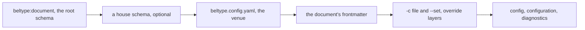

Cascata resolves the pedigree; `core/src/cascade.js` keeps only what Cascata cannot answer: which file is the venue, and how to show Cascata the frontmatter *in place* so a diagnostic lands on the author's own line. It also keeps a short list of refused keys and the math that anchors each path against the file that declared it.

It runs **per render**. Frontmatter is part of the cascade, so re-running the whole thing is the only way frontmatter takes part. It is also why a removed key stops applying at once: nothing is persisted for a stale value to survive in.

:::info{title="Run behaviour is not configuration"}
`port`, `watch`, `open` and `engine` are command-line flags and nothing else. A venue that writes `port:` is refused by name. What a render needs from them crosses as an argument to `Pipeline`, where no config file can reach. See [run options are flags](@decisions/run-options-are-flags.md).
:::

The design reasoning is [the configuration chapter](#configuration-design-principles); the keys are in [the reference](#the-beltype-reference).

## The belt, stage by stage

The belt takes a target file and returns the resolved document. It is rebuilt fresh for each render, and it runs in three movements.

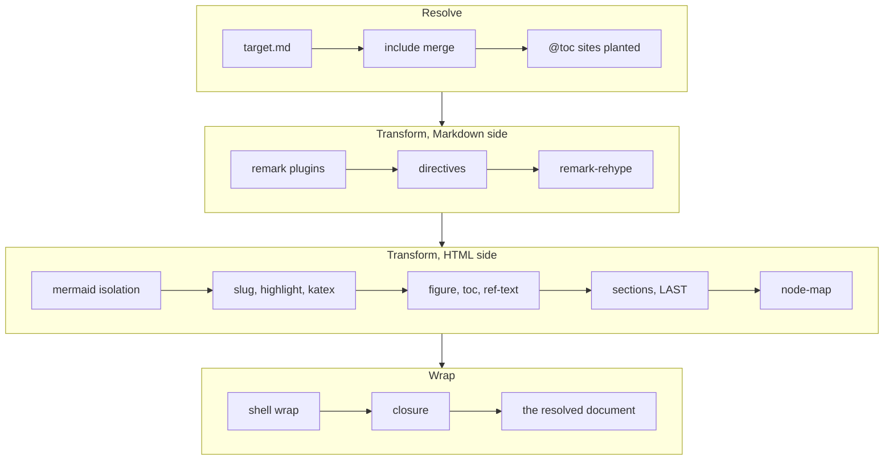

### Resolve: many files become one text

Before a single token is parsed, the include engine walks every `@include` and splices the named file in, recursively, into **one Markdown string**. It tracks the stack of open files, so a cycle is reported instead of followed.

The merge is textual on purpose. CommonMark's link and footnote definitions are *document*-scoped; if chapters were parsed separately and their trees stitched, a `[link][ref]` in one chapter could not see a `[ref]: …` defined in another. Merging raw text is what makes the files one document.

Working on text costs the merge three duties, because a later stage can no longer tell which file a line came from:

1. **Fences are respected.** An `@include` shown inside a code block is an example, and stays one.
2. **References are anchored while provenance exists.** An included chapter's `` resolves beside the chapter, not beside the entry document.
3. **Values are stamped with their scope.** Every attribute on an `@include` besides `src` and `shift` becomes a value for that subtree, so the same file included twice can render differently.

That third duty is the **keyscope**. Each include site opens a scope holding the caller's values over the included file's own `params:` defaults. Caller beats callee, and lookup walks up to scope zero, which is the cascade.

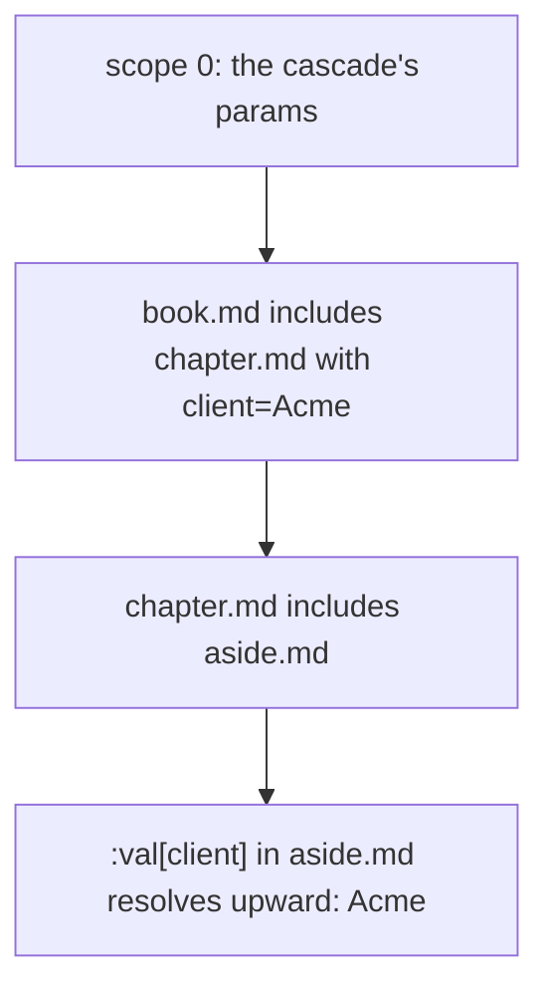

:::info{title="The keyscope is not the cascade"}
They reduce to the same sentence (nearer outranks farther) and are deliberately separate. The cascade resolves a document's identity over separately addressed files; the keyscope resolves values inside one document's own assembly. See [the keyscope is not the cascade](@decisions/the-keyscope-is-not-the-cascade.md).
:::

An at-sign marks the family, the sigil CSS uses for statements about the stylesheet rather than about elements; `@import` is `@include`'s own operation one stratum down. `::` promises "I am a node in your tree"; `@` promises "I am *about* your tree: what appears here is not written here". There are two genera. **Assembly** (`@include`) brings in text authored elsewhere, so its order is inviolable in every engine. **Derivation** (`@toc`) is structure the belt makes, so an engine may re-seat it, which is exactly what the site engine's sidebar does. Generators are refused, and so is computation: values substitute, nothing computes. No expressions, conditionals or loops; that line is where a template language would begin.

### Transform: the order is the design

The constructs the belt parses fall into four content models, and the syntax chapter tags every entry with one: **void** (`::name{…}`, no body), **phrasing** (`:name[text]{…}`, inline content), **flow** (`:::name{…} … :::`, blocks) and **raw text** (a fence, parsed not at all). This is not a taxonomy invented for the occasion. HTML sorts its own elements the same way, void elements like `<br>`, raw-text elements like `<script>`, and normal elements whose content is phrasing or flow, and XML called it the *content model* before that. BelType is web technology pointed at paged documents, so the syntax stratum takes its shape from the document stratum underneath it.

The merged text goes to a [unified](https://unifiedjs.com/) processor: remark on the Markdown side, rehype on the HTML side. It is assembled from the built-in plugin registry, BelType's own transforms and any plugins the author added. Four ordering constraints can be broken by accident:

| Constraint | Why |
| :--- | :--- |
| Author attributes before slugs | An author's `{#id}` must already be on the heading when the slug plugin runs, because it skips headings that have one. That is how a hand-written id wins. |
| Mermaid isolation before highlighting | A `mermaid` fence arrives as an ordinary code block, and the highlighter would mangle its source. It is lifted into `<pre class="mermaid">` first. |
| Slugs before contents and figures | The contents nav and the cross-references both need every heading to carry a stable `id`. |
| Sections last, after user plugins | Every other transform was written against a flat heading sequence and must keep seeing it. Nesting is the fabric's final act. |

That last pass wraps the heading sequence in nested, anonymous `<section>` elements. Ids and classes stay on the headings, so author CSS like `h2.lead` keeps working, and a section is addressed as `section:has(> h2.lead)`.

### Wrap: a fragment becomes a page

The transform stage produces the body and nothing else. The **shell** wraps it into a complete HTML document: the default `@page` rule, the stylesheet links, and the vendor links *the content actually uses* (KaTeX's CSS only if there is math, Mermaid's runtime only if there is a diagram). A small bootstrap then renders diagrams and runs the engine's own statements. The engine contributes two fragments, spliced verbatim at fixed slots.

### The HTML lane: a document that skips the belt

A `.html` target is a document, not belt input. The pipeline reads it, honours its frontmatter, and hands the body to `Shell.splice`, which injects only what an engine needs: the engine's head fragment, the resolved `styles` links, the reload client and the bootstrap. No mechanics, no addendum, no transforms. A `.pug` target rides the same lane with one compile step in front, fed the cascade's `params` and nothing else; Pug's own `include` and `extends` are refused by never being given the `filename` they need.

## The resolved document, core's one outlet

`build()` returns one frozen value, and an engine or a backbone depends on this value and nothing else.

```js
// What Pipeline.build() returns — the shape, from pipeline.js's assemble()
Object.freeze({
  target,        // the file that was built
  config,        // the projected configuration for this render
  configuration, // Cascata's merged node tree, with provenance; never leaves the process
  html,          // the complete document, engine fragments spliced in
  beltOutput,    // the body before the shell wrapped it; engine-blind
  spine,         // { lines, nodes }: source line ↔ emitted node; null on the html and pug lanes
  closure,       // url-space: everything the document reaches for, edges intact
  diagnostics    // the lints a successful resolve earned
})
```

Two questions stay two. One is "which file changes mean I must compile again"; the other is "which resources does the finished page load". Core answers only the second. It keeps no list of what it read: whoever needs the first answer asks the host it read through, and the discriminator is which host did the reading. The pipeline reads the document through its host (under a dev server, a `render` read pass), and a change there means *recompile*. The closure reads the stylesheets and scripts it follows through `Pipeline`'s `closureHost` (a `closure` pass), and a change there only means *re-materialize*. The editing tools' whole edit loop is built on telling the two passes apart, and the `closure` outlet stays for what no pass knows: kinds, edges and the binaries nobody reads.

:::warning{title="configuration never travels"}
Cascata's tree is made of `Map`s. `JSON.stringify` does not throw on it; it silently serializes every mapping as `{}`, so the tree arrives whole and empty. Provenance questions (`why()`) are answered where the tree lives, and what gets published is a deliberate slice: `{ html, closure, spine }`.
:::

## The spine: one chain from the author's line to the page

Click a word in the preview and the editor opens the right file at the right line. That works because four small maps join end to end, and `test/spine.test.js` walks all four.

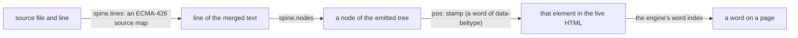

The first hop is a real source map, minted with a standard library, because source maps already solve "connect generated text to its sources" and off-the-shelf consumers read them both ways. The stamps are emitted only when a host asks (`new Pipeline(…, { stamp: true })`), so an ordinary build ships none.

## Three layers of style, and no switch

A document should look finished with no effort, and it should get completely out of your way when you bring your own design. The usual answer, a default theme with an off switch, is clumsy because you have to remember the switch. Browsers solved this long ago: the user-agent stylesheet never disables itself. It *loses*. BelType copies that.

| Layer | Where | Layered? | Job |
| :--- | :--- | :--- | :--- |
| **Mechanics** | inline in the shell | unlayered | Makes features *exist*: the default `@page`, the figure and page counters, `.page-break`, `.no-print`. Without the counters, `:ref[]` renders an empty link. |
| **Addendum** | `core/assets/beltype-ua.css`, linked | `@layer beltype` | The default look: one rule per hook the belt can emit (`.alert`, `.xref`, `figcaption`, `.toc-entry`), plus the default print typefaces. |
| **Author** | every sheet named in `styles` | unlayered | Yours. Always wins. |

The layer is the whole mechanism. In CSS an unlayered rule beats a layered one *regardless of specificity*, so a bare `code { color: red }` in your sheet defeats the addendum's `:not(pre) > code` with no `!important`. That is why there is no `theme` key.

```css
/* the addendum: always applies, always loses */
@layer beltype {
  :not(pre) > code { background: #f6f8fa; }
}
/* your sheet: unlayered, wins without a fight */
code { background: none; }
```

The cost, stated plainly: because the addendum always applies, a look must *unsay* what it does not want. And one constraint for anyone editing these sheets: `@page` stays unlayered, because Paged.js hoists `@page` rules out of any layer it finds them in.

## The closure and the linker: what a ref means

An author writes `styles: ./look.css`, and that sheet says `url(fonts/x.woff2)` and `@import "base.css"`. Something has to know the full list of what this document depends on, and what URL each of those has. Two modules in core answer, with pure string algebra and no filesystem.

**The linker** answers what one ref *means*. There are two spaces. An **fs-space** ref (`rewrites`, an `@include` src) resolves against the directory of the file that wrote it. A **url-space** ref (`styles`, `components`, an image) is resolved on disk the same way and then expressed as a URL against the one URL root, which is the venue. A file outside the venue has no URL unless the author names an alias:

```yaml
# in frontmatter or a venue: "the alias is the mount"
rewrites:
  "@house": ../shared      # ../shared/look.css is served at /@house/look.css
styles: ["@house/look.css"]
```

Nothing is searched and nothing is generated. A ref that nothing serves is refused, with a message naming `rewrites`.

**The closure** answers what the whole document depends on. Right after the shell wraps, core scans the HTML's refs, each stylesheet's `url()`s and `@import`s transitively, each module's imports transitively, and the import map's local targets. Text is read, because scanning it is the job, and it is read through `Pipeline`'s `closureHost`, so an embedder can record those reads apart from the render's. Binaries are listed unopened, because whether a font exists is a `stat`, and that verb belongs to the backbone. Stylesheets are parsed with `css-tree` and modules with `es-module-lexer`; a regex would happily follow an `@import` inside a comment.

The dev server and the closure use the same lookup (`sourceFor`), so they cannot disagree about what a URL means. Problems found by the closure are warnings in the terminal, never failures.

## The engine seam: four members

An engine is a plain object.

```js
// The whole contract between BelType and a rendering engine
const engine = {
  headHtml(base),   // a fragment for <head>: the engine's stylesheet and script tags
  bootstrapJs(),    // statements for the shell's one async bootstrap: "now paginate"
  vendorAssets(),   // the files this engine needs served under /_beltype/
  renderPdf(url, pdfPath, options) // print the document at this URL, or refuse
};
```

One optional member sits beside the four: `realize(html, config)`, which cuts the finished document into the pages the engine's medium serves. Only the site engine has it, under `site.chunk`; the pipeline publishes what it answers as the resolved document's `pages`, and the dev server answers each page by name.

The operator names an engine with `--engine`, and the orchestrator resolves the name against one table. There is no discovery and there are no engine options in config. What crosses the seam is a *standard paged-media document*; an engine's job is to realize the standard in its own medium, never to ask the belt to behave differently.

| Engine | Medium | Paginates with | PDF |
| :--- | :--- | :--- | :--- |
| `pagedjs` (default) | pages | the Paged.js polyfill, in the browser | yes, through headless Chromium, or through Caster |
| `cicero` (beta) | pages | BelType's own engine | refuses; on screen only |
| `site` | a website | nothing; it lays out for reading | refuses, naming the engine that can |

Every engine's composable face is `seam/index.js`, which touches no capability at import time, so a browser tab can import it and call `headHtml` and `bootstrapJs`. Whatever needs a machine lives in a node face, `src/index.js`: Paged.js's real `vendorAssets` and its `renderPdf`. The site engine's seam re-exports its whole object, which is browser-legal already, and Cicero's seam is its only face. `test/engine-seams.test.js` pins the convention for all three; the table is in [the repos chapter](#repos-packages-and-the-publish-posture).

### Three moments: who answers which fact

One law sorts a surprising number of design questions. A fact about a document has a moment.

| Moment | Whose fact | Examples | Answered by |
| :--- | :--- | :--- | :--- |
| **Written** | the document's | heading hierarchy, a figure's caption, the text a `:ref` points at | the belt, at build time |
| **Realized** | the medium's | page numbers, figure ordinals, which nav becomes the sidebar | the engine, at layout time |
| **Read** | the reading's | scroll position, the open tab, the current section highlighted | a component, or the PDF reader |

A fact may be answered *later* than its moment, never earlier. So the belt stamps a cross-reference with its target's **text** (`data-ref-text`, a written fact) and never with a number. Under every engine the number comes from `target-counter()`: the paged engines realize it at layout, and the site engine, which has no pages, delivers every read but a page's with Cicero's own static reads. And a heading like `## 1. Scope` is an author anticipating realization by hand, which is why numbering belongs to CSS counters.

:::warning{title="A numbered heading kills pagination"}
`## 1. Scope` gets the id `1-scope`. A CSS id selector cannot start with a digit, so Paged.js's lookup throws and the whole pass dies at zero pages, blaming fonts. Number with CSS counters, or give the heading a digit-free `{#id}`.
:::

### Components: re-presenting content on screen

BelType syntax is document content, so every block is readable as written. Interactive presentation belongs to engines. Under the site engine, a `transform` binding names a custom element, and the runtime wraps each matching section in it:

```yaml
site:
  transform:
    ".platforms": beltype-tabs   # every heading with class .platforms becomes tabs
```

The contract is three propositions: a standard custom element is the whole API; the section arrives as its light-DOM children; light DOM, so your styles keep applying. If the module fails to load, an undefined element renders its children untouched, and the document reads as written. More in [the engine-site package](#the-engine-site-package).

## How pages get made

Both paged engines start from the same HTML and the same CSS, in a browser. They differ in how they cut.

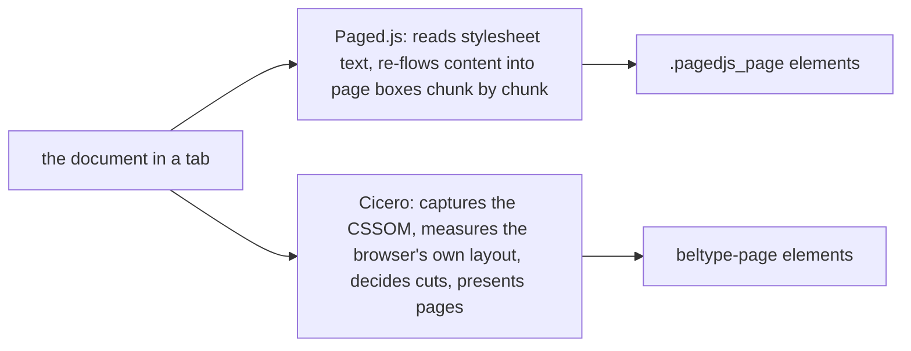

**Paged.js** is a polyfill. It fetches the linked stylesheets as text, translates paged-media rules into things a browser understands, and moves content into page boxes until it overflows, then starts the next. BelType's adapter is the only code that speaks its dialect. See [the engine-pagedjs package](#the-engine-pagedjs-package).

**Cicero** is BelType's own engine, built specification-first and proven by differential testing against Chromium's print. It reads the rules the browser already parsed, measures where the browser put every line, and decides page cuts from those measurements; an optional composed mode hands line-breaking to its own compositor too. See [the engine-cicero package](#the-engine-cicero-package) and, for how it is kept honest, [the essay package](#the-essay-package).

## How a PDF gets printed

`beltype build report.md --pdf` is the only thing `build` does. There is no static export.

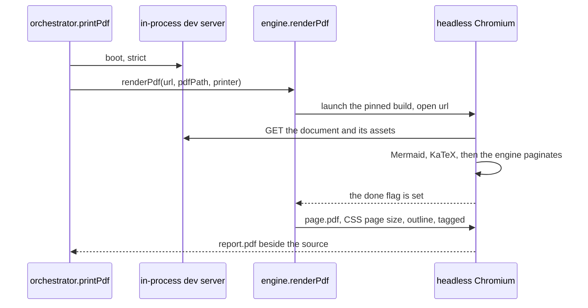

The PDF prints from the dev server's own `http://` URL because Paged.js *fetches* stylesheets, and a browser blocks `fetch` over `file://`. `strict` means a broken document fails the run; otherwise headless Chromium would faithfully print the error overlay. The Chromium build is pinned by `browser-chromium`, because a different build is a different printer.

`--printer caster` ends the same run differently. Instead of Chromium's print, **Caster** runs inside the page, reads the pages the engine presented, and writes the PDF itself: shaped glyphs, subsetted fonts, exact CMYK, and a structure tree for accessibility. It never falls back to Chromium's print. See [the caster package](#the-caster-package).

## Serving and reloading

The dev server is small and strict.

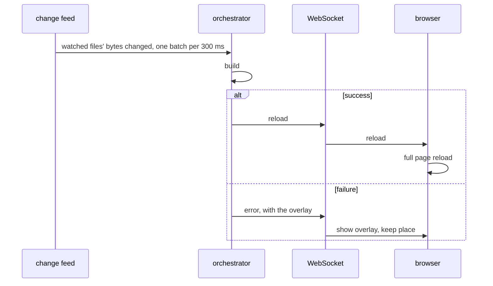

- It watches files, not directories, through a [Provenance](#provenance-is-a-registry-dependency-too) session, and it learns which by reading through it. Every render reads through a `render` read pass, its closure through a `closure` pass, and every venue probe and cascade load through a `cascade` pass. When a pass ends, every file it read and every place it found nothing become that label's watched files, replacing the previous pass's, so what leaves the render stops being watched. A miss is watched too: the chapter behind a broken `@include`, or a `beltype.config.yaml` the probe looked for, rebuilds or reloads the moment it is created. By hand the feed adds only what the page reaches for and no pass opens: the closure's binary and `beside` entries (a font, an image). A batch naming a file of the latest `cascade` pass re-runs the whole cascade, since YAML has no module cache to go stale, and anything else rebuilds. The document itself is the exception: every render re-runs the cascade over its frontmatter, so editing it rebuilds. A change is a change of bytes: re-saving identical text does nothing. See [The render reads through the session](@decisions/the-render-reads-through-the-session.md).
- Every change is a full reload. There is no CSS-only fast path here.
- It binds `127.0.0.1`, sends no `Access-Control-Allow-Origin`, and has **no write verb at all**. With aliases pointing at folders outside the venue, a permissive server would publish a client's folder to any site the browser visits.
- The `/_beltype/` URL space is one table: core's client assets (the addendum, the reload client, KaTeX, Mermaid, the fonts) unioned with the engine's `vendorAssets()`.

More in [the cli package](#the-cli-package).

## The editing tools: a second compile site

`beltype edit` is not the dev server with an editor bolted on. It is a second place where documents get compiled: **the browser tab**.

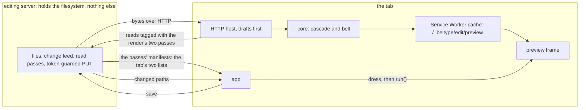

The tab imports core over an import map, reads files through an HTTP host that answers unsaved drafts first, runs the cascade and the belt, and publishes the result to a Service Worker's cache at a real URL. Every render reads through two Provenance read passes the server holds: `render` for what the document is made of and `closure` for the sheets and scripts it reaches for. The tab opens both, tags each read with the id of the pass its host reads for, and ends both with the tree it posts (or the failure). What the server watches is what it served to the last render, a miss included, so the chapter behind a broken `@include` is noticed when it appears; what it lets the tab write is what it served. The tree's answer hands both manifests back, and from them the tab takes what recompiles and which files are the document's sources; what only re-serves is a text-kind closure entry. See [the render reads through the session](@decisions/the-render-reads-through-the-session.md). The preview frame loads that URL. The app then *drives* the engine: it waits for the frame's `beltype:ready` message, dresses the frame with the author's stylesheets as constructed sheets, and paginates, with Cicero's `run()` or with Paged.js's `preview()` after Caster's `prepare()`.

That arrangement is what buys the features: unsaved edits reach the preview, a click on a word opens its source line through the spine, and an inspector can ask the browser itself which author rule set a property. Paged.js is the second engine there, and a preview has a seat (the pane or a window of its own), which the engine does not decide.

:::warning{title="Never srcdoc"}
In a `srcdoc` frame, `<a href="#x">` resolves against the container's URL and navigates, loading the app inside its own preview. The preview is always a real document at a real URL. See [the generation stays in the tab](@decisions/the-generation-stays-in-the-tab.md).
:::

More in [the editing-tools package](#the-editing-tools-package).

## The offline model, said exactly

BelType's own rendering never contacts a CDN: every render-time library is resolved out of its own install and served under `/_beltype/`. What an *author* writes is another matter, and the posture has two halves.

| Space | A remote ref… | Because |
| :--- | :--- | :--- |
| fs-space (something BelType must read to build) | is **refused** | BelType never fetches. A remote schema is refused by construction: Cascata is given no transport. |
| url-space (something the finished page loads) | **warns** and rides through | A hosted font on a website is ordinary web practice, but it is a dependency no artifact of this build contains, so the closure records it and every build says so. |

The principle is **trust through verification** (`TABLET.md`), not *a build never fetches*: what makes reaching for something safe is that the resolved document accounts for it. Vendoring is the mechanism, not the argument.

## What BelType refuses

Each of these is a decision with its reasoning recorded, not an open question.

| Refused | Instead |
| :--- | :--- |
| A `theme` key, a plugin marketplace | `@layer` is the switch; BelType is a tool, not a framework |
| Run options in configuration | flags; see [run options are flags](@decisions/run-options-are-flags.md) |
| Expressions, conditionals, loops, filters in values | values substitute, nothing computes |
| Engine discovery, engine options in config | the operator names an engine; the orchestrator's table resolves it |
| Belt behaviour that switches on the medium | each engine answers the belt's hooks in its own medium |
| Image or asset *search* | an alias is deterministic; a search takes the first match |
| Incremental builds, a CSS-only reload path | one belt, one pass |
| Static export, fingerprint, `vendor`, `init` | cut until a customer returns; see [the MVP cut](@decisions/the-mvp-cut.md) |
| An `.mdx` format | deferred, not dead: the routing stays and throws a clear "planned" error; the likely successor is one more directive |

## Extending BelType

The tool widens at three seams, described from the author's side in the guide: custom directives, user remark and rehype plugins, and the on/off switches of the built-in registry. Internally they are one shape: a small unit slotted into the processor at a known point. A transform of your own should be additive, order-aware, and respectful of the four ordering constraints above. On the site engine, custom elements are the fourth seam.

## Codebase conventions

- **Native ES modules.** Imports carry `.js`; a module that needs its own directory rebuilds it from `import.meta.url`. Cross-package imports use package names with deep paths, and there are no barrel files.
- **Errors are `BelTypeError` subclasses**, never bare `Error`, so a failure carries enough context to be reported well.
- **Paths go through the helpers** in `common/src/paths.js`. Anything that serves a file guards against escaping its directory, and `isRemoteRef` is the one test for "is this ours to resolve?".
- **Transforms stay small and additive**, each doing one thing at a known place.
- **No hard-wrapping** in any file: one paragraph is one line.

The test suite covers the registry, the transforms, the include engine, the cascade, the shell, the PDF wiring, the cross-package contracts, the ref algebra, the spine end to end and the engine seam across all three engines. It is meant to stay green. When you change how something renders, the honest check is still to look at a real document in the browser: tests keep the surface from regressing, but pages are judged by eye.
