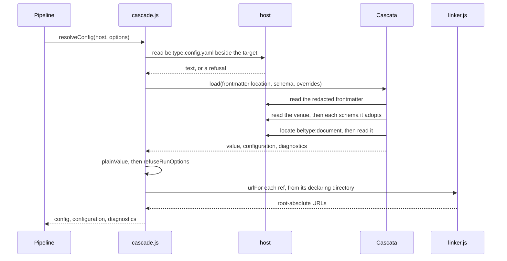
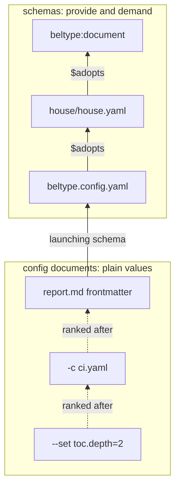
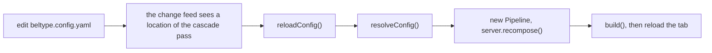

# Configuration: design principles

A document's configuration is assembled from several files, written by several people, at several distances from the document. This chapter explains how BelType decides whose word counts, and why the mechanism has the shape it has. It is the model a proposal about configuration gets judged against, and it applies `TABLET.md`'s principle that legitimacy comes from intent or context, never from proximity.

It is not the list of keys (that is [the reference](#the-beltype-reference)) and not the mechanics of the belt, the chain of transforms that turns Markdown into a document (that is [the architecture](#the-beltype-architecture)). The code it describes is small: `packages/core/src/cascade.js`, under five hundred lines with its comments, plus the root schema in `packages/core/schema/document.yaml`.

## Two questions that look like one

A configuration file tempts its owner to answer two different questions in one place, because both are `key: value` on the page.

| Question | Examples | Who answers | Where it lives |
| :--- | :--- | :--- | :--- |
| *What is this document?* | its title, its look, the values its chapters read, what it must supply | the author and the owner of the folder | schemas and frontmatter, resolved by the cascade |
| *How is this run behaving?* | the port, the engine, whether to watch, whether to open a browser | the operator at the shell | command-line flags and nothing else |

BelType keeps them apart. A document's identity is a **schema** question, and schemas are Cascata's ([cascata owns the cascade](@decisions/cascata-owns-the-cascade.md)). A run's behaviour is a **command line** question, and it has no key anywhere ([run options are flags](@decisions/run-options-are-flags.md)). What stays in BelType's own hands is deliberately small, and most of this chapter is about that small part.

## The cascade is Cascata's

[Cascata](https://github.com/egildo/cascata) is a configuration language with schemas that adopt one another. BelType hands it the whole question of merging, typing, governing and explaining configuration. It rests on `TABLET.md`'s **trust the standard**: when a design starts to look like *and now we build our own version of X*, look harder for the X that exists. A hand-built key manifest, a JSON-Schema subset and a mold expander all lived in core once, and each was an approximation of something Cascata states as law; none is coming back.

The **cascade** is the name for one resolution: every schema and config document that governs a target, merged into one value. BelType's side of it has one entry point.

```js
// packages/core/src/cascade.js
const { config, configuration, diagnostics } =
  await resolveConfig(host, { target, cwd, venue, overrides });
```

| Member | What it is | Who reads it |
| :--- | :--- | :--- |
| `config` | the projected value as a plain object, refs anchored, with `target`, `rootDir`, `urlRoot` and `venue` added | the belt, the shell, the servers |
| `configuration` | Cascata's merged node tree, every node carrying the span it was written at | `why(configuration, pointer)`, and the anchoring math |
| `diagnostics` | the lints a *successful* load earned; a refusal throws a `ConfigError` instead | whoever reports to the author |

The `host` argument is the injected object through which core reaches every file; core itself imports no `fs`. The cascade wraps it for Cascata, adding one thing: it answers the one virtual location described under [frontmatter](#frontmatter-is-a-shared-surface). It records nothing: what the cascade read is recorded by the host it reads through. In the dev server that host reads through Provenance passes, so every file the cascade read or looked for and missed is watched. A change to a location the probe-and-load pass labelled `cascade` read or missed reloads the cascade ([the render reads through the session](@decisions/the-render-reads-through-the-session.md)).

### One call to resolveConfig, end to end



The second step is the venue probe, `findVenue()`. A caller that already probed passes its answer as `venue`, which is what both backbones do: they probe once at startup and hand the result down, so a render costs no second walk. The `load()` call in the middle is the only place Cascata runs, and it receives four options and no more.

```js
load(target + '#frontmatter.yaml', {
  host: cascataHost(host),
  sandboxRoot: venue.dir,   // a schema may not reach outside the venue
  schema: venue.schema,     // the venue's file, or 'beltype:document' when there is none
  overrides                 // -c files and minted --set documents, in command-line order
});
```

Everything after `load()` returns is BelType's own. `plainValue` turns Cascata's null-prototype projection into ordinary data. `refuseRunOptions` checks the refusal list. `anchor` turns the strings an author wrote into paths and URLs.

:::warning{title="An int arrives as a bigint"}
Cascata projects an `int` as a `bigint`, which is right for a library that must not narrow a 64-bit value. BelType has no such value, and `JSON.stringify` throws on one. So `plainValue` narrows every `bigint` to a `Number` once, at this seam, and the CLI and the editing tools' tab both read the same object.
:::

## A venue is a schema

A **venue** is the folder whose `beltype.config.yaml` governs the documents beneath it. Cascata has no second kind of file that merely offers defaults. A file that wants to say *documents under me get this stylesheet unless they say otherwise* has one way to say it, which is to be a schema and `provide` the value. So a venue's config is a schema ([a venue is a schema](@decisions/a-venue-is-a-schema.md)).

```yaml
# beltype.config.yaml
$adopts: beltype:document
keys:
  styles:
    provide: [./house.css]
  owner:
    demand: { type: string, required: true }
```

`$adopts: beltype:document` is what makes the file a schema at all: it adopts BelType's root schema the way every schema in a chain adopts a parent. Under `keys`, each entry speaks in one of two verbs. `provide` offers a default a document may override. `demand` requires something of every document beneath: a type, a range, presence. Both verbs sit in one table, so *every report supplies an `owner`* is one line beside the stylesheet, and needs no second mechanism.

The same construct covers what other tools split into three. A template is a schema a document adopts and satisfies. A house look is a schema whose keys mostly `provide`. A contract is one whose keys mostly `demand`.

The genre has a cost, accepted knowingly: the simple case is heavier. One stylesheet costs four lines, and the smallest venue writes in the schema register. In exchange a venue gains what a settings file structurally cannot offer, the power to demand a value of every document beneath it and not merely default one.

:::info{title="Where cascade: append comes from"}
Whether a list accumulates down the chain or is replaced is a per-key declaration, `cascade: append`. The root schema declares it for `styles` and `components`, and a descendant inherits it. Measured: a venue that provides `styles` with no `cascade:` line still accumulates after the house sheet. A list key that a house schema invents gets `replace` unless that schema says otherwise, and then a venue's one item silently displaces the house's.
:::

What the cost never touches is the zero-config path, which `VISION.md` promises: one Markdown file, every default accepted, renders. It survives through Cascata's **launching schema**. When the probe finds no venue, `resolveConfig` passes `schema: 'beltype:document'` to `load()`, and Cascata proceeds as if the frontmatter had written `$schema:` itself. A folder with no config is a document whose entire chain is the root schema.

## The chain

Cascata calls the chain of adoptions a document's **pedigree**. Read from the root down, each rung outranks the one above it, and only the rungs at the bottom hold plain values.



1. **`beltype:document`** is BelType's root schema, `packages/core/schema/document.yaml`. It declares the guaranteed minimum (`title`, `styles`), the keys venues in this repository use (`lang`, `author`, `customProps`, `params`, `rewrites`, `toc`, `markdown`, `directives`, `components`, `plugins`, `importMap`, `site`), and a reserved, empty `beltype:` namespace. Its top level is open on purpose.
2. **Any number of schema rungs** come next: whatever the venue adopts, and whatever that adopts. A nearer schema displacing a farther one's default is the pedigree's own substitutability, a rule Cascata proves and BelType never restates.
3. **`beltype.config.yaml`** is the venue's own schema, the standing word of whoever owns the folder.
4. **The document's frontmatter** is the entry document, the first rung that holds values instead of governance. A document may write its own `$schema:`, and an authored one replaces the venue's whole chain for that document.
5. **The operator's layers**, `-c` files and `--set` flags, are more config documents ranked after the frontmatter. They get [their own section](#the-command-line-is-a-layer).

`beltype:document` is a name, not a path, because the file sits inside an installed package at a location only the installer can compute. The name is a URI scheme **the host owns**: Cascata offers the reference to the host's `locate`, and the host answers with a location. Every host must answer it. The node host resolves the package, the in-memory test double seeds it into its map, and the editing tools' tab receives the location from its server. The root schema is therefore read through the host on every render, and a dev server's pass records it, which is honest: the cascade read it.

:::warning{title="A venue adopts only what sits inside it"}
The cascade passes `sandboxRoot: venue.dir`, and Cascata refuses a *schema-authored* local reference that resolves outside it, with `sandbox-escape`. Measured: a venue writing `$adopts: ../shared/house.yaml` is refused, relative or absolute. Two references are exempt. A document's own `$schema:` is config-authored and may point anywhere. `beltype:document` is a location the host chose.
:::

## A worked cascade, from house schema to resolved value

One small venue, run for real. The operator stands in `reports/` and runs `beltype q3/report.md`.

```text
reports/
  beltype.config.yaml      the venue
  venue.css
  house/
    house.yaml             the house schema the venue adopts
    house.css
  q3/
    report.md              the document
    local.css
brand/
  logo.css                 outside the venue, reached by an alias
```

The house schema provides a look and a language, and demands two things of every document.

```yaml
# reports/house/house.yaml
$adopts: beltype:document
keys:
  styles:
    provide: [./house.css]
    cascade: append        # restated for the reader; inherited from the root either way
  lang:
    provide: it
  client:
    demand: { type: string, required: true }
  toc:
    demand:
      type: mapping
      keys:
        depth: { demand: { type: int, max: 3 } }
```

The venue adopts it, adds two sheets, names the out-of-tree folder, and sets a default contents depth.

```yaml
# reports/beltype.config.yaml
$adopts: ./house/house.yaml
keys:
  styles:
    provide: [./venue.css, "@brand/logo.css"]
  rewrites:
    provide:
      "@brand": ../brand
  toc:
    provide: { depth: 2 }
```

The document states plain values. `date:` belongs to some other tool and rides through untouched.

```md
---
title: Third quarter
client: Comune di Verona
styles: [./local.css]
date: 2026-09-21
---
```

This is `config`, with the machine's prefix shortened to `/work`.

```json
{
  "client": "Comune di Verona",
  "date": "2026-09-21",
  "lang": "it",
  "rewrites": { "@brand": "/work/brand" },
  "styles": ["/house/house.css", "/venue.css", "/@brand/logo.css", "/q3/local.css"],
  "title": "Third quarter",
  "toc": { "depth": 2 },
  "target": "/work/reports/q3/report.md",
  "rootDir": "/work/reports/q3",
  "urlRoot": "/work/reports"
}
```

Four things in that value are worth reading slowly.

- **`styles` accumulated root to leaf**, and each item was anchored where it was written: the house sheet beside the house schema, the document's sheet beside the document. All four are expressed against one URL root, the venue.
- **`rewrites` became an absolute path**, resolved against the venue that declared it. The `@brand/logo.css` ref resolves through it.
- **`lang` is `it`**, the house's default over the root's `en`. `why(configuration, '/lang')` returns a chain of two entries: `house/house.yaml` line 8, outcome `won`, and `document.yaml` line 41, outcome `overridden`.
- **`urlRoot` is the venue and `rootDir` is the document's directory.** They differ here, and conflating them is a standing hazard.

What the probe and the cascade asked the host for, in order, and so what a dev server's `cascade` pass records and watches:

```text
/work/reports/q3/beltype.config.yaml           missing: the probe looks beside the document first
/work/reports/q3/beltype.config.js             missing: the legacy name, looked for only to refuse it
/work/reports/beltype.config.yaml              the venue, found at the invoking directory
/work/reports/q3/report.md                     read for its frontmatter, the #frontmatter.yaml location
/work/reports/house/house.yaml
<install>/packages/core/schema/document.yaml
```

The two misses are watched too, so creating `q3/beltype.config.yaml` reloads the cascade and moves the venue. The document is the one location left out of that classification: every render re-runs the cascade over its frontmatter, so editing it rebuilds.

Three refusals from the same venue show governance at work. Removing `client:` from the frontmatter fails the build and names both the hole and the line that demanded it.

```text
The configuration is refused:
  - /work/reports/q3/report.md:2:1 — required key is absent — constraint from /work/reports/house/house.yaml:10 (/keys/client/demand/required) rejected value from /work/reports/q3/report.md:2 (required-violated)
```

`--set toc.depth=9` is refused twice over, once by the root's `max: 6` and once by the house's `max: 3`. The second line reads:

```text
  - --set #1:2:10 — expected max 3, got 9 — constraint from /work/reports/house/house.yaml:15 (/keys/toc/demand/keys/depth/demand/max) rejected value from /work/reports/#set-1.yaml:2 (range-violated)
```

And `--set port=4000` never reaches a schema; BelType's own list stops it.

```text
`port:` is not a configuration key (/work/reports/q3/report.md) — a run option — pass `--port` on the command line
```

## Who may say what, and where

| Voice | Register | `provide` and `demand` | Plain values | Relative refs anchor against |
| :--- | :--- | :--- | :--- | :--- |
| `beltype:document` | schema | yes | no | nothing; it names no file |
| a house schema | schema | yes; demands add, never relax | no | its own directory |
| `beltype.config.yaml` | schema | yes | no | the venue directory |
| frontmatter | config document | no | yes, and it may name `$schema:` | the document's directory |
| `-c <file>` | config document, an override | no | yes, outranking the frontmatter | the file's directory |
| `--set key=value` | config document, minted | no | yes, outranking everything before it | the shell's working directory |
| `--port`, `--engine`, `--open`, `--no-watch` | run option | n/a | never a key | n/a |
| `Pipeline`'s `amend` argument | the composing program's word | n/a | `port`, `engine`, `print`, laid over the answer ungoverned | n/a |
| `@include` attributes, a chapter's `params:` | the keyscope, outside the cascade | n/a | values for `:val`, caller over callee | the including file |

Two rows need a word. Any document key is legal at any rung, `plugins` and `directives.*.render` included, so the table has no column for *which keys*. And the last two rows are not rungs at all: `amend` is an argument no file can reach, and the keyscope is a separate mechanism with [its own section](#the-keyscope-is-not-the-cascade).

## The venue probe is the one thing Cascata cannot answer

The rule is short: beside the document; failing that, the directory BelType was invoked from. `findVenue(host, targetDir, cwd)` returns `{ dir, schema }`, where `schema` is the venue's file or, when neither directory holds one, the name `beltype:document`.

BelType keeps the probe because Cascata's host boundary draws the line exactly there: **a host supplies bytes, never meaning.** It answers *what is at this location*, never *is this the venue*. Discovery is also the read. The host reports a missing file as data, not as a throw, so "is there a venue here?" and "what does it say?" collapse into one question.

The probe carries one scar. A legacy `beltype.config.js` is **refused** with a migration message and never silently ignored, because a venue that quietly loses its config ships a wrong PDF.

:::warning{title="The venue is not rootDir"}
`rootDir` is `dirname(target)`. The venue is where the config speaks from, and a venue naming a document one directory down sits above it. The worked example shows the two differing. Code that treats them as one serves the wrong URL root.
:::

## Frontmatter is a shared surface

Other tools read frontmatter too. A `date:` some static-site generator wants has to ride through BelType untouched, which is why the root schema's top level is **unsealed**: an undeclared key is legal. The one courtesy is a warning for a near-miss, since `styels` beside `styles` is a typo nobody meant. A document that prefers to be tidy may gather BelType's keys under one `beltype:` mapping, the way `package.json` gives every tool a named subtree.

Cascata loads files, and frontmatter is a fragment of one. The answer is the system's one virtual location, **`<file>#frontmatter.yaml`**: the whole file with every byte outside the frontmatter replaced by a space, both `---` fences blanked, and every newline kept ([frontmatter as a redaction](@decisions/frontmatter-as-a-redaction.md)). Core answers it in `host.js`'s `readText`, using `redactFrontmatter` from `frontmatter.js`; a host only ever supplies the real file's bytes.

The YAML then sits at exactly the offsets it occupies in the file the author edits. A diagnostic names the author's own file at the author's own line, and there is no offset arithmetic anywhere to get wrong. Writing `styles: 3` on the fourth line of the worked example's report produces this:

```text
The configuration is refused:
  - /work/reports/q3/report.md:4:9 — expected string, got a int scalar — constraint from <install>/packages/core/schema/document.yaml:23 (/types/resource/demand/type) rejected value from /work/reports/q3/report.md:4 (type-mismatch)
  - /work/reports/q3/report.md:4:9 — expected one of [path, url], got a int scalar — constraint from <install>/packages/core/schema/document.yaml:23 (/types/resource/accept) rejected value from /work/reports/q3/report.md:4 (type-mismatch)
```

Two details are load-bearing. **Both fences are blanked**: a surviving closing `---` starts a second YAML document, and a standard parser refuses the pair. **The suffix is `.yaml`**: Cascata picks its parser by extension, so a virtual location has to describe itself the way a real one does. Where a `beltype:` namespace is present, the revealed window narrows to that mapping's own bytes, which parses because YAML allows a block mapping's root to be indented.

## Run behaviour is not configuration

`port`, `target`, `watch`, `open` and `engine` are the operator's and nobody else's business. The root schema never declares them, so a venue has no vocabulary for a port. Their defaults live beside the flags, in `RUN_DEFAULTS` in `packages/cli/src/orchestrator.js`.

Schema governance cannot finish the job alone, though. The root is unsealed for the sake of third parties, and there is no way to close it against BelType's reserved words while leaving it open to `date:`. So one narrow list survives, `REFUSED` in `cascade.js`, checked once over the projected value. Each entry refuses by naming the move.

| Key | What the refusal tells the author |
| :--- | :--- |
| `spec` | a house schema is an ordinary schema: `$adopts:` in the venue, or `$schema:` in the document |
| `schema` | a contract is `keys.<name>.demand` in the governing schema |
| `requires` | write `keys.<name>.demand: { required: true }` in the venue |
| `cover` | a cover page is content, written in the document |
| `mountPaths` | the alias table is `rewrites`, and the alias is the mount |
| `port`, `watch`, `open`, `engine` | pass the flag |
| `target` | name the document on the command line |
| `run` | there is no `run:` block; every run option is a flag |

A legacy `rehypePlugins:` key is refused the same way, with its migration to `plugins: { rehype: [...] }`.

These are **errors, never warnings**. A `port:` typed into frontmatter would otherwise merge into the value and be read by nothing, and a shipped PDF cannot be re-checked. A silently inert key is worse than a refused one.

`plugins` and `directives.*.render` are deliberately absent from the list. The essay's book computes HTML from the repository through `embed-*` directives, which no `{ tag, className }` pair can express, so the render mechanism stays and `plugins:` is an ordinary document key, legal at any rung.

Where a run option must still reach a render (`port` and `engine` for the reload client, `print` for the PDF pass) it crosses as `Pipeline`'s **`amend`** option. That is an argument, stated at composition where a reader can see who is amending what, and no config file, frontmatter or schema can reach it.

```js
// packages/cli/src/orchestrator.js
new Pipeline(config, engine, renderHost, { amend: { port, engine, print }, overrides, closureHost });
```

## The command line is a layer

The operator may add configuration from the shell, and it is no new kind of rung: it is more config documents, ranked after the frontmatter ([the command line is a layer](@decisions/the-command-line-is-a-layer.md)).

```bash
beltype build report.md --pdf -c ci.yaml --set toc.depth=2 --set title="Draft 3"
```

`-c <file>` names a YAML document. `--set key.path=value` mints one from a dotted path and a YAML value; `mintSet()` in `cascade.js` spells `--set toc.depth=2` as this one-document layer:

```yaml
toc:
  depth: 2
```

Both kinds are collected in command-line order, and order is rank: the last outranks everything, the frontmatter included. Cascata reads them as *overrides*, which means the one thing that matters: **an override is governed exactly as the frontmatter is.** A venue's demand refuses `--set toc.depth=9` naming the venue's line and the flag. A key the house marked `final` holds against it. A key under `append` accumulates the operator's items after the document's. `why()` names the flag.

| | `-c ci.yaml` | `--set key=value` |
| :--- | :--- | :--- |
| Location | the real file | virtual: `<cwd>/#set-<n>.yaml`, seeded into the node host |
| Read through the host, so watched and live-reloaded | yes | no; the node host serves it before the pass is asked, and it changes only with the run |
| A relative ref resolves against | the file's directory | the shell's directory, where the operator meant it |
| Named in a diagnostic as | its path | `--set #n:line:column` |

:::info{title="Why not merge the flags over the answer"}
Merging the operator's values over the projected value *after* the cascade answered was simpler, and it saw no demand, held no `final`, and left `why()` naming the document that lost. A layer is governed; a merge is not. That is the whole reason overrides are not `amend`.
:::

The editing tools do not take these flags. Their door is an **overrides document**, `#overrides.yaml` beside the target: a source with no file behind it, kept as a draft and handed to the tab's cascade as the same kind of layer (`packages/editing-tools/DESIGN.md`, *The overrides document*, proposition 46).

## The two spaces

Rank decides *who wins* a key. This section decides *what a key's value means*, and getting it wrong produces `<link href="/Volumes/…/house.css">`, which the server joins onto the root and answers with a 404.

fs-space
: `rewrites`'s values. Real locations on disk that never appear in the output. **Their base is the directory of the config that declared them**, which is what makes a schema relocatable. CSS `@import`, Sass and tsconfig's `extends` resolve this way for the same reason.

url-space
: `styles`, `components`, and the leaf values of `importMap`'s `imports` and `scopes`. These *become* hrefs. The URL space is flat and rooted at the server, so each ref is resolved on disk beside whoever wrote it and then expressed against the one URL root, or through an alias, or refused.

The declaring directory comes from the merged tree's own provenance. Every node's span records the location of the document that produced it, and `declaringDir()` takes its `dirname`.

```js
// cascade.js, the url-space pass for a list key
out.styles = held.map((ref, i) =>
  urlFor(ref, declaringDir(configuration, ['styles', i], rootDir), space));
```

So an accumulated `styles` list anchors item by item, which the worked example shows: four sheets from three files, each resolved where it was written. `anchor()` runs the fs pass first, so that `rewrites` is already absolute when a url-space ref such as `@brand/logo.css` needs it. The ref algebra itself, `urlFor` and `spaceOf`, lives in `packages/core/src/linker.js`.

## One URL root, and the alias is the mount

**There is one URL root, and it is the venue**: the directory holding `beltype.config.yaml`, or the document's own when there is none ([the URL root is the venue](@decisions/the-url-root-is-the-venue.md)). Every ref resolves on disk beside the file that declared it and is then expressed against that root, through a `rewrites` alias, or refused with a message naming `rewrites`.

`rewrites` is one author-named table, and **the alias is the mount** ([the alias is the mount](@decisions/the-alias-is-the-mount.md)).

```yaml
rewrites:
  "@house": ../shared    # @house/x.css is ../shared/x.css on disk, served at /@house/x.css
```

That is the whole mechanism. Nothing is generated: no label is minted per render, so the table rides the configuration. It is legal in frontmatter too; this manual's own `index.md` declares `"@decisions": ../.claude/decisions/project` there, which is what makes the decision-record links in this chapter resolve.

An out-of-tree folder is **named, never searched**. A search path takes the first match, so a venue's own `cover.png` would silently shadow a house folder's. A name the author wrote points at exactly one folder and says so in the document (`@brand/cover.png`) as well as in the config. That is why no image-search key exists.

`importMap` marks the boundary of the append argument by *not* appending. It merges per specifier, later rung winning, because two mappings for one specifier cannot both apply the way two sheets can both link. Its leaves anchor like any url-space ref; its cascade is the ordinary override. The shell emits one `<script type="importmap">`, before the component scripts.

## The cascade runs per render

The cascade runs in `Pipeline.renderConfig()`, once for every render, and not once at startup. It has to: frontmatter is the cascade's entry document, so it cannot take part any other way. That is also what keeps a **removed** key from applying. Nothing is persisted, so nothing goes stale.

A config edit therefore live-reloads the cascade instead of merely triggering a rebuild.



`--port` is a flag, so a config edit cannot move it: the listener stays bound to the port the operator typed. All of this works because a config file is **data**, parsed by the same YAML machinery as frontmatter. An executed-module config format would bring a module cache that YAML does not have.

A refused cascade is an ordinary build error in the dev loop, and only there. A half-written frontmatter key is a state an author passes through, so `boot()` keeps going on the CLI's bare defaults and the error overlay heals on the next save. `printPdf()` passes `strict` and receives the refusal, because a headless Chromium would otherwise cheerfully print the overlay.

## The keyscope is not the cascade

An include opens a **keyscope** (DITA's name for it): a scope of values along the include tree, where the call site's values outrank the included file's own `params:` defaults, composing down through nested includes.

```md
@include{src="./chapter.md" edition="3"}
```

Caller beats callee, nearer outranks farther. That is almost word for word how a pedigree resolves, and the resemblance is close enough that the refusal to merge the two was recorded before anyone tried ([the keyscope is not the cascade](@decisions/the-keyscope-is-not-the-cascade.md)).

| | The cascade | The keyscope |
| :--- | :--- | :--- |
| Resolves | identity: which schema governs a document, and its keys | values inside one document's own assembly |
| Walks | a pedigree of separately addressed files | the include tree that *is* the document being built |
| When | before any value in the document is looked at | during the merge, per call site |
| Owner | Cascata, through `cascade.js` | `packages/core/src/plugins/include.js` |

An included chapter is text becoming one document, and a schema has no notion of *this file's attributes at this particular call site*: a schema is adopted once by identity and never spliced in per occurrence. The cascade's resolved `params` are scope zero of the keyscope, and that is the only place the two touch.

### Where params may name a file

`params` is derefable: where the mapping is expected, a string is a single ref to a YAML file, grafted beside the file that wrote it.

```yaml
params: ./values.yaml
```

Two implementations honour it, one on each side of the line above. In frontmatter it is Cascata's **delegation**, which the root schema switches on with `delegate: allow` under `params`. Inside the include tree it is `include.js`'s own `derefParams`. Delegation is the nearest Cascata construct to a keyscope, and it still cannot replace it: a delegated fragment is grafted whole, with no notion of whose value wins when caller and callee both state one.

:::info{title="Delegation fires on a config document's own value"}
Measured: `params: ./values.yaml` works in frontmatter, and a venue writing the same string under `provide` gets a type error. Delegation is triggered by a value a config document states, never by a schema's default.
:::

A `demand` governs the **document**, at its own entry. A contract per included chapter is a question for the include tree and has no mechanism in the cascade.

## What the channels carry, and why

- **Identity lives in the artifact, not the incantation.** A document that needs the right flags typed to know its own look forgets what it is between invocations, and the incantation ends up frozen in a script, which is a config file in worse clothes. So the CLI has no document flags of its own; `-c` and `--set` are governed layers, not a side channel. The same principle keeps a name-to-schema catalog out: it had no user, and the indirection cost the artifact its self-description.
- **Precedence is grammar, not a value.** The resolution order is never configurable. If it varied per invocation, no file in the repository would mean anything on its own.
- **A build never fetches, by construction.** BelType supplies Cascata no `transport`, so a remote `$schema:` cannot be fetched even if something wanted to; `loadCascade` dresses the resulting throw as a `ConfigError`. Should a later round open the door, Cascata's host boundary already has the shape: a host that supplies the transport, a user who opts in, and a `$pin` content hash that makes the fetched schema checkable.

## A note on what BelType has no room for

CSS sorts by origin: user agent, then **user**, then author. It is tempting to read BelType's rungs onto that ladder and call the venue the user origin. It isn't. CSS's user origin is the person *reading* the page, and every voice in BelType's cascade is a person *authoring*.

For a PDF the reader's slot is structurally empty: the person holding the file is not running BelType and cannot restyle it. Under `--engine site` the document is read in a live browser and the slot exists again, though nothing fills it yet. A proposal for it should be judged per engine.

The slot BelType does occupy is the user agent's. `packages/core/assets/beltype-ua.css` is an addendum: the rules a browser would ship if it knew about `.alert`, `.xref` and `figcaption`. Nothing an author links can be of user-agent origin, so the sheet approximates one with `@layer beltype`, which loses to every unlayered rule regardless of specificity. That is why no `theme` key exists. Writing CSS *is* the opt-out, and a reusable look is an ordinary sheet named in `styles:`, accumulating down the cascade. Config binds which sheets link; CSS decides what wins.

## Open questions about configuration

- **The venue register is heavier than a settings file, and nothing refunds it.** A small folder that wants one house sheet pays the full schema price. Whether that wants sugar, and whether sugar could exist without becoming a second configuration language, is open.
- **Nothing reminds an author to write `cascade: append` on a key the root does not declare.** `styles` and `components` inherit it; a house schema's own list key defaults to `replace`. Whether forgetting it deserves a Cascata lint, a BelType check over the resolved pedigree, or nothing, is unsettled.
- **`why()` is host-side.** It needs Cascata's real merged tree, and that tree does not survive a wire: its mappings are `Map`s, so `JSON.stringify` empties every one without throwing. A provenance query runs where the tree lives, or behind an endpoint that answers from there.
- **Three tables, one shape, and still three.** `directives:`, the built-in belt lifts, and fence bindings each bind a name to a rendering, for different owners on different clocks. Collapsing them would conflate a document key with a mechanic, the category error `TABLET.md` names.
