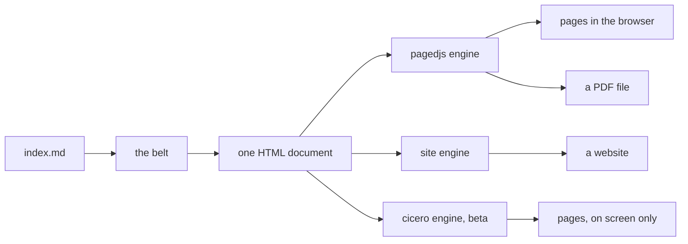
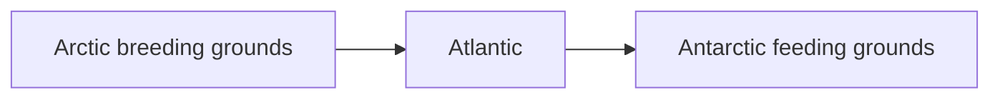
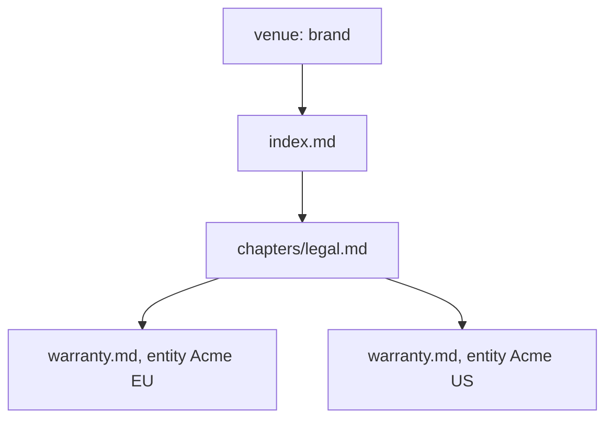
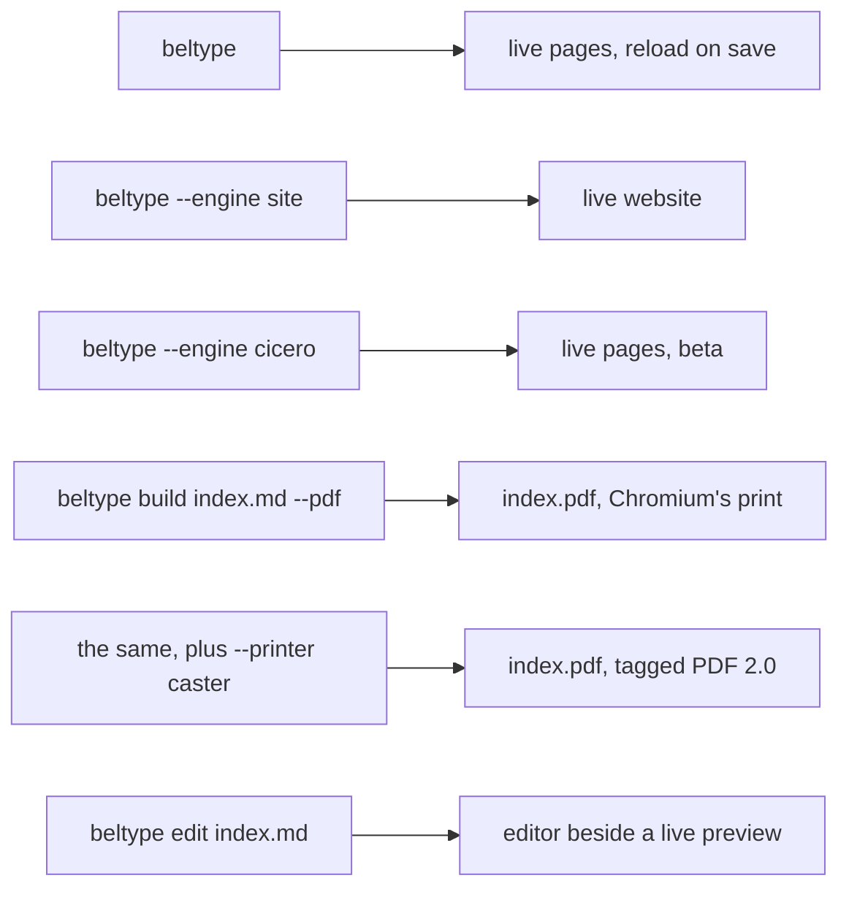

# The BelType guide

Markdown is a pleasant way to write. You keep your hands on the keyboard, the source stays readable, and the words are never buried under formatting. What Markdown is *not* good at is becoming a document: a real one, with numbered pages, a cover, a table of contents, and a header that repeats the title along the top of every page. For that you normally reach for a word processor, or for a heavyweight typesetting system, and you leave the comfort of plain text behind.

BelType is an attempt to keep you in plain text all the way to the finished document. You write Markdown; BelType lays it out in a real browser engine and hands you print-ready pages or, with one flag, the same document as a website. Nothing leaves your machine, and BelType itself fetches nothing from the network while it works (a remote URL you write yourself is loaded by the browser, and every build says so).

Three words recur from here on, so here they are once. The *belt* is the chain of transforms that turns your Markdown into one ordinary HTML document. An *engine* is whatever presents that document: `pagedjs` cuts it into pages and is the default, `site` lays it out as a website, and `cicero` is BelType's own page engine, still in beta. A *printer* is what writes the PDF file at the end of a `build --pdf` run.



This guide teaches BelType by building one document from start to finish: a short report on the Arctic tern, a bird that flies further each year than seems reasonable. By the end you will have used every feature that matters, and you will have met each one at the moment you actually needed it. When you want the exhaustive answer instead, every construct and exactly what it produces, that is the [syntax manual](#syntax). The CLI flags and configuration keys are in the [reference](#the-beltype-reference). If you want to know how the machine works underneath, read the [architecture](#the-beltype-architecture). This is the friendly path.

## Getting started

BelType is a command-line tool that runs on Node.js (version 22 or newer). Once you have the project installed and, optionally, linked so that `beltype` is on your path, the quickest way to see it work is to write one file and point the tool at it. There is no scaffolding step. A document needs nothing beyond the Markdown file itself:

```bash
mkdir tern-report && cd tern-report
```

Create `index.md` (the next section shows what to put in it), then run:

```bash
beltype
```

A `beltype.config.yaml` beside the document is optional. Reach for one once you have something to share across several documents, a stylesheet or a value; until then, every key lives in the document's own frontmatter. The command starts a development server and opens nothing on its own (`-o` opens the browser for you). Visit the address it prints (by default `http://localhost:3000`) and you will see the document laid out as pages. Leave that server running. Every time you save the file, the page in the browser refreshes itself.

That is the mode you will spend the most time in. The other mode produces output you can keep:

```bash
beltype build ./index.md --pdf   # prints a PDF beside index.md
```

We will return to it. For now, keep the server running in a terminal off to the side, and write the tern report below.

## A first document

A BelType document is an ordinary Markdown file with one addition at the very top: a block of configuration fenced by triple dashes, called *frontmatter*. It is where the document says what it is. Write this into `index.md`:

```markdown
---
title: The Arctic Tern
author: A. Ornithologist
---

# The longest commute in nature

The Arctic tern breeds near the North Pole and winters near the South, and it makes the
trip twice a year.
```

Save it, and the browser catches up on its own. The title you gave in the frontmatter becomes the name of the browser tab; the heading and paragraph become the first page. Already you have the whole rhythm of working in BelType: edit the Markdown, glance at the page, edit again. The frontmatter will grow as the document asks for more, but it never becomes mandatory. A document with no frontmatter at all still renders. And the block isn't BelType's alone: if other tools read your frontmatter too, put BelType's keys under one `beltype:` mapping and it will read only that, leaving the rest of the block to them.

Everything you know from ordinary Markdown works here, and a good deal that you may not. BelType understands GitHub Flavored Markdown, so task lists and strikethrough are available without ceremony. Tables and bare-URL links are one line away. They cost the parser time on every edit, so they are off until a document or venue asks for them with `markdown: { gfm: { tables: true, autolinks: true } }` (in frontmatter, indent it under `markdown:` and `gfm:`). A table looks like this:

```markdown
| Leg        | From         | To           |
| :--------- | :----------- | :----------- |
| Northbound | Weddell Sea  | Arctic coast |
| Southbound | Arctic coast | Weddell Sea  |
```

That table will render with the alignment you asked for in the header row, styled to match the rest of the document. You did not have to think about how it looks, which is the point: BelType ships with an opinionated default design so that a document looks finished before you have written a line of CSS. Later, when you *do* have opinions, that default gets out of your way. But we are getting ahead of ourselves.

## Writing the report

A report is more than paragraphs. As you write the tern's story you will keep running into things prose alone cannot say, and each time BelType has an answer.

### Notes to the reader

Some remarks sit slightly apart from the argument: a warning, a helpful aside, a piece of context. BelType renders these as *callouts*, using a syntax borrowed from the wider Markdown-directive world: three colons, a name, and a matching three colons to close.

```markdown
:::tip
Terns navigate partly by the sun, which makes their timing remarkably precise.
:::
```

There are four such callouts: `tip`, `warning`, `danger`, and `info`. Each renders in its own color with a heading printed automatically ("Tip", "Warning", and so on). If the default heading is not what you want, name your own:

```markdown
:::warning{title="Unverified"}
The 90,000-kilometre figure is a rough annual estimate, not a measurement.
:::
```

One more directive rounds out the family: `:::aside` floats a block to the side of the text, useful for definitions you want visible but not in the way. And should you ever nest one container in another, note that a `:::` block closes at the first `:::` it meets, so the outer one needs more colons than the thing inside it: `::::warning` around a `:::tip`. You will not need that for the tern, but it is there.

### Numbers

Our report will want to state the tern's route length, and it will want to do so properly. Wrap mathematics in dollar signs for an inline formula. A formula that stands on its own line takes a pair of doubled dollar signs:

```markdown
A round trip covers roughly $2 \times 45{,}000 = 90{,}000$ kilometres. Over a thirty-year
life that is

$$
30 \times 90{,}000 = 2{,}700{,}000 \text{ km},
$$

further than three round trips to the Moon.
```

BelType renders the mathematics with KaTeX, so the fractions and roots come out as typeset symbols rather than literal dollar-sign soup.

### Pictures, and referring to them

A report about a migratory bird is poorer without a map. Drop an image in with the usual Markdown syntax, but give it a *title* (the quoted string after the URL). BelType then promotes it from a bare image into a proper figure, complete with a caption and an automatically assigned number:

```markdown

```

The caption will read "Figure 1. The annual migration of the Arctic tern", and the numbering takes care of itself: add a second figure earlier in the document and every number after it adjusts.

Numbers that adjust themselves are only useful if you can point at them without hard-coding the value. End the caption with an identifier in braces, and elsewhere refer to it:

```markdown


The route in :ref[fig:route] is longer than the equator.
```

`:ref[fig:route]` becomes a link that reads "Figure 1". It keeps reading the right number no matter how the figures are shuffled: the value is resolved when the document is paginated, not when you write it. This is the first hint of something that runs through BelType: the page numbers in your table of contents work the same way, and for the same reason.

### Drawing a diagram

Some ideas are clearer as a diagram than as a sentence. A fenced code block tagged `mermaid` is rendered as a vector diagram:

````markdown

````

The diagram is drawn in the browser. A detail that matters more than it sounds: it is drawn *before* the page is broken into pages, so that BelType knows how tall it is and never splits it awkwardly across a page boundary.

### The small conveniences

A handful more features cost you nothing and improve the reading. All of them are common across the wider Markdown ecosystem, not inventions of BelType's own.

Definition lists, for the short glossary every report seems to grow, are written as a term on one line and its definition indented with a colon on the next:

```markdown
Pelagic
: Living on the open sea rather than near the coast.
```

A word wrapped in double equals signs is highlighted, the way a reader marks up a printed page.

```markdown
The tern's ==entire adult life== is spent chasing summer between two poles.
```

Chemistry and mathematics get their subscripts and superscripts without reaching for raw HTML.

```markdown
A tern's wingspan is roughly 0.8 m, and its body mass around 110 g — call the ratio x^2^
for a rough sense of a wing's loading, or note that its blood carries O~2~ efficiently at
altitude.
```

And an abbreviation, defined once, becomes an `<abbr>` with its expansion everywhere it appears. Browsers render that as a dotted underline with the full phrase on hover. The convention is the one PHP Markdown Extra popularised. BelType implements it itself, since no remark package for it survives contact with a modern Markdown parser:

```markdown
*[IOC]: International Ornithological Congress

The IOC recognises Sterna paradisaea as the accepted name.
```

Footnotes keep citations out of the way of the sentence.[^banding] Emoji shortcodes such as `:compass:` become their pictured selves. And smart typography (curling straight quotes, turning `--` and `---` into proper dashes) is one line in the frontmatter away:

```yaml
markdown:
  smartypants: true
```

[^banding]: The distances are known from decades of banding recoveries.

Every one of these, including mark, sub/superscript, and abbreviations, can be switched off the same way. Footnotes come with GitHub-flavoured Markdown, `gfm`, and go only with the rest of it. A document that needs `==...==` to mean something else entirely turns `mark` off and is free to reuse those characters however it likes. The steps are in [how to turn a built-in feature off and reclaim its idea](#how-to-turn-a-built-in-feature-off-and-reclaim-its-idea).

### Nominating a class or id

When one heading, paragraph, image or block wants to look different from its neighbours, give it a name and let your CSS decide what the name means. A brace block at the end of the line sets a class (`.name`), an id (`#name`), or any attribute (`key=value`):

```markdown
# Executive summary {#summary .lead}

This paragraph is the pull-quote. {.callout}

{.full-width}
```

A fenced code block takes the same brace block on its opening line, after the language: `` ```js {.numberLines} ``. The class lands on the code without disturbing its syntax highlighting.

For a run of text *inside* a sentence, wrap it in double brackets and add the same brace block: `[[like this]]{.term}`. The brackets are doubled on purpose: a single `[` already means a link, so `[[ ]]` keeps spans from ever colliding with one, and the text inside still takes normal formatting.

```markdown
The [[Arctic tern]]{.species} migrates [[pole to pole]]{.emphasis}.
```

BelType only *nominates*: it puts the class or id on the element and stops there; your stylesheet says what `.lead` or `.species` looks like. An `{#id}` you write also becomes the element's anchor, overriding the one BelType would generate. That is the clean way to give a numbered heading a stable, digit-free id. It's on by default and, like everything else, switches off with `markdown: { attrs: false }`.

## Composing a larger document

Our report is still one file, which is fine until it isn't. When a document grows into chapters, you will want to split it across several files and stitch them together. `@include` does that:

```markdown
# The Arctic Tern

@include{src="./chapters/route.md"}
@include{src="./chapters/lifespan.md"}
```

The `@` is not decoration, and it is worth one sentence because it tells you how the thing behaves. Everything else in this chapter (`:::tip`, `:ref[]`, `==mark==`) becomes a piece of your document. `@include` doesn't: it decides what your document is *made of*, and it does so before a single word is parsed. CSS marks that same distinction the same way, which is why `@import` is spelled with an at-sign and `color` is not. Practically, it means one thing: give an `@include` a line of its own. A mid-line one is prose.

That it runs before parsing is also what makes it useful rather than merely convenient. Because the files are merged into one document *first*, a link reference or a footnote defined in one chapter resolves from another. They are genuinely one document by the time anything reads them, not several documents glued at the edges.

Each included file is an ordinary Markdown file; it may include others in turn, and BelType will notice and complain if two files ever try to include each other in a circle rather than looping forever. One nicety worth knowing: an `@include` that appears *inside* a code block, as in the example you are reading right now, is left alone. BelType only expands the real ones.

A chapter written to stand alone naturally starts at `# Route`, which is one rank too high once it lives under the report's own `#` title. Rather than editing the chapter, re-rank it where you use it: `@include{src="./chapters/route.md" shift="+1"}` lands the whole file one level down, internal hierarchy intact. The offset is always written at the include site, never guessed. A shift that would push a heading off the scale fails the build naming the file, because a silently flattened hierarchy is a wrong document.

### Writing a chapter once and using it twice

Sometimes the same section belongs in a document more than once, with something changed. A warranty for two legal entities; a booklet whose client name differs per copy. Pass the differing values at the call site:

```markdown
@include{src="./warranty.md" entity="Acme EU" jurisdiction="Ireland"}

@include{src="./warranty.md" entity="Acme US"}
```

and inside `warranty.md`, put each value where it belongs with `:val[…]`:

```markdown
## Warranty — :val[entity]

Governed by the laws of :val[jurisdiction].
```

The two copies come out different. That is the whole point: the values belong to the *call*, not to the document.

A value is looked up along the chain of includes that led to it: the call site first, then whoever called that file, and so on out to the project itself. So a value set once at the top reaches a chapter three levels down, and the files in between never have to pass along something they don't use themselves.



The arrows run the way the includes do; a lookup walks them backwards. A `:val[entity]` inside the second `warranty.md` is answered at its own call site and reads "Acme US". A `:val[brand]` finds nothing there, climbs through `legal.md` and `index.md`, and is answered by the venue, although `legal.md` never mentions `brand`. The two copies of `warranty.md` never see each other's values, because neither is on the other's path.

Document-wide values go in the entry document's frontmatter, under `params`:

```yaml
---
params:
  brand: Acme SpA
---
```

It is the same `params` key at every level, deliberately. A chapter asking for `:val[brand]` doesn't know or care whether the value came from the project, from the document, or from the include that called it. A whole project's values can also live one rung up, in `beltype.config.yaml`. That file needs a word of its own, because it is not a settings file:

```yaml
$adopts: beltype:document

keys:
  params:
    provide:
      brand: Acme SpA
```

**A venue is a schema.** The folder holding `beltype.config.yaml` is the *venue*, the standing voice over every document under it, and what it holds is a schema in Cascata's own vocabulary rather than a bag of settings. `$adopts: beltype:document` says which schema it stands on: BelType's own, the one that declares every key in this guide. Then each entry under `keys` either **provides** a default a document may override, or **demands** something of every document beneath it. Two lines instead of one is the honest cost, and the reason it is worth paying is the second verb: a settings file can only ever offer, and a schema can also require.

That second verb is how a venue says what it expects. A demand belongs to whatever schema governs the document:

```yaml
$adopts: beltype:document

keys:
  entity:
    demand: { type: string, required: true }
  jurisdiction:
    provide: Delaware
```

A missing demanded value stops the build, naming the file and the line. A missing *optional* value does not stop anything: it renders a loud marker naming the key, and the build warns. That asymmetry is deliberate: a document you are still drafting should stay readable, but a PDF cannot be re-checked once you have sent it, so a hole must never leave quietly. If you want the marker gone, one CSS rule removes it.

One limit is worth knowing before you look for it: **a demand governs the document, at its own entry**, not each included chapter against its own values. A per-chapter contract is a question for the include tree, and the cascade does not answer it.

One boundary worth stating plainly, because it is the kind of thing people try: values are *substituted*, never computed. There is no arithmetic, no conditionals, no loops, and `:val` cannot be used inside another construct's attributes: `@include{src=":val[which]"}` does not work. BelType binds values to the places you name; it is not a template language, and that line is where one would start.

Included files often live in their own folders, and so do the images they reference. Write each image path *relative to the file that mentions it* and it works: a chapter in `chapters/` that writes `` resolves to `assets/tern.png` even though it was merged into an entry document a folder up. BelType tracks where each line came from, so an included chapter's own images resolve from the chapter, not the entry.

To reach a folder that lives *outside* the project (a shared image library, say), give it a name and write that name. In the document's own frontmatter:

```yaml
rewrites: { "@img": ~/company/images }
```

or venue-wide, in `beltype.config.yaml`, where every key is spelled the schema's way:

```yaml
$adopts: beltype:document

keys:
  rewrites:
    provide: { "@img": ~/company/images }
```

Now `` resolves to `~/company/images/tern.png` on disk and is served at `/@img/tern.png`. The alias is the mount: one name, one folder, in the document and in the URL alike. There is no image *search*: a name points at a folder, deterministically. A ref that reaches outside the project with no alias covering it fails the build naming `rewrites`, rather than emitting a URL that quietly 404s.

## Designing the page

So far the report has been wearing BelType's default clothes, and they are perfectly respectable. At some point, though, you will want it to look like *your* document rather than the default one. This is the moment to understand the single most important idea in BelType's styling: **your CSS always wins, and you never lose the defaults for writing it**.

BelType ships a *user agent stylesheet addendum*: the rules a browser would already ship if it knew about BelType's markup. A browser styles `<blockquote>` so unstyled HTML stays legible; this does the same for `.alert`, `.xref`, `figcaption` and the rest. Like a browser's, it never asks whether you brought your own CSS and never disables itself. It **loses**.

It can afford to, because it lives in a CSS cascade layer (`@layer beltype`), and an unlayered rule beats a layered one *regardless of specificity*. So a plain `code { color: red }` of yours defeats BelType's `:not(pre) > code`: no `!important`, no specificity war, nothing to disable. Underneath it all sits a thin **mechanics** layer that is not a matter of taste: the `@page` rule, the figure and page counters that make `:ref[…]` resolve, the page-break helpers.

The practical consequence is the good one: **say only what you want to change.** Write four lines to swap the body font and you keep every alert, table and code block style. The trade is that you must *unsay* what you don't want (`h1 { border-bottom: none }` to drop the default underline, say), because the defaults are still there rather than deleted.

Curious what you're overriding? Open `/_beltype/beltype-ua.css` in the preview and read it. It's a normal file, and it's the thing to fork if you want to start from scratch.

One more thing about the markup your CSS is aimed at: every heading opens a real `<section>`, nested by rank, with the heading keeping its own id and classes. That gives your stylesheet a handle on a whole section at once: `section:has(> h2.keep-together) { break-inside: avoid }` holds one on a single page, a rule that has no flat-document equivalent. It also means selectors written for a flat body (`body > h2`, a heading's `+` siblings) see section boundaries. The syntax manual's Headings entry has the full shape.

```yaml
styles: ./styles/report.css     # one file
# styles: [./styles/base.css, ./styles/report.css]   # or several
```

Config only ever does two things to presentation: it *links* your stylesheets (`styles`) and *passes values* into them (`customProps`: `{ brand: '#c00' }` becomes `:root { --brand: #c00 }`, which your CSS reads with `var(--brand)`). Everything a page actually looks like (fonts, page size, running headers) is CSS.

### Fonts

Fonts are `@font-face` and `font-family`, in your stylesheet. Put the file under your assets and declare it. It is then served like any other asset the document reaches for:

```css
@font-face {
  font-family: "Spectral";
  src: url("../fonts/Spectral-Regular.woff2") format("woff2");
}
body { font-family: "Spectral", serif; }
```

BelType ships four faces of its own, so a document that declares none still has faces to be set in. More to the point, it still has faces a PDF can *carry*: **Source Serif 4**, **Source Sans 3**, **Source Code Pro** and the monochrome **Noto Emoji**, all under the SIL Open Font License, all variable. Name any of them the way you would name a font already installed; there is nothing to vendor. They matter most when you print through Caster (`--printer caster`). A PDF embeds the bytes of every face it shows. A glyph that falls through your stack to a generic family such as `serif` or `system-ui` asks for a font Caster is not allowed to read, which is an error naming the family rather than a silent substitution. Chromium's own print embeds whatever system font it lands on.

### The shape of the page

The paper is a CSS `@page` rule, the same one a print stylesheet uses anywhere on the web:

```css
@page {
  size: A4;              /* or Letter, or a custom "210mm 297mm" */
  margin: 22mm;          /* or per side: 22mm 18mm */
}
```

BelType always ships a beatable default `@page { size: A4; margin: 20mm }`, so a document with no stylesheet still paginates. Your own `@page` wins.

**A look worth reusing is a stylesheet worth sharing**, and `styles:` is how it travels. The key *accumulates* down the cascade, so a shared sheet stays linked when a document adds its own on top:

```yaml
---
rewrites: { "@house": ~/company/report }
styles:
  - "@house/report.css"           # the house look, reached through its alias
  - ./styles/this-one.css         # what differs here
---
```

The house sheet lives outside the project, so a `rewrites` alias names it, like any other out-of-tree file. A bare `~/company/report/report.css` is refused, naming `rewrites`. (The quotes are YAML's requirement: a plain value may not begin with `@`.)

There is no built-in theme to reach for instead. A shared look is ordinary CSS in a file you read, edit or throw away, reaching for nothing you couldn't write yourself.

The same list can be said once for a whole venue. A venue is a schema, so it `provide`s the sheet, and the accumulation comes with it: BelType's root schema declares `styles` as `cascade: append`, every schema that adopts it inherits that, and none can weaken it.

```yaml
$adopts: beltype:document

keys:
  rewrites:
    provide: { "@house": ~/company/report }
  styles:
    provide: ["@house/report.css"]   # a document's own sheet joins this one
```

**`cascade: append` is the line to remember on a list of your own.** A key a house schema invents (a list of logos, say) defaults to `replace`, so a document that adds one item discards the rest. Nothing errors; the value comes out short. Say `cascade: append` on such a key when its items should accumulate.

When what you want to share is *more than a look* (values, directive bindings and a contract, the whole shape of a kind of document), you do not reach for a different construct. You write a bigger schema and have the venue `$adopts:` it. A venue adopts only what sits inside its own folder, so a schema shared across venues is named by each document directly, with `$schema:`, which may point anywhere. It is an ordinary rung of the same chain: a schema that mostly `provide`s is a house look, a schema that mostly `demand`s is a contract, and one that does both is a document type. The keys `spec:`, `schema:` and `requires:` are refused by name, each with the move written into the message.

Two things this guide deliberately does not teach here, because each already has one home. **Footnotes** are the CSS property `float: footnote`, declared on any inline element at the point of attachment. The paged engine does the rest, moving it to the page foot and numbering it. **Press output** (crop marks, bleed, a trim size inside a larger sheet) is `@page` geometry with a `marks` declaration. Both are stylesheet work rather than configuration. Both have their recipe in the how-to chapter: [how to put the notes at the foot of the page](#how-to-put-the-notes-at-the-foot-of-the-page) and [how to add crop marks and bleed](#how-to-add-crop-marks-and-bleed). The footnote construct's own syntax is in [syntax.md](#syntax). They are named here so you know they exist and where they live, not repeated.

## Turning a document into a book

A report of any length wants a front. BelType can build two pieces of book matter for you: a table of contents, and running headers and footers. A title page is not one of them: there is no built-in cover mechanism. An author who wants one writes an ordinary container directive (`:::something … :::`) and lays it out with author CSS, the same way any other custom block gets styled.

A **table of contents** (a real one, with page numbers that find themselves) is a single line, written where the contents page should appear:

```markdown
@toc
```

It reads your headings and lists them at that spot. That spot can be behind a foreword, at the front, or wherever the book wants its contents. Parameters ride the line itself (`@toc{depth="2" title="Contents"}`), or sit in frontmatter if you prefer the text clean:

```yaml
toc:
  depth: 2
  title: Contents
```

The key only configures; the `@toc` line is what summons. The [syntax manual](#syntax) has the full construct, including naming instances when a book wants two contents pages.

And **running headers and footers** put text in the margins of every page. These are the `@page` margin boxes (`@top-center`, `@bottom-right`, and the other four), filled in as the document paginates. `counter(page)` and `counter(pages)` give the current and total page counts. To show the document's own title without hardcoding it, capture it as a named string off your top-level heading and read it back:

```css
@page {
  @top-center { content: string(doctitle); }
  @bottom-right { content: "Page " counter(page) " of " counter(pages); }
}
h1 { string-set: doctitle content(text); }
```

The contents key stays in the frontmatter. Page geometry and the running header/footer are these `@page` rules in a stylesheet (a shared one, or your own). With them the report has a contents page that numbers itself and a title along the top of every page.

## Publishing

You have been watching the document in the development server this whole time. `beltype build <target> --pdf` is the other thing the tool does, and the only thing `build` does: there is no static export, and running `beltype build` without `--pdf` is a parse error naming the reason. Every door the command line has, and what comes out of each:



`build --pdf` starts the dev server in-process, opens the document's own URL in headless Chromium, and waits for the pages to finish laying out. It then prints a PDF whose page count and layout match what you saw in the preview (diagrams, mathematics, and all). The PDF lands beside the source document, named after it (`report.md` → `report.pdf`, next to it). The one cost is that this mode needs a copy of Chromium. Playwright, an optional dependency nothing else in the tool touches, fetches and drives it. BelType installs deliberately skip the ~170 MB browser download. The first `--pdf` without one tells you the single command that fetches it, and the dev server carries on without it either way.

Two flags change a single run without touching a file. `--set title="Draft 3"` supplies one key, and `-c ci.yaml` layers a whole YAML document; both rank after the frontmatter and are bound by the venue's demands like any other value. Run options stay flags: `--set port=4000` is refused, naming `--port`.

**A second printer.** By default the PDF is Chromium's own print of the pages. `--printer caster` ends the same run in Caster instead, BelType's own printer. Caster reads the pages the engine presented and writes a tagged PDF 2.0 file (PDF/UA-2, the accessibility profile) with the fonts embedded as real programs:

```bash
beltype build ./index.md --pdf --printer caster
```

It works with the default `pagedjs` engine only. It also needs a checkout of the BelType repository: Caster is a private package that a published install does not carry. Where either condition fails, the run refuses by name and never falls back to Chromium's print, because a file that silently came from the other printer is the wrong file.

One more door, for when the document isn't Markdown at all: **the target can be an HTML file**. `beltype page.html` (and `beltype build page.html --pdf`) treats your HTML as the document it is: nothing is parsed, wrapped, or restyled. BelType only adds the engine's interface, any `styles` you declared in config or frontmatter (linked into the `<head>`, where a stylesheet belongs), and the live-reload client. Hand-written Paged.js documents, legacy or new, work as they are. The door has a sibling: a `.pug` target compiles [Pug](https://pugjs.org) to that same HTML first, and inside Markdown a ```` ```pug ```` fence renders a dense structural fragment at build time. Both are the syntax manual's territory.

### The same document as a website

Everything you have written so far (the chapters, the includes, the values, the custom syntax) can also be read on screen, as a website, without touching a single source file. Pass `--engine site` and the document is compiled exactly as before, but presented for reading instead of printing. You get a comfortable reading column, your `@toc` rendered as fixed sidebar navigation instead of a contents page with page numbers, and cross-references resolved on the spot.

```bash
beltype --engine site
```

serves it live with the same reload loop. The engine is a run option and lives only on the command line. There is no `engine:` key to pin it with, in a config file or in frontmatter, because how a document is *run* is not part of what it *is*. This engine refuses `--pdf` and names the one that prints: printing is the default `pagedjs` engine's craft alone.

The site engine can also *re-present* content you mark. Give a section your own class (`## Installation {.platforms}`) and bind the meaning in config, under the site engine's own namespace: `site: { transform: { '.platforms': 'beltype-tabs' } }`. A binding names a custom element; `beltype-tabs` comes preinstalled, and the `components` key lets you provide your own (an ES module with an ordinary `customElements.define`; see the site reference). On the website that section's subsections become a tab widget, their headings the labels; in print, and anywhere the binding isn't answered, the section reads exactly as written. That is the deal throughout: the document stays readable everywhere, and a medium that can do better is allowed to.

A long book makes a long page. Add `site: { chunk: 1 }` to the frontmatter and the site engine cuts the compiled document into pages instead, one for each top-level section, with the cover and the contents before the first section as the front page. The document is still compiled whole, so every cross-reference resolves and a link into another chapter goes to that chapter's page; the sidebar is on every page, and chapter 7 is still numbered 7 on its own.

One document, two consumptions: the same folder of Markdown is the printed book under the default engine and the website under this one.

### The same pages under Cicero

```bash
beltype --engine cicero
```

Cicero is BelType's own paged-media engine: it reads the same `@page` rules, margin boxes and break properties your stylesheet already carries, and cuts the pages itself instead of handing the job to Paged.js. It is in **beta, and on screen only**. `beltype build --pdf --engine cicero` refuses, pointing you back at the default engine, so treat it as a second opinion on your pagination rather than a way to ship. It is also the engine the editor below starts on.

### Editing in the browser

`beltype edit ./index.md` opens a different tool from the dev server: a split view with your files on the left, an editor in the middle, and the live document on the right. Above the document sits a switch between the engines. The file list is the include tree, every chapter the document is made of, each with its own unsaved-changes dot. A chapter living outside the project folder is listed for orientation but can't be edited here. Run `beltype edit` with no document at all (optionally `--root <dir>`) and it stands on the folder instead, serving a picker until you choose one.

Typing goes into a browser-side draft continuously (close the tab mid-thought and a banner offers the draft back when you return). A save (Cmd/Ctrl-S from anywhere on the page, or the button) writes the real file. Nothing is saved for you. The files on disk remain the only truth: nothing lives in the browser that isn't either already saved or visibly marked as a draft. If a file changes on disk underneath your unsaved edits, the editor says so and lets you choose.

What is different from a preview you have already seen is where the compiling happens. **BelType itself runs in the tab.** Nothing is asking a server to build the document; the page holds the compiler, reads your files over a small local protocol, and produces the document you are looking at. Which is why the engine switch costs nothing and needs no restart: the next compile hands the same words to the other engine.

The two halves stay tied to each other. Click a paragraph in the rendered document and the editor opens the file it was written in, at the line. This holds across the include merge, so a click on a chapter's heading opens that chapter and not the entry document. Turn on "follow" and the traffic runs the other way, the preview scrolling to wherever your cursor is.

Two engines are available, one at a time, and where their pages are shown is a separate question. The engine buttons above the document choose between Cicero and Paged.js. The `↗ window` toggle beside them moves the preview into a window of its own and back, without changing the engine. That window is where Paged.js shows facing spreads, and where either engine can go if you have a second monitor. Closing the window brings the preview back to the pane. "Follow" and the style inspector work in both seats under both engines. The print button prints from whichever engine is showing, and the preview is never prepared. The printer prepares its own hidden copy of the document, and the pages you see are the pages in the file because that preparation changes no layout. `beltype build --pdf` prints from the command line through Chromium, and `--printer caster` sends the same pages to the same printer the button uses: a tagged PDF 2.0 file, from a checkout that carries it.

You can also decide how the tool opens. `--ui key=value`, repeated as often as you like, sets the engine it starts on, where each toggle starts, and which controls are not there at all. A colleague who only writes can then have an editor without the switches they will never use, from one npm script:

```bash
beltype edit report.md --ui engine=pagedjs --ui follow=on --ui hide=files,inspect,diff,reset,composed,window
```

A hidden control keeps the value you gave it. So `follow=on` with `hide=follow` means the preview always follows and there is no switch to turn it off. It is a way of tidying the screen, not of locking anything: Cmd/Ctrl-S still saves with the Save button hidden. Every key and control name is listed [in the reference](#the-edit-subcommand).

Unsaved edits reach the preview too, and by two different roads depending on what you touched. Change a chapter and the document is recompiled from your buffer. Change a stylesheet the document links, and nothing needs recompiling at all: the preview re-reads it, which is what makes watching a CSS edit land feel immediate. Either way, a save is still what makes anything durable: the files on disk remain the only truth.

One thing it tells you honestly rather than hiding: fenced code is not highlighted there, because the highlighting library cannot be loaded into a browser page. The page says so, rather than quietly showing you a document different from the one you will publish.

The plain dev server, meanwhile, writes nothing at all, and cannot be configured to.

---

That is the whole tool. The report you built along the way (contents, figures, a diagram, running headers) is exactly the kind of document BelType exists to make, and you wrote all of it in Markdown. If you want a finished example to take apart rather than one to build, this manual is one: it is itself a BelType document, source and all, covering the same ground you have walked. From here, the [reference](#the-beltype-reference) has the exhaustive detail, and the [architecture](#the-beltype-architecture) explains how the pages actually get made. For a single goal, or for something that looks wrong, the [how-to guides](#how-to-guides) give the steps.
