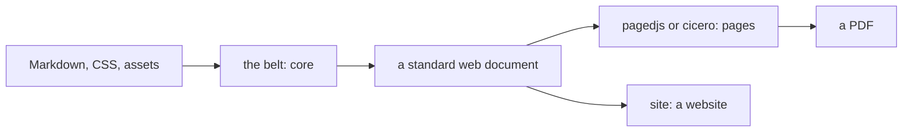

BelType is a local-first CLI that compiles Markdown into paginated, print-ready HTML and PDF, or into a website: one source, either medium. This manual is itself a BelType document, built and served by the tool it describes, so what you read here is running proof that the tool does what the prose says.

It has four parts, and you can enter at any of them.

| If you want to… | Read |
| :--- | :--- |
| make documents | the [guide](#the-beltype-guide), which teaches the tool with a running example, then the [syntax](#syntax) chapter, the authority on what you can write |
| do one thing, now | the [how-to guides](#how-to-guides): one goal per entry, in steps, and what to do when something looks wrong |
| look something up | the [reference](#the-beltype-reference): the command line, the configuration keys, the protocols and the module signatures |
| understand or change the tool | the [architecture](#the-beltype-architecture) first, then [configuration](#configuration-design-principles) and [repos](#repos-packages-and-the-publish-posture) for the design reasoning, then the chapter of whichever package you are about to open |

The package chapters are each package's own `README.md`, included from where it lives beside the code. They explain what the package does and how it does it, with no need to read the source first.

@toc

@include{src="./guide.md"}

@include{src="./syntax.md"}

@include{src="./how-to.md"}

@include{src="./reference.md"}

@include{src="./architecture.md"}

@include{src="./configuration.md"}

@include{src="./repos.md"}

@include{src="../packages/common/README.md"}

@include{src="../packages/core/README.md"}

@include{src="../packages/cli/README.md"}

@include{src="../packages/engine-pagedjs/README.md"}

@include{src="../packages/engine-site/README.md"}

@include{src="../packages/engine-cicero/README.md"}

@include{src="../packages/browser-chromium/README.md"}

@include{src="../packages/editing-tools/README.md"}

@include{src="../packages/caster/README.md"}

@include{src="../packages/essay/README.md"}
