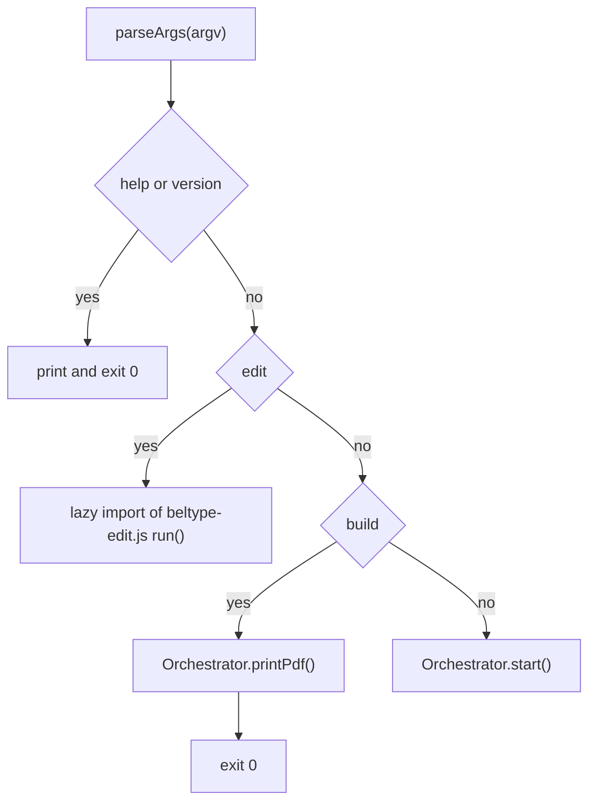
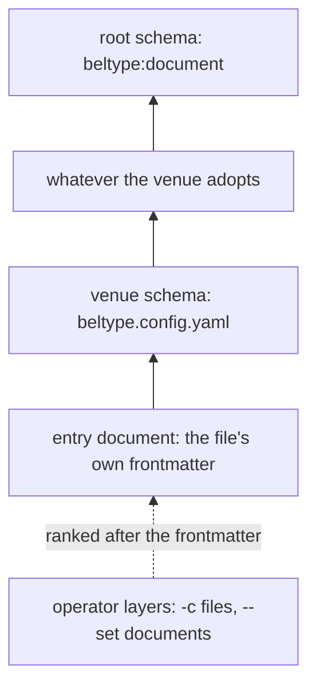
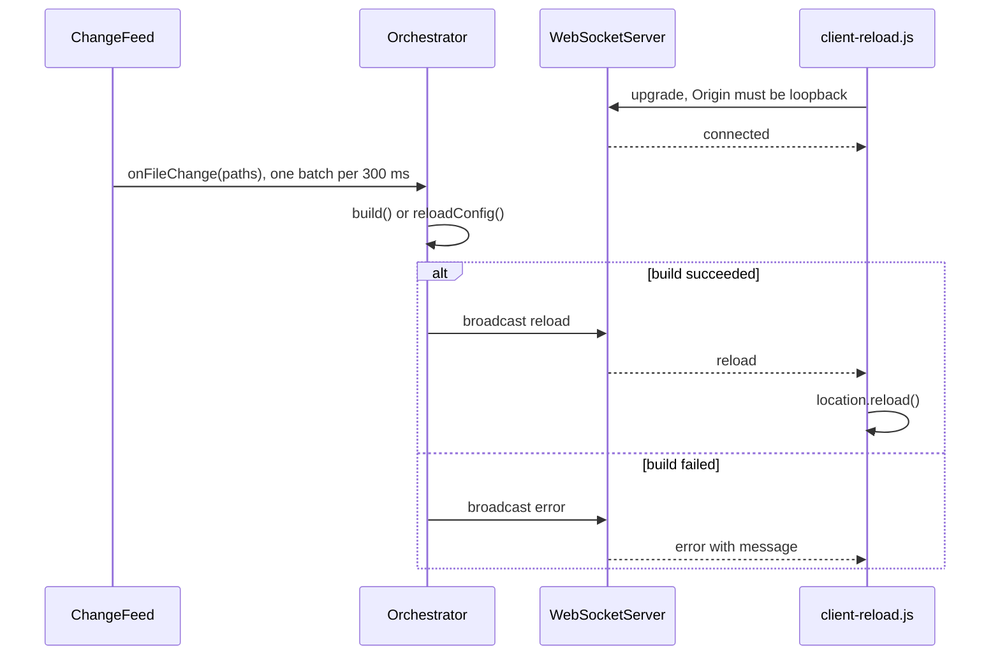
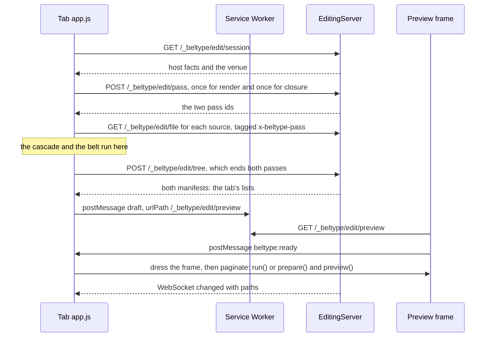

# The BelType reference

This chapter is for looking things up. It owns four questions: what the command line accepts, which configuration keys exist, what travels over each wire, and what each module exports. Authoring syntax belongs to the [syntax chapter](#syntax), the tutorial to the [guide](#the-beltype-guide), and the reasoning behind the shapes below to the [architecture](#the-beltype-architecture) and [configuration](#configuration-design-principles) chapters.

| Fact | Value |
| :--- | :--- |
| Runtime | Node.js ≥ 22, native ES Modules |
| Compiler | unified (remark → rehype), in `packages/core` |
| Engines | `pagedjs` (default), `site`, `cicero` (beta, on screen only) |
| PDF | headless Chromium driven by `playwright-core`, fetched on demand; optionally Caster as the printer |
| Configuration | a Cascata cascade ending at `packages/core/schema/document.yaml` |

---

## Command line

```text
beltype [options] [target]                                  dev server with live reload
beltype build <target> --pdf [--printer <name>]             render one PDF beside the document
beltype edit [<target>] [--root <dir>] [--port <n>] [--host <addr>] [--mounted] [--ui <key=value>]...   the editing tools
```

The command line has three modes and no others. `build` renders a PDF and nothing else: there is no `dist/` export, no `init` and no `vendor` subcommand ([the MVP cut](@decisions/the-mvp-cut.md)). `parseArgs(argv)` in `packages/cli/src/args.js` is the whole parser, and `packages/cli/bin/beltype.js` dispatches on what it returns.



Any error thrown on the way exits `1` with a message naming the phase: `Failed to start BelType:`, `PDF render failed:` or `Failed to start the editing tools:`.

### Command-line options

| Option | Short | Value | Effect | Default |
| :--- | :--- | :--- | :--- | :--- |
| `--port` | `-p` | integer | the dev server's port; `0` lets the OS pick one, and then the page carries no live-reload client, because the shell is written before the port is known | `3000` |
| `--target` | `-t` | file | the entry document; the same as the positional `target` | `index.md` |
| `--no-watch` | | | build once and serve, watch nothing | watching |
| `--open` | `-o` | | open the browser once the server is up | off |
| `--engine` | | name | `pagedjs`, `site` or `cicero` | `pagedjs` |
| `--pdf` | | | render a PDF; implies `build` when the word is omitted | off |
| `--printer` | | name | with `--pdf` only: `chromium` (the browser's own print) or `caster` (BelType's PDF 2.0 / PDF/UA-2 printer) | `chromium` |
| `--config` | `-c` | file | a YAML config document layered after the frontmatter; repeatable | |
| `--set` | | `key.path=value` | one key layered after the frontmatter; repeatable | |
| `--help` | `-h` | | print help, exit `0` | |
| `--version` | `-v` | | print the version, exit `0` | |

`--help` and `--version` are recognized anywhere on the line and returned as intents; the bin does the printing.

### What the parser refuses

The parser refuses a mis-parse instead of guessing, because a bad command line otherwise shows up later as a bad document.

| Input | Refusal |
| :--- | :--- |
| an unknown `-flag` | `Unknown option: <flag>` |
| a value-taking flag followed by another flag or by nothing | `<flag> requires a value` |
| a second positional, or `--target` beside a positional | one target per run, naming both |
| `build` without `--pdf` | `build` only renders a PDF; the message names the MVP cut |
| `--open` or `--port` with `--pdf` | both need the dev server; a PDF run opens no browser and takes an ephemeral port of its own |
| `--printer` without `--pdf` | the dev server prints nothing |
| `--printer` with a name outside `chromium`, `caster` | lists the available printers |
| `--set` without `=`, or with an empty key segment | `--set needs key=value` |

Four refusals come later, from `Orchestrator.boot()`, because they need the composed run:

| Condition | Refusal |
| :--- | :--- |
| `--engine` names nothing in the table | `ConfigError` listing `pagedjs, site, cicero` |
| `--engine cicero` where `engine-cicero` is absent | `ConfigError`: the engine ships unpublished and lives only in a checkout |
| `--printer caster` under `site` or `cicero` | `ConfigError`: only `pagedjs` presents pages to a headless run |
| `--printer caster` where `@egildo/beltype-caster` is absent | `ConfigError`; nothing falls back to Chromium's print |

`--engine site --pdf` and `--engine cicero --pdf` fail inside the engine: both `renderPdf` members throw a `BuildError` naming `--engine pagedjs`.

### What a target's extension selects

The target's extension chooses a lane. Every lane ends in the same resolved document, so serving, watching, `--engine` and `--pdf` behave identically downstream.

| Extension | Lane | What the belt does |
| :--- | :--- | :--- |
| `.md` | Markdown | the full belt: include merge, at-rules, remark, rehype, then `Shell.wrap()` |
| `.html` | HTML | no transforms at all; `Shell.splice()` injects the engine's head fragment, the `styles` links, the reload client and the bootstrap into the author's own document. A bare fragment gets a minimal skeleton carrying `title` and `lang` |
| `.pug` | Pug | one compile step (`renderPug`), then the HTML lane |
| `.mdx` | | refused with a "planned" `BelTypeError` |

Frontmatter works on all three lanes. The Pug lane holds two standing refusals, both in `packages/core/src/pug-lane.js`: the template's locals are the cascade's resolved `params` and nothing else, and Pug's own `include`/`extends` never work because the compiler is never handed a `filename`. Pug is an optional dependency, imported only when a `.pug` target or a `pug` fence appears.

### The operator's layers: `-c` and `--set`

`-c` and `--set` are not run options. Each is a config document that the cascade ranks after the frontmatter, in command-line order, governed by every `demand`, `final` and `append` the venue accumulated ([the command line is a layer](@decisions/the-command-line-is-a-layer.md)).

```bash
beltype build ./book.md --pdf -c ci.yaml --set title="Draft 3" --set 'styles=[./draft.css]'
```

| Flag | What the cascade receives | Anchors refs against | Watched by a dev server |
| :--- | :--- | :--- | :--- |
| `-c ci.yaml` | the file, resolved against the shell's directory | the file's own directory | yes, a `cascade` pass read; an edit live-reloads the cascade |
| `--set a.b=v` | a one-document YAML layer minted by `mintSet` at the virtual location `<cwd>/#set-<n>.yaml` | the shell's directory | no; it is not a file |

A `--set` value is the YAML text as typed; nothing computes. A diagnostic names the flag as `--set #n`. `--set port=…` is refused like any `port:` key, naming `--port`. The `edit` subcommand takes neither flag.

### The `edit` subcommand

```text
beltype edit <target> [options]                  one document
beltype edit [--root <dir>] [options]            no target: a picker over --root
                                                 options: --port, --root, --host, --mounted, --ui (below)
```

`edit` starts a different server, in a different package (`packages/editing-tools`), so the CLI hands everything after `edit` to that package's own parser, the one the package's bin `beltype-edit` uses too. Every dev-server flag but `--port` is refused there by name (`Unknown option for edit: <flag>`), and `beltype edit --help` prints the editing tools' own help.

| Option | Short | Effect | Default |
| :--- | :--- | :--- | :--- |
| `--port` | `-p` | port to listen on; `0` picks a free one | `48736` |
| `--root` | `-r` | the folder the picker browses, and one more directory the server may read within. It never widens the write door | the current directory when no target is given |
| `--host` | | bind address; `0.0.0.0` inside a container. The URL handed to the operator stays `127.0.0.1` | `127.0.0.1` |
| `--mounted` | | the root must be a mount point, for a container | off |
| `--ui` | | a preset for the chrome, repeatable `key=value`: `engine=cicero\|pagedjs`; `follow`, `inspect`, `diff`, `composed` `=on\|off`; `hide=<control,…>` over `documents`, `files`, `follow`, `inspect`, `diff`, `save`, `reset`, `engines`, `composed`, `window`, `print`, `pdf`. A hidden control keeps its preset value. Unknown keys, values and controls are refused by name | the tool's own defaults |

With `--mounted` the root must be a mount point (a directory on a different device than its parent). A container started without a folder fails that test, the picker explains how to connect one, and the session reports `unmounted: true`. The Docker image's entrypoint is `beltype-edit --host 0.0.0.0 --root /docsource --mounted`.

`--ui` is a run option, never configuration: the server holds it for the whole run and every page it serves opens with it, the picker's round trip included, and nothing is persisted. A lighter desk for a colleague is one npm script: `beltype edit report.md --ui engine=pagedjs --ui follow=on --ui hide=files,inspect,diff,reset,composed,window`. It is a convenience, not a lock: Cmd/Ctrl-S still saves.

Where the CLI has `-c` and `--set`, the editor has **the overrides document**: `#overrides.yaml` in the Schema pane, a config layer ranked after the frontmatter that lives in the tab only. Typing a key there recompiles the preview under it, governed by the venue like the frontmatter. Nothing is written to disk.

### Run defaults

```js
// packages/cli/src/orchestrator.js
const RUN_DEFAULTS = { port: 3000, target: 'index.md', watch: true, open: false };
```

Run defaults belong to the CLI, not to any cascade rung. `engine` has no entry: an absent name resolves to `pagedjs`. A `--pdf` run always listens on an ephemeral port, whatever `RUN_DEFAULTS` says, so it prints while the author's own dev server holds port 3000.

---

## Configuration keys

Configuration is a **cascade**: several documents, ranked, merged into one resolved config. BelType delegates the whole question to the Cascata library ([cascata owns the cascade](@decisions/cascata-owns-the-cascade.md)); `packages/core/src/cascade.js` is BelType's side of it, and `resolveConfig` is its one entry point.



| Rung | File | Holds |
| :--- | :--- | :--- |
| entry document | the target's YAML frontmatter, read at the virtual location `<file>#frontmatter.yaml` | plain values; the only rung that does |
| venue | `beltype.config.yaml`, beside the document or else in the invoking directory | a **schema**: `$adopts`, then `keys.<name>.provide` and `keys.<name>.demand` ([a venue is a schema](@decisions/a-venue-is-a-schema.md)) |
| adopted schemas | whatever the venue's `$adopts` names | the same vocabulary |
| root schema | `packages/core/schema/document.yaml`, named `beltype:document` | the declared keys and their defaults |

A **venue** is the folder holding `beltype.config.yaml`. A document with no venue still resolves: the root schema stands in as the launching schema, so an empty folder renders with every default. A document may name its own `$schema:` in frontmatter, and an authored one replaces the venue's whole chain.

Four rules govern every run of the cascade:

- **It runs per render**, in `Pipeline.renderConfig()`. Nothing is persisted, so a key removed from frontmatter stops applying on the next rebuild.
- **The venue probe is BelType's.** Which file is the venue is meaning, and a host supplies only bytes, so `findVenue` answers it: beside the document, else the directory BelType was invoked from.
- **A refusal is an error, never a warning.** A shipped PDF cannot be re-checked.
- **In the dev loop a refused cascade is an ordinary build error.** The server boots on the CLI's bare run options, shows the overlay, and heals on save. `printPdf()` passes `strict` and fails the run instead.

:::warning{title="A legacy beltype.config.js is refused, not ignored"}
A venue that quietly loses its config ships a wrong PDF. `findVenue` recognizes the `.js` spelling only to throw a `ConfigError` carrying the migration: rename to `beltype.config.yaml` and write `$adopts: beltype:document`, then `keys.<name>.provide`.
:::

### The refusal list

Run behaviour is not configuration ([run options are flags](@decisions/run-options-are-flags.md)). The root schema never declares `port`, `target`, `watch`, `open` or `engine`, and `cascade.js` checks the projected value once against its refusal list (`REFUSED`, and `MIGRATIONS` for the one renamed key). Each entry throws a `ConfigError` naming the move.

| Refused key | The move |
| :--- | :--- |
| `spec` | a house schema is an ordinary schema: `$adopts:` in the venue, or `$schema:` in the document's frontmatter |
| `schema` | a contract is `keys.<name>.demand` in the schema that governs the document |
| `requires` | `keys.<name>.demand: { required: true }` in the venue |
| `cover` | a cover page is content, written in the document |
| `mountPaths` | the alias table is `rewrites`, and the alias is the mount |
| `port` | pass `--port` |
| `target` | name the document on the command line |
| `watch` | pass `--no-watch` |
| `open` | pass `--open` |
| `engine` | pass `--engine <name>` |
| `run` | there is no `run:` block; every run option is a flag |
| `rehypePlugins` | is gone: `plugins: { rehype: [...] }` is the one key |

An **undeclared** key is legal and rides through untouched. A near-miss of a declared key (`styels` beside `styles`) logs a warning. `plugins` and `directives.*.render` are deliberately not on the list: they are ordinary document keys, legal at any rung.

:::info{title="Why a list and not a sealed schema"}
Frontmatter is a shared surface, and another tool's `date:` has to ride through. Sealing the root schema to police `port:` would seal it against every third party's key too. The list closes one narrow door against BelType's own reserved names.
:::

Where a run option must reach a render (`port` and `engine` for the reload client's tag, `print` to omit it), it crosses as `Pipeline`'s `amend` argument, which no config file, frontmatter or schema can reach.

### The frontmatter namespace

A document may put BelType's keys under one `beltype:` mapping, the way a JavaScript tool reads its own subtree of `package.json`.

```yaml
---
title: Quarterly report        # universal; other tools read it too
date: 2026-03-01               # another tool's key, ignored by BelType
beltype:
  styles: ./report.css
  toc: { depth: 2 }
---
```

| Frontmatter shape | What BelType reads |
| :--- | :--- |
| no `beltype:` mapping | the whole block |
| a `beltype:` mapping | that mapping only; everything beside it is foreign, unread and unvalidated |
| `beltype:` that is not a mapping | a parse error naming the file |
| a distinctly-BelType key stranded outside the mapping | ignored, with one warning naming every stray; `title`, `author` and `lang` never warn |

The rule lives in the one frontmatter parser (`splitFrontmatter`), so included files inherit it. `beltype.config.yaml` has no namespace: the file is BelType's by definition.

### Paths in a config: the two spaces

Which base a path resolves against depends on what kind of path it is. The design argument is in [the configuration chapter](#configuration-design-principles); the rule is this table.

| Space | Keys | Resolves against | Becomes |
| :--- | :--- | :--- | :--- |
| filesystem | `rewrites` values | the directory of the config that declared the value; `~` expands | an absolute path, never emitted |
| URL | `styles`, `components`, `importMap` leaves, and every ref in the document body | on disk against the declaring file, then expressed against the **URL root** | a root-absolute URL |

The URL root is the venue directory when there is one, else the document's own directory ([the URL root is the venue](@decisions/the-url-root-is-the-venue.md)). A ref that lands outside the URL root and under no `rewrites` alias has no URL, and `urlFor` refuses it with a `ConfigError` naming `rewrites`.

The declaring directory is read per node from the merged tree's provenance (`span.origin.id`). An accumulated `styles` list therefore anchors item by item: the venue's sheet against the venue, the document's against the document.

### The root schema

`packages/core/schema/document.yaml` ships with the compiler. Documents and venues name it `beltype:document`, a URI scheme the **host** answers through Cascata's `locate`, because where an installed package's file sits is a fact about the machine. Its top level is open.

| Key | Type | Cascade | Default |
| :--- | :--- | :--- | :--- |
| `title` | `string`, required | replace | `"Untitled Document"` |
| `lang` | `string` | replace | `"en"` |
| `author` | `string` | replace | |
| `styles` | `resource[]` | **append** | `[]` |
| `customProps` | mapping of `string` | deep merge | |
| `params` | mapping, `delegate: allow` | deep merge | |
| `toc` | mapping: `depth` (`int` 1–6), `title` (`string`); open | deep merge | |
| `markdown` | mapping of `bool \| mapping` | deep merge | |
| `directives` | mapping of `{ tag, className, render }`, each sealed | deep merge | |
| `plugins` | `sequence \| mapping` | replace | |
| `components` | `resource[]` | **append** | |
| `importMap` | mapping: `imports`, `scopes` | deep merge, so per specifier | |
| `site` | mapping: `transform`; sealed | deep merge | |
| `rewrites` | mapping of `path` | deep merge | |
| `beltype` | mapping, sealed and empty | | reserved name |

`resource` is the schema's own type: a string accepting a path or a URL. Cascata's default strategy is `replace`; mappings merge deeply; only a key declaring `cascade: append` accumulates across rungs.

#### `title`, `lang`, `author`

`title` is the one guaranteed key: the `provide` fills it, and an explicit `null` is an error. `lang` sets `<html lang>`.

#### `styles`

The document's stylesheets, linked in cascade order after the UA addendum, which they always beat (author sheets are unlayered; the addendum sits in `@layer beltype`). Page size, margins, fonts and running headers are author CSS (`@page`, `@font-face`), not configuration.

```yaml
styles: [./styles/main.css, "@house/print.css"]
```

#### `customProps`

Values injected as `:root { --name: value }` for the author's CSS to read. With `styles`, this is the whole presentation surface of the configuration.

```yaml
customProps: { brand: "#8a1f2b" }   # :root { --brand: #8a1f2b }
```

#### `params`

The values `:val[key]` reads, at every rung and in every included file. Where the mapping is expected, a string is a single filesystem ref to a YAML file holding it, grafted beside the file that wrote it. The graft is one hop, globs are refused, and the file is read through the host, so a dev server watches it.

```yaml
params: ./values.yaml
```

:::info{title="Delegation fires on a config document's value, never on a schema's provide"}
`params: ./values.yaml` works in frontmatter (Cascata's `delegate: allow`) and inside the include tree (`include.js`'s own `derefParams`, see [the keyscope is not the cascade](@decisions/the-keyscope-is-not-the-cascade.md)). A venue writing it under `provide` gets a type error. Measured.
:::

#### `toc`

Parameters only; the `@toc` at-rule is the one summons, and the [syntax chapter](#syntax) owns it. `depth` defaults to 3 and `title` to "Contents" in the belt. Any other key holding a mapping configures the instance whose `id` matches. Precedence runs inline attributes, then instance, then flat defaults. A `toc:` key with no `@toc` site in the merged document fails the build.

```yaml
toc:
  depth: 2
  title: Contents
  appendix: { depth: 1, title: In this appendix }
```

:::warning{title="toc carries keys and no values, on purpose"}
Cascata composes `keys` and `values` by intersection. `values: { type: mapping }` beside an `int` `depth` made `depth` uninhabitable, a `type-mismatch` against every venue that set a `toc:`, and `metaValidate()` accepted the contradictory schema. `seal` says which keys; `values` says what shape, and `toc` entries share none.
:::

#### `markdown`

Toggles and options for the built-in plugins, by registry name. See [the markdown plugin registry](#markdown-plugin-registry).

```yaml
markdown: { smartypants: true, inlineFootnotes: true, gfm: { tables: true, autolinks: true } }
```

#### `directives`

The custom directive map: a name to `{ tag, className }`, or to a `render`. In a config file `render` is a string naming an ES module whose default export is `(text, attributes) => html`; the loader looks in `<rootDir>/extensions/<name>.js`, then asks the host for a package of that name. A host-authored config object may pass the function itself. `tag` is optional: a directive with a `render` never reads it, and a declarative one naming none gets `div`.

```yaml
directives:
  pullquote: { tag: aside, className: pullquote }
  embed-spec: { render: embed-spec }
```

#### `plugins`

User unified plugins. A bare sequence is the remark list; the staged mapping names both stages. An entry is a name or a `[name, options]` pair. The interior is deliberately unconstrained by the schema; `processor-factory.js` and `plugin-loader.js` own that reading.

```yaml
plugins:
  remark: [remark-breaks]
  rehype: [[rehype-external-links, { target: _blank }]]
```

#### `components`

ES modules defining the custom elements that `site.transform` bindings name, emitted as `<script type="module" src>` tags under every engine. URL-space like `styles`, and accumulating for the same reason. A module is a plain `customElements.define(...)`; there is no BelType component API. The closure follows a module's own imports transitively and warns about anything it cannot find.

```yaml
components: [./components/platform-tabs.js]
```

#### `importMap`

The import-map standard's own JSON, published rather than interpreted: one `<script type="importmap">`, emitted before the component scripts, with `</` escaped. Leaf values of `imports` and `scopes.*` are URL-space refs anchored like `styles`; scope prefixes and unknown members pass as written. Rungs merge **per specifier**, the later rung winning, because two mappings for one specifier cannot both apply.

```yaml
importMap:
  imports: { lit: ./vendor/lit.js }
```

#### `site`

The site engine's namespace. `site.transform` binds a selector to a custom element: a string, or `{ element, attrs }` with exactly those two keys. `attrs` is a flat map of scalar attributes set on every wrapper (`id` is refused, since every match would share it). The shell publishes the resolved value in the body as `<script type="application/json" data-beltype="transform">`, wrapped under the engine's name (`{ "site": { … } }`) so each engine reads its own namespace. It warns at build time about a binding value with no hyphen, which can never name a custom element. A matched heading owns its whole `<section>`; anything else owns itself. `beltype-tabs` is preinstalled.

`site.chunk` cuts the site into pages at a section depth: `1` gives a page to every top-level section, `2` to their subsections too, and absent or `0` keeps one page. The depth counts the belt's nested sections, never the heading rank. A page is served as `<heading id>.html`, and whatever lies outside every page section is `index.html`, which `/` answers. Links across pages are rewritten, the contents ride on every page with the page's own entry `aria-current="page"`, and footnotes go with the page that calls them. Every page carries the other pages' blocks as a hidden skeleton, so counters and reads see the whole document ([the engine-site package](#the-chunked-site-one-document-served-as-pages)). Read by the site engine only; the paged engines have pages already.

```yaml
site:
  chunk: 1
  transform:
    '.platforms': beltype-tabs
    '.gallery': { element: photo-strip, attrs: { columns: 3 } }
```

#### `rewrites`

The alias table: an author-written alias to a directory that may sit outside the venue. **The alias is the mount** ([the alias is the mount](@decisions/the-alias-is-the-mount.md)): `@house/theme.css` means `../shared/theme.css` on disk and `/@house/theme.css` in the document, and both servers serve it there. It works in config values and in the document body alike. Nothing is generated; an out-of-tree ref with no alias is refused.

```yaml
rewrites:
  "@house": ../shared
  /seeds: ~/work/seeds        # a leading slash serves at /seeds/
```

### Members the cascade derives

`resolveConfig` adds four members that no schema declares and no document may write.

| Member | Value |
| :--- | :--- |
| `target` | the entry document, absolute |
| `rootDir` | `dirname(target)` |
| `urlRoot` | the venue directory when there is one, else `rootDir`; the directory `/` names |
| `venue` | `{ dir, schema }`, the probe's whole answer |

The venue is not `rootDir`: a venue may sit above its document. Every `int` in the projected value is narrowed from a bigint to a Number at this seam, so `JSON.stringify` works and the CLI and the editing tab hold the same value.

### A venue, written out

```yaml
$adopts: beltype:document

keys:
  styles:
    provide: [./assets/house.css]
  owner:
    demand: { type: string, required: true }
  site:
    provide:
      transform:
        '.platforms': beltype-tabs
```

That is a venue's whole grammar. `$adopts` names the schema it stands on. Each entry under `keys` either `provide`s a default a document may override, or `demand`s something of every document beneath it. A demand governs the **document**, at its own entry, resolved once over the whole pedigree; a per-chapter contract is a question for the include tree, not the cascade.

:::warning{title="cascade: append is inherited, and only an invented list needs it said"}
The root schema declares `cascade: append` on `styles` and `components`, so the venue above accumulates its sheet with a document's own without restating it. A descendant writing `cascade: replace` on either is refused. A list key a house schema invents defaults to `replace`: say `cascade: append` on it when its items should accumulate.
:::

### Frontmatter example

```yaml
---
title: "My Document"
lang: "en"
styles: ./styles/main.css             # page size, margins, @font-face, running heads live here
customProps: { brand: "#8a1f2b" }     # :root { --brand: #8a1f2b }
params: { owner: "Acme SpA" }         # what :val[owner] reads, here and in every include
toc: { depth: 2, title: "Contents" }  # parameters for the document's @toc sites
markdown: { smartypants: true }
---
```

Page geometry and running headers are CSS in `main.css`:

```css
@page {
  size: A4; margin: 22mm;
  @top-center { content: string(doctitle); }
  @bottom-right { content: "Page " counter(page) " of " counter(pages); }
}
h1 { string-set: doctitle content(text); }
```

---

## Authoring syntax

The complete authoring surface (every construct, the HTML it produces, the directives, the `@include` and `@toc` at-rules, `:val` and the keyscope, figures and cross-references, the CSS vocabulary the belt emits) is the **[syntax chapter](#syntax)**. This chapter keeps the operator and contributor surface and does not repeat it.

---

## The `data-beltype` attribute

BelType marks an element in one place: the attribute `data-beltype`, a space-separated list of **words**. A word is a flag (`split`) or a value written `key:value` (`slice:2`, `has:3gv2ab`, `pos:135`), and never contains a space; an element with nothing to say carries no attribute. It is matched with `[data-beltype~="word"]`. The belt writes the words of a source. Cicero writes its own on the **copies** it makes of a source for a page, and never on the source itself. Every writer adds a word to what the attribute already holds and never replaces it, because a copy keeps whatever its source carried (the belt's line stamp, an author's own words). **The attribute is reserved:** a `data-beltype` written in a `{…}` attribute list or a directive's attributes is refused with an error naming the reservation. Raw HTML, the HTML and Pug lanes and an author's own rehype plugin cannot be policed, so the engine treats a source's attribute as read-only. Every word is declared once, in `packages/engine-cicero/src/data-beltype.js`, which is the engine's registry and its grammar (`words`, `wordOf`, `hasWord`, `addWord`, `removeWord`, `setValue`, `posOf`) because the engine's `src/` imports nothing. The grammar over a string value, the belt's two words (`pos`, `transform`) and the reservation test also live once in `packages/common/src/data-beltype.js`, which core, the editing tools' tab and Caster's Cicero adapter import. The root `test/data-beltype.test.js` imports both and pins them equal (the attribute, the belt's words and their kinds, the parse of a table of values). The editing tools' stylesheet readers keep their selectors as literals, pinned by the same test. No key may end with another key (`pos:` and `xpos:` cannot both exist), so that "every element carrying a key" (`[data-beltype*="pos:"]`) can be selected by substring.

| Word | Kind | Writer | On | Meaning | Facing |
| :--- | :--- | :--- | :--- | :--- | :--- |
| `transform` | flag | the belt (`shell.js`) | the JSON `<script>` binding block | the site engine's `transform` bindings; read by `site-transform.js` | host |
| `cicero-provision` | flag | Cicero's seam | the head's inline `<style>` | the engine's line-height provision; the stylesheet rewrite leaves it alone, and the editing tools' inspector names it as the engine's stratum | host |
| `cicero-interface` | flag | Cicero's seam | the head's linked interface sheet | the engine's screen chrome; handled as `cicero-provision` is | host |
| `pos:<line>` | value | the belt, when a host asks for stamps | a block | the merged-document start line a block came from; a copy inherits it by cloning. The editing tools open a file at that line by it; Cicero and Caster pair a copy with its original by it | host |
| `fragment` | flag | Cicero (and Caster, on a span it lifts out of a margin cell) | the root of every copy the engine appends to `<beltype-root>`: a fragment, a fixed box's per-page copy, a running element's | this element is a copy, not an original | engine |
| `split` | flag | Cicero | every piece of a box a cut divides, at every depth | this box is divided across pages | author hook |
| `start` | flag | Cicero | a piece of a divided box | the piece is dressed as the box's beginning: it keeps the box's `::before`, marker, first letter, top edge and indent — which includes the box a painted shell slices, divided yet dressed as a start | author hook |
| `end` | flag | Cicero | a piece of a divided box | the piece holds the box's end: it keeps `::after` and the bottom edge | author hook |
| `slice:<N>` | value | Cicero | the root of each piece of a divided top-level block | the Nth page the block has been on, 1-based; also the custom property `--beltype-slice: N` on the same element, delivered when a stylesheet of the document names `--beltype-slice` (a registered `<integer>` that does not inherit: a descendant reads `0`, so style below the root through `[data-beltype~="slice:2"] p`) | author hook |
| `fixed` | flag | Cicero | a `position: fixed` box's per-page copy | the box is repeated on every page and re-homed against the page area | engine |
| `shell` | flag | Cicero | the `<div>` Cicero creates around a box the page edge slices | the painted shell's wrapper | engine |
| `break` | flag | Cicero | a `<br>` the Compositor inserts | a line the Compositor chose; an author's `<br>` has no word | engine |
| `fill` | flag | Cicero | a `<span>` the Compositor inserts | a filler that justifies a line | engine |
| `wrapped` | flag | Cicero | a divided box | the box wraps each fragment whole (`box-decoration-break: clone`), so border and padding stay at a cut; decided by the engine because a selector cannot test the property | engine |
| `adjoin` | flag | Cicero | the box a cut between boxes resumes at, and its first-child chain | its block-start margin adjoins the cut and is truncated; the box is not divided | engine |
| `away` | flag | Cicero | a box outside a page's interval | put away on this page: `display: none`, kept as an element so structural selectors read as in the source | engine |
| `artifact` | flag | Cicero | every copy the engine repeats that a reader does not read: a running element's copy in a margin box, a fixed box's copy after the first page, a divided table's repeated header or footer group | PDF's own word for pagination furniture, and nothing else; every artifact is also `aria-hidden` | host |
| `has:<hash>` | value | Cicero | every element of a page copy whose original satisfies a `:has()` of the document | the original satisfies `:has(<argument>)`; the hash is six base-36 characters of the argument's canonical text, widened on a collision. See below | engine |

**The piece words are Cicero's, and only Cicero's.** `split`, `start`, `end` and `slice:N` are the one part of this table meant for an author's stylesheet. `[data-beltype~="split"]:not([data-beltype~="start"]) { … }` styles a continuation, `section[data-beltype~="slice:2"]` the second page of a section, and `var(--beltype-slice)` on the same element reads the number. They exist under `--engine cicero` and nowhere else: **not portable to Paged.js or to the browser's own print**, which put no such attribute on anything. Treat them as a diagnostic or as a Cicero-only enhancement, as you would a vendor prefix. `slice:N` is written on the root of each piece of a divided top-level block and not on the boxes nested inside it. Nothing the words say may change a box's size. The number reaches the presentation and not the measure, so a rule that read `--beltype-slice` to lay a box out would be measured under a different number than it is shown under.

**What the engine does with the other words is a sheet, not a style attribute.** A continuation's margin, indent, border and padding, and a cut-off piece's, are truncated by `!important` rules keyed on `split`, `start`, `end`, `wrapped` and `adjoin`. A box put away is hidden by one keyed on `away`. The rules live in a cascade layer the engine's own `<style>` (its provision, first in the head) names first. They therefore beat the author's own declarations (a plain rule, an `!important` rule layered or not, an inline style), as css-break-3 §5.2 and §5.4 require (`packages/engine-cicero/src/dressing.js`). An author's inline `style` with `!important`, and an author's own layer named before the engine's, are the two things they do not beat.

Not words, each with its reason: `data-ref-text`, `data-ref` and `data-key` (read by CSS `attr()`, which returns the whole attribute), `aria-hidden`, measured inline sizes, Caster's `data-pdf-*` contract, and the marks of other tools.

**The `has:` words, and what they mean for a stylesheet.** A box outside a page's interval is presented as an empty element, and a `:has()` can find nothing in one. Cicero's stylesheet rewrite therefore turns every `:has(A)` your CSS writes, at any depth and in any grouping rule, into `:is(:where([data-beltype~="has:H"]):is(*, A′), :where(:not([data-beltype~="fragment"])):has(A))`, in place and on the line you wrote it. Here `A′` is `A` without each item's leading combinator. The rewrite ends the sheet with a rule that matches nothing (`:not(*) { --beltype-has-H: "A" }`) carrying the arguments. The specificity is exactly `:has(A)`'s. You write nothing and need nothing; the inspector shows your selector, not the union. An argument that reads state that changes while the document is on screen (`:hover`, `:checked`, `:focus-within`, `:target`, `:focus-visible`, `:visited`, form validity, a media element's state, or `:scope` and `&`) is left as written, with a console line naming the rule. Every box outside a page's interval is then kept whole for that document, as before: the pages are the same and cost more to build. A rule that looks sideways or forward from a box (`section:has(~ section p.warn)`) is answered for a copy by the document's tree and for an original presented whole by the originals alone. The native arm's argument carries the same weightless guard after each sibling it reaches, so the copies the engine seats beside the originals in `<beltype-root>` are never among them. This is Cicero-only: Paged.js, the site engine and the browser's own print have no copies and need no words.

---

## Markdown plugin registry

Built-in plugins are gated by the `markdown` key, one entry per registry name (`packages/core/src/default-plugins.js`).

| `markdown.<name>` value | Meaning |
| :--- | :--- |
| `false` | disabled |
| `true` | enabled with the default options |
| a mapping | enabled, the mapping merged over the default options |

**Remark stage** (`REMARK_REGISTRY`), in order:

| Name | Default | What it does |
| :--- | :--- | :--- |
| `gfm` | on, `{ singleTilde: false, autolinks: false, tables: false }` | GitHub-flavoured Markdown: footnotes, strikethrough, task lists. `autolinks: true` turns bare `https://…`, `www.…` and email addresses into links; `tables: true` enables pipe tables. Both are off by default because each costs parse time on every edit (measured on a 126 000-character document: about 25 ms and 7–8 ms of a 73 ms parse); `<https://…>` and `[text](url)` need neither. `gfm: false` switches all of GFM off |
| `frontmatter` | on | recognizes the YAML block |
| `math` | on | `$…$` and `$$…$$` |
| `directive` | on | the `:name`, `::name`, `:::name` syntax |
| `deflist` | on | definition lists |
| `emoji` | on | `:shortcode:` |
| `mark` | on | `==text==` to `<mark>` (`remark-flexible-markers`) |
| `supersub` | on | `H~2~O`, `x^2^` |
| `abbr` | on | `*[TERM]: definition` wraps whole-word matches in `<abbr>`; BelType's own (`plugins/abbr.js`) |
| `attrs` | on | `{#id .class key=val}` and `[[text]]{…}` spans; BelType's own (`plugins/attrs.js`); runs before `slug`, so an author id wins |
| `inlineToc` | off, `{ heading: 'contents|table of contents|toc', tight: true }` | an inline list under a `## Contents` heading (`remark-toc`); unrelated to the `toc:` key |
| `smartypants` | off | typographic quotes and dashes |

**Rehype stage** (`REHYPE_REGISTRY`):

| Name | Default | What it does |
| :--- | :--- | :--- |
| `slug` | on | heading ids |
| `highlight` | on | syntax highlighting |
| `katex` | on | renders mathematics |
| `inlineFootnotes` | off | moves each GFM footnote definition into a `<span class="footnote">` at its call, where the author's own `float: footnote` rule needs it. A note referenced more than once stays in the trailing section, with a warning |

One gate lives outside the registry: the `pug` fence is on by default and switched off with `markdown: { pug: false }`. It is wired directly because it needs `config.params`, which registry options cannot carry.

:::info{title="Two details that look like bugs and are not"}
`gfm` pins `singleTilde: false` because single-tilde strikethrough eats the subscript syntax; `remark-gfm` is all-or-nothing, so `plugins/gfm.js` registers the same micromark and mdast extensions itself and leaves out the two switched off. `resolveRegistry` omits an empty options object because `remark-frontmatter` misbehaves when handed `{}`.
:::

---

## Live-reload protocol

The dev server (`packages/cli/src/http.js`, `socket.js`) upgrades a WebSocket on its own port. Messages are JSON, `{ type, ...data }`, server to client only.

| Type | Data | Meaning |
| :--- | :--- | :--- |
| `connected` | | sent once per connection |
| `reload` | optionally `{ engine }` | a rebuild succeeded; the client calls `location.reload()` |
| `error` | `{ message }` | a rebuild or a config reload failed; the client shows the message |



Every change is a full reload; there is no CSS-only path. The initial build broadcasts nothing. The client ignores a `reload` carrying an `{ engine }` other than its own document's `data-engine`; no server sends one (the CLI broadcasts a bare `reload`, and the editing tools use no reload client), so every client reloads.

The client (`packages/core/assets/client-reload.js`) reads its port from the script tag's `data-port`, reconnects with a growing delay (1 s, factor 1.1, capped at 5 s, at most 30 attempts) and exposes `window.BelTypeReload` with `reconnect()`, `disconnect()` and `isConnected()`. The shell omits the client entirely under `print`, and for a host that amends no `port`.

:::warning{title="What the dev server will not do"}
It binds `127.0.0.1` and sends no `Access-Control-Allow-Origin`. It gates the WebSocket upgrade to loopback origins (the same-origin policy does not cover WebSockets, and build errors carry file paths), and has **no write verb under any configuration**. The absence is pinned in `test/server.test.js`.
:::

### The editing tools' protocol (`packages/editing-tools`)

`beltype edit` starts a different server. The belt runs in the browser tab. The server holds the filesystem and four facts: the venue it probed, the token it minted, the last **tree** the tab published, and the two **read passes** each render reads through, `render` and `closure`. They are what it watches, what opens its write door, and what the tab's lists come back from. It runs no cascade and never sees the compiled document ([the generation stays in the tab](@decisions/the-generation-stays-in-the-tab.md)).



**Routes.** `Host` is checked on every request (loopback binding does not stop DNS rebinding, and this server writes). A `Host` naming anything but `localhost`, `127.0.0.1` or `[::1]` gets `403` (a request with no `Host` at all, which no browser sends, passes). "Token" means the per-session `x-beltype-edit-token` header, baked into the application page. "Pass" means the `x-beltype-pass` header, carrying the id `POST pass` answered; a read carrying the live one is served through that pass and recorded, and a read with none, or a stale one, is served from disk and recorded nowhere.

| Route | Method | Guard | Contract | Status |
| :--- | :--- | :--- | :--- | :--- |
| `/` | GET | | the application page, with the import map, the token, the engine list and the `--ui` preset spliced in; the picker while no document is open | 200 |
| `/sw.js` | GET | | the Service Worker, `no-cache`, served from the origin root so its scope is `/` | 200 |
| `/_beltype/edit/session` | GET | | host facts, below | 200 |
| `/_beltype/edit/picker` | GET | | the picker page; 404 on a server opened on one document | 200 · 404 |
| `/_beltype/edit/open` | POST | token | `{ path }` rebinds the server to a `.md`, `.html` or `.pug` file inside `--root`; answers `{ target }`, and the tab reloads itself | 200 · 400 · 401 · 405 |
| `/_beltype/edit/pass` | POST | token | `{ label }`, `render` or `closure`: opens a read pass under that label and answers `{ id }`; opening another under the label discards the one open | 200 · 400 no document or no such label · 401 · 405 |
| `/_beltype/edit/file?path=` | GET | containment | `{ content }`. Carrying a live pass, the bytes are the ones the pass recorded, and a 404 inside containment is a recorded miss | 200 · 404 |
| `/_beltype/edit/file?path=` | PUT | token, two locks | body is the content (32 MB cap), written atomically; `x-beltype-base-sha256` (the SHA-256 of the base text, 64 lowercase hex) must hash the text on disk at PUT time; absent, the check is skipped (a forced save) | 200 `{}` · 400 malformed base · 401 · 404 · 409 `{ error }` · 500 body over the cap |
| `/_beltype/edit/dir?path=` | GET | containment | `{ entries }`, each `{ name, dir }`, for the picker | 200 · 404 |
| `/_beltype/edit/module?specifier=&from=` | GET | | resolution only: `{ resolved, location, url, mtimeMs }`. `url: null` means the module exists outside everything the venue serves. Carrying a live pass, a served module is noted on it | 200 · 400 · 404 |
| `/_beltype/edit/tree` | POST | token | the publication, below; ends the passes it names and answers `{ ended }`, with both manifests when it ended them | 200 · 400 · 401 · 405 |
| `/_beltype/edit/error` | POST | token | `{ passes, message }`: a compile that failed in the tab. Ends the passes it names like a tree, then logs and broadcasts `message` as `error`; answers `{ ended }` | 200 · 400 · 401 · 405 |
| `/_beltype/edit/reset` | POST | token | restores every file this session wrote to its first pre-image; answers `{ restored }` | 200 · 401 · 405 |
| `/_beltype/edit/print` | POST | token | `build --pdf` on the open document, in-process; answers `{ pdfPath }` or `{ error }`. One render at a time | 200 · 400 · 401 · 405 · 500 |
| `/_beltype/mod/*` | GET | containment | the module space: a file under the workspace root's `packages/` or `node_modules/`, the two directories the import map addresses, each its own containment root; any other path, and a `..` leaving either, is 404. Node's extensionless and `index.js` resolution applied; `node_modules/` is cached for an hour, `packages/` revalidates | 200 · 404 |
| `/_beltype/app/*` | GET | containment | the application's own assets | 200 · 404 |
| `/_beltype/*` | GET | | the composed asset table, as on the dev server | 200 · 404 |
| anything else | GET | containment | one lookup through the Linker's `sourceFor` | 200 · 403 · 404 |

One path is **not a server route**. The tab publishes the compiled document to the Service Worker's cache at `/_beltype/edit/preview`, one URL whichever engine composed it and whichever seat shows it. The worker answers the GET, from the pane, the window and the print frame alike. A request for it that reaches the server is a miss.

:::warning{title="Never srcdoc"}
In a `srcdoc` document, `<a href="#x">` parses against the container's base and navigates, so every contents entry would load the application inside its own preview. The preview must be a real URL at the origin, which is why the Service Worker is a precondition and not a convenience.
:::

**The session** is host facts only, the whole of what a server can state that a tab cannot discover:

```json
{
  "target": "/abs/book/index.md",
  "rootDir": "/abs/book",
  "root": null,
  "venue": { "dir": "/abs", "schema": "/abs/beltype.config.yaml" },
  "cwd": "/abs",
  "homedir": "/Users/me",
  "schemaLocations": { "beltype:document": "/abs/node_modules/…/schema/document.yaml" },
  "engines": ["cicero", "pagedjs"],
  "print": true,
  "unmounted": false
}
```

`venue` is the probe's whole answer, so the tab's cascade starts from the venue's own file. `homedir` lets the tab expand `~` as this machine does. `schemaLocations` lets the tab's host answer `locate` identically; it carries a location, never bytes. `target` is `null` and `rootDir` equals `root` before a document is chosen.

**The read passes** are how a render tells the server where it begins and ends ([the render reads through the session](@decisions/the-render-reads-through-the-session.md)). `rebuild()` opens two before it compiles, one per label: `render` for what the document is made of, and `closure` for the stylesheets and scripts the closure opens to follow their imports. The tab reads through two HTTP hosts over one draft store: the pipeline's, and the closure's, handed to `Pipeline` as `closureHost`. Each tags every read it makes with its own pass's id, whether the read goes to the `file` route (which also answers the host's `canonicalize`) or to the `module` route. The server serves a tagged read through the named pass's Provenance host, which records the SHA-256 of the bytes it handed out, or the miss when there was nothing there, and notes a module it resolved. A read a draft answers never reaches the server, so the tab lists those locations as that pass's `drafts` when the passes end. The server reads each one that is inside a readable root through the pass itself: a file that exists is a recorded read, one that does not a recorded miss. The tree ends both passes; so does `error`, since a failed render's misses are exactly what must be watched. One pass is live per label, and a tree or failure naming any other answers `{ "ended": false }` and ends nothing, not even a live one it also named.

When a pass ends, what it read, noted and found nothing at become its label's watched files, replacing the last render's under that label; the watch set is the union of both labels'. The document itself is watched from the start, before any pass has ended. Nothing else is listed by hand, so a font or an image the page reaches for, which no pass reads, is not watched; the chapter behind a broken `@include` is a watched miss, so creating it is a `changed`.

**The tree** is what a file server still needs to know about the tab's latest render. It is not the document.

```json
{
  "passes": {
    "render": { "id": "5f0c…", "drafts": ["/abs/book/chapters/two.md"] },
    "closure": { "id": "9a41…", "drafts": [] }
  },
  "rewrites": { "@house": "/abs/shared" },
  "problems": [{ "level": "missing", "message": "…" }],
  "ms": 412
}
```

When the tree names both live passes, the server ends them with their `drafts` read, keeps the tree to resolve URLs through `rewrites`, prints `problems` in the terminal, and logs `ms`. A tree naming any other pass, or none, is answered `{ "ended": false }` and neither kept nor printed. A member the tree does not name is ignored. The URL root never comes off this wire: the server pins it to the venue it probed itself.

The answer to a tree that ended its passes carries what they recorded, and it is where the tab gets its two lists:

```json
{
  "ended": true,
  "render": { "read": ["/abs/book/index.md", "…"], "missing": [] },
  "closure": { "read": ["/abs/book/look.css"], "missing": [] }
}
```

Every location is spelled as the tab asked for it. Provenance keys a file by its realpath, and the server maps each back. The `render` reads are the tab's Sources, which the Schema pane lists. What recompiles is the `render` reads and misses plus the `closure` misses. The Resources pane reads the closure outlet, `closure.entries`.

:::warning{title="configuration never travels"}
`JSON.stringify` does not throw on Cascata's merged node tree. Its mappings are `Map`s, so the tree arrives syntactically whole and semantically empty, which is worse than a refusal. Measured and pinned in `test/closure.test.js`. Provenance queries (`why()`) run in the process that holds the tree.
:::

**The write door has two locks**, both checked by `editableFile`:

| Lock | Passes when |
| :--- | :--- |
| membership | the latest ended render's `render` or `closure` pass read the path: served it through a pass, or resolved it as the render's module. A stylesheet or script the closure scanned is a `closure` read, so it counts; a binary is never read, so it does not. A drafted file counts too, because the server reads its disk bytes through the pass when the pass ends; a failed render adds its reads to the members instead of replacing them. Compared as Provenance keys a location, by realpath |
| containment | the path is inside `rootDir` or inside the venue directory |

The entry document is writable before any pass has ended, so an author can edit their way out of a first compile that fails. BelType's own root schema is read by every render and sits outside both roots: readable, never writable. A location a render found nothing at is watched and never writable. Reads use containment alone (the venue, `rootDir`, `--root`, every `rewrites` target, plus the exact `schemaLocations`), because the tab must read the venue's schema and every include before any pass has ended.

**The WebSocket** carries two message types after `connected`:

| Type | Data | The tab's response |
| :--- | :--- | :--- |
| `changed` | `{ paths }`, every watched path whose bytes changed inside the change feed's 300 ms window, spelled as the tab asked for it | classifies each path: a path the `render` pass read or missed, or the `closure` pass missed, recompiles, even when it is also a text resource; a text resource otherwise republishes and reloads the frame; a path in neither list recompiles too, which matters after a failed render, whose misses the server watches while the tab keeps the last good lists |
| `error` | `{ message }` | a banner |

There is no `reload` and no `config-changed`. The tab publishes the document and drives the frame itself, and a venue's schema is an ordinary `render` read.

**Tab to Service Worker** (`assets/sw.js`, cache `beltype-working`), each acknowledged on the sender's own `MessageChannel` port:

| Message | Effect |
| :--- | :--- |
| `{ type: 'draft', urlPath, text, contentType }` | hold `text` in the cache and answer GETs for `urlPath` from it. Unsaved buffers and the compiled preview document both travel this way |
| `{ type: 'draft-clear', urlPath }` | forget it |

Drafts also persist in `localStorage` under `beltype-edit:<rootDir>:<path>`. The filesystem stays the only durable truth; a save is an ordinary PUT.

**Frame to tab.** The tab composes each engine's `seam/index.js` with `bootstrapJs` replaced by one statement, which the shell splices after its own client stages:

```js
(window.opener || window.parent).postMessage({ type: 'beltype:ready' }, location.origin);
```

`ready` therefore means the document has stopped changing, which the frame's `load` event never meant. On `ready` one handler, whichever seat posted it, branches on the engine. Under Cicero the Dresser adopts the closure's sheets into the frame. The tab calls `frame.contentWindow.__beltypeCicero.run({ composed, until })` for the first view, reading `{ pages, ms, complete }` off the promise, and then cuts the rest as the reader scrolls and in idle slices. Under Paged.js the tab runs `paginatePaged`, which hands the Dresser's sheet texts to `PagedPolyfill.preview()` under one 45 s guard and re-binds each sheet to the `<style>` the Polisher inserted for it ([the seat is not the engine](@decisions/the-seat-is-not-the-engine.md)). Caster's `prepare()` runs only in the print frame, never in the preview.

Two belt-side arguments are particular to this host. It builds with `{ stamp: true }`, so block elements carry the `pos:<line>` word of `data-beltype` and a click resolves through `spine.lines` to a source line. It amends no `port`, so the shell omits the reload client. It also forces `markdown.highlight` off, and the page says so: `highlight.js` ships CommonJS behind an ESM wrapper that a browser module graph cannot load.

---

## Vendored assets

Both servers serve `/_beltype/*` from one **asset table**, `{ files, dirs }`, mapping a URL path under `/_beltype/` to a location on disk. The composer builds it as the union of the compiler's half and the engine's half. No CDN is contacted at render time.

```js
const assets = unionAssets(clientAssets(), engine.vendorAssets());   // + casterAssets() for --printer caster
```

| Path under `/_beltype/` | Kind | Owner | What it is |
| :--- | :--- | :--- | :--- |
| `beltype-ua.css` | file | `clientAssets()` | the UA addendum: the default look, `@layer beltype` |
| `client-reload.js` | file | `clientAssets()` | the live-reload client |
| `vendor/katex.min.css` | file | `clientAssets()` | linked by the shell only when the content uses mathematics |
| `vendor/fonts/` | dir | `clientAssets()` | KaTeX's fonts, beside the sheet that references them |
| `vendor/mermaid.min.js` | file | `clientAssets()` | loaded by the shell only when the content has a diagram |
| `vendor/beltype-fonts/` | dir | `clientAssets()` | the four print default faces ([print default faces](@decisions/print-default-faces.md)) |
| `vendor/paged.polyfill.js` | file | `engine-pagedjs` | Paged.js |
| `vendor/pagedjs-interface.css` | file | `engine-pagedjs` | page boxes and crop marks on screen |
| `site-interface.css`, `site-transform.js` | files | `engine-site` | reading layout and the transformer runtime |
| `cicero-interface.css` | file | `engine-cicero` | Cicero's screen surround |
| `cicero/seam/`, `cicero/src/` | dirs | `engine-cicero` | the client and the engine, published at their own depths |
| `cicero/seam/csstree.js` | file | `engine-cicero` | answers with css-tree's browser ESM bundle |
| `caster/src/`, `caster/vendor/`, `caster/profiles/`, `common/src/` | dirs | `casterAssets()` | the printer, only for a `--printer caster` run |

A `files` entry is matched exactly and first; a `dirs` entry by contained prefix. Entries under `vendor/` are cached for an hour; everything else is `no-cache`.

The print default faces are Source Serif 4, Source Sans 3, Source Code Pro and the monochrome Noto Emoji, all SIL OFL 1.1, variable, WOFF2. The addendum declares them with URLs relative to its own. They exist because Caster embeds font programs, and a stack ending in a system family is a document nobody can print. `packages/core/assets/fonts/PROVENANCE.md` carries every source and checksum.

The browser driver, `playwright-core`, is an optional dependency of `browser-chromium`, pinned exactly and imported only when something launches a browser. Its Chromium is fetched on demand, never at install. A `--pdf` run with no browser refuses, naming the command:

```bash
npx playwright-core install --no-shell chromium
```

---

## Module & class API

Signatures by package. How each package works is the business of its own chapter, linked from each heading below; the package topology is in [repos](#repos-packages-and-the-publish-posture). All modules are ES Modules, and cross-package imports use package names with deep paths (`@egildo/beltype-common/src/paths.js`). The root `bin/beltype.js` is a shim into `packages/cli/bin/beltype.js`.

### `packages/cli` — the application

See [the cli package](#the-cli-package).

```js
// src/args.js
parseArgs(argv)   // → { help } | { version } | { edit, argv }   (argv: everything after `edit`, unparsed)
                  //   | { target?, port?, watch?, open?, engine?, build?, pdf?, printer?, overrides? }
printHelp(); printVersion();

// src/orchestrator.js
new Orchestrator(cliArgs)
  .start()                        // change feed opened on the target (unless --no-watch) → boot → WebSocket → browser → shutdown handlers
  .printPdf()                     // → { pdfPath }
  .boot({ strict, print })        // cascade → engine → Pipeline → first build → HttpServer; → { servingConfig, assets }
  .build({ strict })              // `render` and `closure` read passes around pipeline.build → state.publish → warn closure problems → broadcast → end both passes → feed.watch(closureSources())
  .closureSources()               // every binary closure entry's source and every beside source — what the page reaches for and no pass opens
  .onFileChange(paths)            // namesCascade(paths) → reloadConfig(), else build(); once per batch
  .namesCascade(paths)            // → boolean: a location the latest `cascade` pass read or missed, the target excepted
  .reloadConfig()                 // re-probe, re-run the cascade, recompose engine + server, rebuild
  .loadCascade(run)               // a `cascade` read pass around findVenue + resolveConfig, run options laid on top
  .manifests                      // { render, closure, cascade }: each label's latest ended pass as { read, missing }, Provenance's keys
  .runAmendment()                 // → { port, engine, print }
  .stop()                         // no process.exit; what makes it callable from a test
defaultPdfPath(rootDir, targetFile)   // → <rootDir>/<basename>.pdf
```

`overrides` from `parseArgs` is a list of `{ kind: 'file' | 'set', text }` in command-line order. The orchestrator is the one place the engine and the host are composed. Its `ENGINES` table maps a name to an engine or to an `async` loader; `cicero` is a loader because its package is unpublished. `printPdf()` calls `engine.renderPdf(server.getUrl(), pdfPath, { printer })` and stops the server in a `finally`. A failed `build()` publishes an error overlay over the previous generation's closure. `port` is a flag, so a config reload cannot move it. Without `--no-watch`, `start()` builds the pipeline on `readThrough(host, documents, () => passes.render)`, hands it a `closure` twin as `closureHost`, and loads the cascade on a `cascade` twin; `printPdf()` reads with the node host itself.

```js
// src/host-node.js
createNodeHost({ cacheDir, documents = new Map() })   // → Host, with paths, locate and loadModule
resolveSpecifier(specifier, from)                     // → absolute path | undefined

// src/client-assets.js
clientAssets()        // → { files, dirs }   the compiler's half of the /_beltype/ table
casterAssets()        // → { files, dirs } | null   where Caster is not installed
unionAssets(a, b)     // → { files, dirs }

// src/http.js
new HttpServer(config, state, beltypeAssets = { files: {}, dirs: {} })
  .start(); .stop(); .getUrl();
  .setWebSocketHandler(handler)
  .recompose(config, beltypeAssets)   // live swap on config reload; the bound port never changes

// src/socket.js
new WebSocketServer()
  .start()                     // noServer mode, 30 s ping/pong
  .stop()
  .broadcast(type, data = {})

// src/change-feed.js — one @egildo/provenance session, no handlers
new ChangeFeed(onChange, { host = createNodeHost() })   // host: Provenance's; its memory host in tests
  .open(entry)        // → Promise; opens the session on entry now, before any pass
  .watch(paths)       // → Promise; the WHOLE hand-added set, applied as addRoot/removeRoot; opens the session on the first non-empty call
  .read(label)        // → ReadPass | null; discards an open pass of that label
  .end(pass)          // → Promise<{ read, missing }>, locations as Provenance keys them; the pass's reads, notes and misses become its label's roots
  .key(path)          // → Promise<string>; the host's canonical location, else the path resolved
  .remember(path)     // → Promise; a report names path as spelled here — every watch() path, and each location the editing server serves a pass
  .spelling(location) // → string; a location as Provenance keys it, in the spelling it was remembered under — how the editing server hands the tab its manifests
  .close()            // final; idempotent
readThrough(base, documents, pass)   // → Host: base with read/canonicalize/cache verbs through pass(), documents served first, loadModule's location noted
// onChange(paths): absolute, only files whose bytes changed — a remembered path spelled as handed over, any other as Provenance keys it
```

`HttpServer` routes in this order: `/_beltype/*` from the asset table, `/` and `/index.html` from `state.html`, then one lookup through the Linker's `sourceFor`. `serveFile` allows the URL root, `rootDir` and every alias target, and nothing else. The change feed watches files, never directories. Provenance's Node host watches each file's parent directory filtered by basename, debounced 300 ms, so an editor's temp-then-rename save is one change and a temp file is nobody's. A missing file is watched and reports when it appears. A pass's miss is one, which is how a new `beltype.config.yaml` or the chapter behind a broken `@include` is noticed. A directory that does not exist yet cannot be watched. `documents` on the node host is a map of virtual locations served before the disk; its one customer is the minted `--set` layers.

### `packages/core` — the compiler

See [the core package](#the-core-package).

**`cascade.js`**, the cascade:

```js
resolveConfig(host, { target, cwd, venue, overrides = [] })
  // → { config, configuration, diagnostics }
findVenue(host, targetDir, cwd)                        // → { dir, schema }
loadCascade(host, { target, venue, overrides = [] })   // → { value, configuration, diagnostics }
mintSet({ cwd, index, text })                          // → { location, yaml }
why(configuration, pointer)                            // Cascata's, re-exported
spaceOf(config)                                        // linker.js's, re-exported
VENUE_CONFIG  // 'beltype.config.yaml'
ROOT_SCHEMA   // 'beltype:document'
```

| Member of the result | What it is |
| :--- | :--- |
| `config` | the projected value, plain data, every ref anchored, plus the four derived members |
| `configuration` | Cascata's merged node tree; what `why()` reads; never serialized |
| `diagnostics` | the lints a successful load earned; a refusal throws a `ConfigError` instead |

A remote schema is refused by construction: BelType hands Cascata no `transport`.

**`host.js`**, the host contract:

```js
// every host
read(location)          // → Promise<{ ok: true, bytes: Uint8Array } | { ok: false, reason }>
canonicalize(location)  // → Promise<string | undefined>
cacheRead(key)          // → Promise<Uint8Array | undefined>
cacheWrite(key, bytes)  // → Promise<void>
// optional
locate(reference)                  // → Promise<string | undefined>
loadModule(specifier, { from })    // → Promise<{ namespace, location } | undefined>
paths                              // Cascata's path facility: the node host answers real node rules and a home; the editing tools' tab answers POSIX with the server's home

// exported helpers
readText(host, location)   // → Promise<string | null>
requireHost(host, who)     // → host, or throws TypeError
```

A refusal is data, never a throw: `{ ok: false, reason }` from `read`, `undefined` elsewhere. `readText` is the one place a refusal becomes `null`, and the one place the virtual location `<file>#frontmatter.yaml` is answered. There is no default host; `requireHost` throws a `TypeError`, a programmer error. `loadModule` resolves and evaluates in one verb, and its import must be version-keyed (the node host puts `mtimeMs` on the URL), so an edited extension never hits a stale module map. A host without `loadModule` makes core refuse a string-named plugin by naming the lawful door: pass the function.

| Host | Where | Notes |
| :--- | :--- | :--- |
| `createNodeHost` | `packages/cli/src/host-node.js` | the filesystem; owns `beltype:document` through `locate` |
| `createHttpHost({ readDraft, schemaLocations, homedir, pass })` | `packages/editing-tools/assets/host-http.js` | draft-first over HTTP; `pass()` names the read pass every server-bound read is tagged with; `loadModule` imports a URL the server resolved |
| `memoryHost`, `recordingHost` | `test/host-memory.js` | a `Map`, for tests |

:::info{title="Nothing under packages/core/src may import fs, module or process"}
A sweep in `test/host.test.js` fails if any appears. That is what lets the same compiler run in a browser tab.
:::

**`frontmatter.js`**:

```js
splitFrontmatter(content, source)   // → { data, body }; throws BelTypeError code 'parse' on bad YAML, ConfigError on a list or scalar block
refuseUnmappedFrontmatter(content, source)   // the whole file in, the list-or-scalar refusal, also run by loadCascade on the entry document
redactFrontmatter(content)          // → the whole file, every byte outside the block blanked, newlines kept
FRONTMATTER_FRAGMENT                // '#frontmatter.yaml'
```

The redaction keeps the YAML at the author's own offsets, so a diagnostic names the real line with no arithmetic ([frontmatter as a redaction](@decisions/frontmatter-as-a-redaction.md)). The `.yaml` suffix is load-bearing: Cascata picks its parser by extension. Where the document writes the `beltype:` namespace, the revealed window narrows to that mapping's bytes.

**`pipeline.js`**:

```js
new Pipeline(config, engine, host, { stamp = false, amend = {}, overrides = [], closureHost = host })
  .build(targetFile)         // → the resolved document
  .renderConfig(targetFile)  // → { config, configuration, diagnostics }, the cascade per render
  .assemble({ html, config, configuration, diagnostics, beltOutput, spine })
```

The construction `config` is the composition config alone: `target`, `rootDir`, `venue`. `stamp`, `amend`, `overrides` and `closureHost` are arguments of the composing program. `closureHost` is the host the closure reads the stylesheets and scripts it follows through. A dev-time embedder hands one that reads through a `closure` read pass, so what the document is made of and what it reaches for are recorded apart. Core keeps no list of what it read. `amend` is merged over the cascade's answer ungoverned; `overrides` goes into the cascade and is governed like the frontmatter.

**The resolved document** is core's one outlet, shallow-frozen, and the only thing an engine or a server depends on:

```js
Object.freeze({
  target,          // the entry document, absolute
  config,          // projected configuration: plain data, refs anchored, safe anywhere
  configuration,   // Cascata's merged tree; host-side only, never travels
  html,            // the shelled document
  beltOutput,      // the engine-blind content, before Shell adds any engine's fragment
  spine,           // { lines, nodes } | null on the html and pug lanes
  closure,         // url-space: { entries, problems }. What it reaches for
  diagnostics      // the cascade's lints
})
```

What the render read is not on the value. A host reading through a pass records it (the `render` pass, the recompile clock), and the closure's own reads, made through `closureHost`, are the `closure` pass's (the re-serve clock): two passes, never fused. `spine` connects the source to the page: `spine.lines` is an ECMA-426 source map from a merged line to a source file, and `spine.nodes` maps an emitted node to a merged line.

**`generation-state.js`**:

```js
new GenerationState()
  .publish({ html, closure, spine })   // one assignment; → the new generation number
  .generation; .html; .closure; .spine;
```

A class, not a singleton, holding a deliberate slice of the resolved document. `config` rides the server's own clock, and `configuration` must never be published.

**`closure.js`**, everything the emitted document reaches for:

```js
computeClosure(html, { urlRoot, rewrites = {}, readText })   // → { entries, problems }
htmlRefs(html); remoteRefs(html); emittedImportMap(html); importMapCovers(map, spec);
```

```js
// one entry, as a shape
{ ref,          // the URL path, root-relative, no leading slash
  source,       // resolved filesystem path, or null
  kind,         // 'css' | 'js' | 'binary'
  via,          // what reached for it
  importedBy?,  // the ref of the sheet that @imported this one
  edits?,       // a JS entry's root-absolute import offsets
  beside? }     // a stylesheet's own relatively-referenced assets
// one problem
{ level: 'missing' | 'warn', message }
```

A stylesheet's `@import`s are parsed with css-tree, never a regex; a module's imports with es-module-lexer. Text is read and scanned; binaries are listed unopened. `/_beltype/` refs are skipped. Remote refs warn (`isFetchableRemote`) and ride through: BelType never fetches. Consumers: the orchestrator (warnings, and the binary and `beside` entries it watches by hand), the editing tools' Resources pane and its dresser.

**`linker.js`**, the ref algebra, pure string work over a *space* `{ urlRoot, rewrites }`:

```js
spaceOf(config)                     // → { urlRoot, rewrites }
urlFor(ref, declaringDir, space)    // → url; throws ConfigError naming rewrites
urlForPath(abs, space)              // → url | null; URL root first, else the longest containing alias
sourceFor(pathname, space)          // → { source, root } | null; longest alias prefix, then the URL root
urlPrefix(alias)                    // '@house' → '/@house', '/seeds/' → '/seeds'
rewriteRoots(space)                 // → the directories the table reaches
applyEdits(text, edits)             // { s, e, text } offsets, applied right to left
resolveBareSpecifiers(moduleText, importMap, moduleUrl)   // → { text, unresolved }
```

`urlFor` passes through refs that are not BelType's to resolve (remote, `data:`, `#`, already root-absolute). `sourceFor` is the one lookup both servers and the closure make, so preview and closure cannot disagree about what a URL means. `resolveBareSpecifiers` has no consumer outside `test/linker.test.js`.

**`line-map.js`**: `buildLineMap(origin, file)` returns an encoded source map. `origin` is one `{ file, line } | null` per merged line, threaded through the include merge and `resolveTocAtRules`, mapped at column 0 because every at-rule is line-anchored. Its only reader is the editing host.

**`processor-factory.js`**, **`default-plugins.js`**, **`plugin-loader.js`**:

```js
new ProcessorFactory(config, scopes = {}, host, { stamp = false })
  .create(type)                 // 'md' | 'mdx'
  .createMdProcessor()          // registry + internal transforms + user plugins, in order
  .createMdxProcessor()         // throws: MDX is planned
  .getTypeFromExtension(filePath)   // → 'md' | 'mdx'
  .stagedPlugins()              // normalizes plugins:, refuses rehypePlugins
  .loadUserPlugins(list); .resolveDirectives(directives);

REMARK_REGISTRY; REHYPE_REGISTRY   // entries { name, plugin, defaultOptions, enabledByDefault }
resolveRegistry(registry, markdownConfig = {}, skip)   // → Array<[plugin] | [plugin, options]>

new PluginLoader(config, host)
  .resolvePlugins(plugins)    // → [plugin, options] pairs
  .loadPluginByName(name)     // <rootDir>/extensions/<name>.js, then host.loadModule(name, { from: rootDir })
```

`scopes` is the keyscope table `:val` resolves against. `plugin-loader.js` is imported lazily, only when a plugin or a `render` is named by string; the host's `loadModule` answers each module's location, which a dev server notes on the render's pass.

**`shell.js`**:

```js
new Shell(config, engine)
  .wrap(content)      // belt output → full HTML
  .splice(html)       // the HTML and Pug lanes
  .omitReload()       // true under print or export, or with no port (so under --port 0 too); nothing sets export today
bindingProblems(transform)   // → string[]; what renderTransformData warns about
```

The shell inlines the mechanics CSS, links the addendum, splices `engine.headHtml(base)` before the author sheets and `engine.bootstrapJs()` after its own client stages (the mermaid pre-render) inside one bootstrap script. It emits the custom props, then one import map, then the component scripts in the head (the standard requires the map first), and the transform data block in the body. It initializes Mermaid with `htmlLabels: false`, because Caster refuses an HTML label inside a `<foreignObject>`. There is no theme switch and no cover.

**`pug-lane.js`**: `renderPug(source, params, contextPath)` returns HTML; `setPugModule(mod)` injects a compiler; `pugUnavailable(cause, inBrowser)` is the install sentence as a pure function.

### `packages/engine-pagedjs` — the rendering engine

See [the engine-pagedjs package](#the-engine-pagedjs-package). Every engine is one object with four members, and keeps its composable face at `seam/index.js` (pinned by `test/engine-seams.test.js`). A fifth member, `realize`, is optional and only the site engine has it.

```js
// the engine seam, as a shape
{ headHtml(base),      // → string, spliced before author sheets
  bootstrapJs(),       // → string of statements, spliced after the shell's client stages
  vendorAssets(),      // → { files, dirs }
  renderPdf(url, pdfPath, options),   // → Promise<pdfPath>
  realize?(html, config) }            // → Promise<{ [file]: html } | null>, published as the resolved document's `pages`
```

| Module | Export | Notes |
| :--- | :--- | :--- |
| `seam/index.js` | `pagedjsEngine` | importable in a tab. `bootstrapJs({ hostDriven = false })`; `vendorAssets()` throws by name; `renderPdf` lazily imports the node half |
| `src/index.js` | `pagedjsEngine` | the node face: the seam's strings plus the real `vendorAssets` and `renderPdf`. What the CLI composes |
| `src/vendor-assets.js` | `vendorAssets()` | two `files` entries |
| `src/render-pdf.js` | `renderPdf(url, pdfPath, { printer = 'chromium' })` | takes a URL, never a directory |

The default bootstrap races `PagedPolyfill.preview()` against a 45 s guard and then sets `window.__BELTYPE_PAGED_DONE__`. Both ends of that flag live in this package. With `hostDriven: true` the bootstrap paginates nothing and sets `window.__BELTYPE_STAGES_DONE__`, so the Caster branch can `prepare()` before the first cut. The Chromium branch prints with:

```js
page.pdf({ path, printBackground: true, preferCSSPageSize: true,
           margin: { top: 0, right: 0, bottom: 0, left: 0 }, tagged: true, outline: true })
```

:::warning{title="The 45 s guard catches a hang, not a throw"}
A rejecting `preview()` never sets the done flag, and the timeout's message blames fonts or a throttled tab either way. Read the real page error first. The commonest cause of zero pages is a heading that starts with a digit: its id breaks `target-counter`'s selector.
:::

### `packages/engine-site` — the site engine

See [the engine-site package](#the-engine-site-package).

| Module | Export | Notes |
| :--- | :--- | :--- |
| `seam/index.js` | `siteEngine` | a re-export of `src/index.js`, already browser-legal |
| `src/index.js` | `siteEngine` | `headHtml` links `site-interface.css` and loads `site-transform.js`; `bootstrapJs` returns no statements, and `site-transform.js` delivers the reads with Cicero's modules, served by `ciceroAssets()`; `renderPdf()` throws `BuildError` naming `--engine pagedjs`; `realize(html, config)` answers `null` unless `site.chunk` is set, and otherwise imports `src/realize.js` |
| `src/realize.js` | `realize(html, depth)` | node only: cuts the wrapped document into pages at a section depth, rewrites links from one id table, carries the contents and splits the footnotes per page, and writes the skeleton |
| `assets/site-transform.js` | | the transformer runtime: wraps each `site.transform` match in its element; the `beltype:reveal` service, which forwards a hash naming another page's stub; the footnote aside; defines `<beltype-tabs>` and `<beltype-toc-nav>` |

### `packages/engine-cicero` — Cicero (beta)

See [the engine-cicero package](#the-engine-cicero-package).

| Module | Export | Notes |
| :--- | :--- | :--- |
| `seam/index.js` | `ciceroEngine` | `headHtml`: the line-height provision as an inline `<style data-beltype="cicero-provision">`, then `cicero-interface.css`, then `seam/client.js` as a module. `bootstrapJs` awaits `window.__beltypeCicero.run()`. `renderPdf()` throws `BuildError` naming `--engine pagedjs` |
| `seam/client.js` | `window.__beltypeCicero.run({ composed, resumeAt, until })` | rewrites what Chromium's parser drops, adopts the document into `<beltype-root>`, paginates, presents `<beltype-page>` frames (every page a sheet at once, its content built as the reader nears it and in idle time; `reveal(el)`, `buildPage(k)`, `buildAll()` and `built()` are the handle's doors onto that); resolves `{ pages, ms, composed, complete, resumed, composition }`. With `until` (a page count, or a source element: the page that holds its first word) it cuts only as far as asked, presents what it cut and stops with its place kept — `complete` is false, the page total is blank on every page, a page number the cuts have not reached is invisible and `pageOf` answers `'not-yet'` beyond the last page — and the next `run()` goes on from there (no `until` is the end); with no `until` on the first call it is the whole run. A run stopped before the end is let go by a call with `resumeAt`, which resumes within the pages cut. With `resumeAt` (an address, from `addressOf(el, word)`) it restarts one page before the edit and presents again only the pages it cut again; `resumed` names them, or is `null`. `composition` is the composed mode's count, `{ blocks, hits, misses, laid }` (`null` in the default): `misses` the paragraphs composed, `hits` the ones found already composed, `laid` the top-level blocks measured to read their widths |
| `seam/rewrite.js` | `rewriteSheet`, `rewriteNote`, `hashOfArgument` | the css-tree source-text pass; each `:has()` becomes a union that a `has:` word on a copy also satisfies ([the attribute](#the-data-beltype-attribute)) |
| `src/data-beltype.js` | `words`, `wordOf`, `hasWord`, `addWord`, `removeWord`, `setValue`, `posOf`, `REGISTRY` | the `data-beltype` registry and grammar; zero imports |
| `src/dressing.js` | `ensureDressing`, `deliverValues` | the fallback words sheet for a host without the provision, and the values sheet (`slice:2` as `--beltype-slice: 2`, delivered for a document whose stylesheets name the property); the rules themselves are `WORDS_RULES` in `src/data-beltype.js`, carried by the provision |
| `seam/rewrite-document.js` | | the same pass over a whole document's sheets |

`seam/` is the only directory in the package allowed to import outward; `src/` depends on nothing.

### `packages/browser-chromium` — the browser

See [the browser-chromium package](#the-browser-chromium-package).

```js
launchBrowser({ deterministic = true, args = [], driver, executablePath })   // → Playwright Browser
loadDriver()                  // → playwright-core's chromium, imported lazily
pinnedExecutablePath()        // → the one build the exact pin names
assertChromiumBaseline(browser)
CHROMIUM_BASELINE             // 'Chrome/153.0.8010.12'
```

### `packages/editing-tools` and `packages/caster`

See [the editing-tools package](#the-editing-tools-package) and [the caster package](#the-caster-package). Both are private; their wire contracts are [above](#live-reload-protocol).

```js
// editing-tools
new EditingServer({ target, root, port = 48736, host = '127.0.0.1', requireMount = false, ui = { hide: [] } })
  .start()         // → url
  .open(target)    // rebind to a document inside root
  .stop()
run(argv)                                  // bin/beltype-edit.js; → EditingServer | null
buildImportMap(root = moduleRoot(), { mod = MOD, app = APP })   // src/import-map.js

// caster, injected into the frame it prints
print({ document, strip?, manifest?, onCapability?, onStage? }, options)   // → { bytes, report, pageStreams }
prepare(doc); reify(doc); surveyNeeds(doc, container, options); adaptStrip(doc);
```

### `packages/core/src/plugins/`

| Module | Export | Stage | Contract |
| :--- | :--- | :--- | :--- |
| `include.js` | `IncludePlugin(config, host)`, `resolveValue`, `scanFences`, `parseAttributes` | pre-parse | the assembly at-rule and the keyscope, below |
| `toc.js` | `resolveTocAtRules(content, origin = null, sites = [])`, default `rehypeTocPage({ conf })` | pre-parse + hast | rewrites `@toc` lines into index markers, records each site's parameters in the `sites` side table (the way the include merge hands its keyscope table on), then furnishes each as `<nav class="toc-page">` from that table. The one pass that is not line-count-preserving, so it takes and returns `origin` |
| `directives.js` | default `remarkDirectives(config, scopes)`, `flattenText` | mdast | callouts and titles, `:ref`, `:val`, custom directives and `render` hooks |
| `abbr.js` | default `remarkAbbr` | mdast, registry | two passes: collect definitions, wrap whole-word matches |
| `attrs.js` | default `remarkAttrs`, `parseAttrList`, `refuseReservedAttribute` | mdast, registry | sets `data.hProperties`; `parseAttrList` returns `null` when nothing is nominated; an author-written `data-beltype` throws `ValidationError` (the directive attribute spreads call the same refusal) |
| `pug.js` | default `remarkPug(config)` | mdast | a `pug` fence becomes inline HTML; locals are `params` only |
| `mermaid.js` | default `rehypeMermaid()` | hast, before highlight | `<pre><code class="language-mermaid">` becomes `<pre class="mermaid">` |
| `figure.js` | default `rehypeFigure()` | hast | a titled `` alone in a `<p>` becomes a `<figure>` |
| `inline-footnotes.js` | default `rehypeInlineFootnotes()` | hast, registry | see the registry |
| `ref-text.js` | default `rehypeRefText()` | hast, after slug | stamps each `a.xref` with its target's text as `data-ref-text`, the belt's one emitted data attribute. Never a number |
| `sections.js` | default `rehypeSections()` | hast, last of the transforms | each root-level heading opens an anonymous nested `<section>`; GFM's footnotes section stays at root |
| `node-map.js` | default `rehypeNodeMap({ stamp = false })` | hast, after sections | computes `spine.nodes`; stamps the `pos:<line>` word of `data-beltype` only when the host asked |

```js
// include.js
mergeIncludes(filePath, stack, state = null, site = null, shift = 0)
  // → { content, frontmatter, scopes, origin }
shiftHeadings(markdown, offset, filePath, origin = null)
rebaseAssets(markdown, filePath)
stampValues(markdown, scopeId)
resolveValue(key, scopeId, scopes)   // the one chain walk: caller beats callee
```

The merge is recursive, fence-safe, cycle-checked, and stays pre-parse, because CommonMark's link and footnote definitions are document-scoped. `shift` re-ranks a file's own top-level headings and errors past `h6` or above `h1`. `rebaseAssets` anchors every file's refs, the entry document's included, through the Linker's `urlFor`. `origin` feeds the line-map.

### `packages/common` — the shared kit

See [the common package](#the-common-package). Zero dependencies.

```js
// errors.js
new BelTypeError(message, code?)   // code: 'not-found' | 'include' | 'circular-include' | 'plugin' | 'parse', a closed union
ConfigError; ValidationError; BuildError;   // subclasses, (message)

// paths.js
isWithin(filePath, rootDir)   // the one containment check
isRemoteRef(value)            // "is this ours to resolve?"; broad: true for data: and mailto:, false for a Windows drive (a scheme needs two letters)
isFetchableRemote(value)      // http(s) or protocol-relative only; what the closure warns about
expandHome(p); resolveFrom(baseDir, p);

// logger.js
logger.info; logger.success; logger.warn; logger.error;   // (message, ...args); warn and error → stderr
logger.server(url); logger.build(file, duration); logger.changed(file);

// mime.js, html.js
contentType(filePath); escapeHtml(text);
```

Throw a `BelTypeError` subclass, never a bare `Error`. A missing host is the one exception, and it is a `TypeError` on purpose: `BelTypeError` is for a document's problems, which are the author's.
