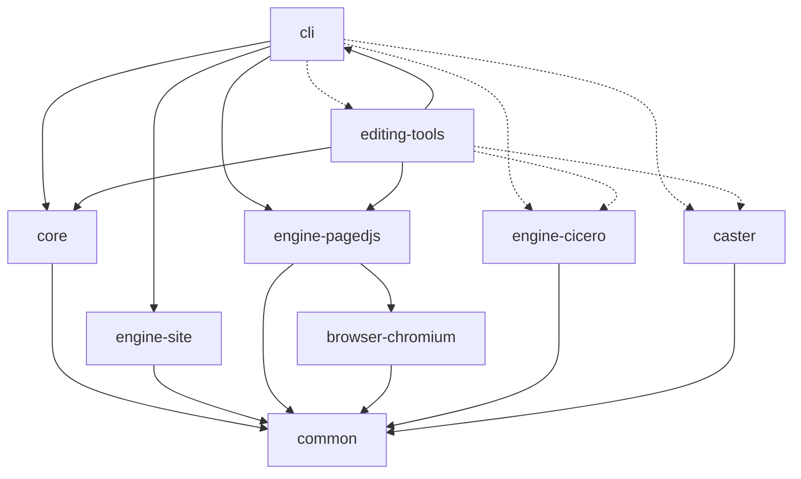
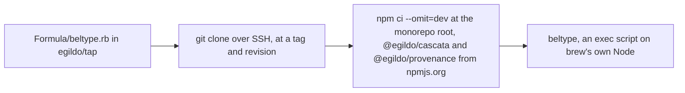
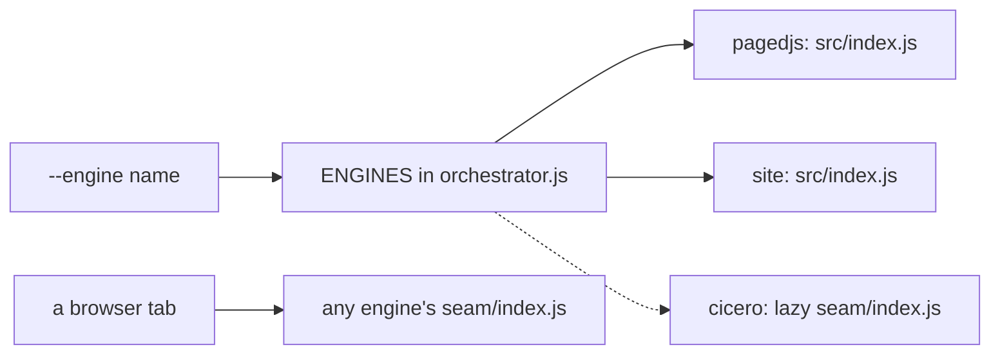

# Repos, packages, and the publish posture

BelType is one git repository holding eleven npm packages. This chapter says what the packages are, which way they depend on one another, which of them reach a registry, and how the tool gets onto a machine. The topology is itself a decision, written down so that a session with no memory of the rounds that produced it can act correctly.

## The topology: one repository, eleven packages

The repository is `beltype`, under the GitHub account `egildo`. It is an npm workspaces monorepo (`"workspaces": ["packages/*"]` in the root `package.json`), Node 22 or later, ES modules throughout. The root `bin/beltype.js` is a one-line shim into `packages/cli/bin/beltype.js`, kept for muscle memory.

The import graph is acyclic. Five packages are **published** and form the installable tool; six are **private** siblings that prove, demonstrate, document, edit and print it.

| Package | Role | Published? | Depends on |
| :--- | :--- | :--- | :--- |
| [common](#the-common-package) | the shared kit: path helpers, error types, logger, mime table, HTML escaping | yes | nothing |
| [core](#the-core-package) | the compiler: the cascade, the belt, the shell, the linker, the closure, the host contract, the root schema, the default fonts | yes | `common`, Cascata, the unified ecosystem |
| [engine-pagedjs](#the-engine-pagedjs-package) | the Paged.js adapter, and the PDF render through headless Chromium | yes | `common`, `browser-chromium`, `pagedjs` |
| [engine-site](#the-engine-site-package) | the site engine: the same document presented as a website | yes | `common` |
| [cli](#the-cli-package) | the application (bin `beltype`): arguments, orchestrator, dev server, change feed, and the node host | yes | `common`, `core`, `engine-pagedjs`, `engine-site`, Provenance, `ws` |
| [browser-chromium](#the-browser-chromium-package) | the one place BelType launches headless Chromium, and the pin on which build | private | `common`; `playwright-core` as an optional dependency, pinned exactly |
| [engine-cicero](#the-engine-cicero-package) | Cicero, BelType's own paged-media engine, in beta | private | `common` and `css-tree`, from its `seam/` only; its `src/` has no dependencies |
| [essay](#the-essay-package) | the venue that proves Cicero against Chromium's print, and the book that demonstrates it | private | dev only: `browser-chromium`, `cli`, `common` |
| [editing-tools](#the-editing-tools-package) | `beltype edit`: a file server plus a browser application in which the belt runs in the tab | private | `common`, `core`, `cli`, `engine-pagedjs`, CodeMirror, `ws` |
| [caster](#the-caster-package) | Caster, the browser-side PDF 2.0 and PDF/UA-2 printer | private | `common`; its heavy libraries are committed bundles under `vendor/` |
| `docs` | this manual: `index.md` and six chapters | private | dev only: `cli` |

Every npm name is `@egildo/beltype-<dir>`. Cross-package imports use the package name with a deep path, such as `@egildo/beltype-common/src/paths.js`; no package has a barrel file.

### The package dependency graph

Solid arrows are `dependencies` declared in a `package.json`. Dashed arrows are doors that exist only at run time: a lazy `import()`, a `require.resolve`, or an import-map prefix that is emitted only when the package is present.



Left out for legibility: `cli → common` and `editing-tools → common` (both declared), and the development-only edges. Those are `essay → browser-chromium, cli, common`, `caster → browser-chromium, editing-tools`, `editing-tools → browser-chromium` and `docs → cli`, all needed by tests and by no shipped path.

### The run-time doors, and why they are not dependencies

A published package that statically imported a private one would crash on load in every registry install. So each private capability is reached through a door that fails late, in a sentence, and only when an operator asks for it.

| Door | Where it is | What happens when the package is absent |
| :--- | :--- | :--- |
| `cli` → `engine-cicero` | `ENGINES.cicero` in `packages/cli/src/orchestrator.js`, a thunk around `import('@egildo/beltype-engine-cicero/seam/index.js')` | `--engine cicero` refuses, saying the engine ships unpublished |
| `cli` → `editing-tools` | `packages/cli/bin/beltype.js` imports `bin/beltype-edit.js` when the subcommand is `edit` | `beltype edit` refuses |
| `cli` → `caster` | `casterAssets()` in `packages/cli/src/client-assets.js`, a `require.resolve` of the package | `build --pdf --printer caster` refuses by name; it never falls back to Chromium's print |
| `editing-tools` → `engine-cicero`, `caster` | `OPTIONAL_PREFIXES` in `packages/editing-tools/src/import-map.js` | no import-map prefix is emitted; without Caster the print panel stays hidden |

Composable and published are two decisions, and these doors are what keep them apart.

One more relation is not an import at all. `essay` reads `packages/engine-cicero/src/` off the filesystem at run time, through a path named `ENGINE_DIR`. It does so on purpose: Cicero's `src/` stays free of dependencies even from its own test harness.

:::info{title="One declared edge crosses the publish line"}
`engine-pagedjs` is published and declares `browser-chromium`, which is private, because `src/render-pdf.js` imports `launchBrowser` from it statically. Inside the workspace, and in the Homebrew install that runs `npm ci` at the monorepo root, the sibling resolves from the tree. A registry install of `@egildo/beltype-cli` cannot resolve it, because a private package is never published; the Homebrew tap is the install that works. The seam face, `seam/index.js`, never touches it.
:::

### Why one repository

The contracts that cut across packages (the alias table, the `/_beltype/` asset table, the hooks between the belt and the default stylesheet, the host contract, the engine seam) have each broken at least once *inside one repository*. A repository boundary through a contract is a place where it drifts with a version number attached. One repository gives one flat test run and one pull request that touches both sides of any contract.

:::info{title="The scar: the harness left once, and came back"}
Cicero's test venue lived in a separate repository for a time, split out because its footprint dwarfed the engine it tested. The boundary then charged a pinning ceremony for a property one repository provides free: knowing which engine state a battery run was taken against. It was folded back in as `packages/essay`. The record is [one repository](@decisions/one-repository.md).
:::

`packages/essay` is deliberately large beside its siblings. The acyclic framing is about the shape of the import graph, not about line counts, and a test venue with no consumer was never going to be proportionate to a package that ships.

### What lives beside the packages

| Path | What it is | Why it is not a package |
| :--- | :--- | :--- |
| `docker/` | the image's recipe: `Dockerfile`, `Dockerfile.dockerignore`, the operator's page and its Italian twin, `ISTRUZIONI.md` | no code, no `package.json`, and nothing imports it |
| `.claude/decisions/project/` | the decision records this manual links to | records, not a build input |
| `test/` | the root `node:test` suite and the shared fixtures | it tests contracts *between* packages |
| `scripts/` | `worktree-init.sh`, `sync-skill.js` and `zero-diff.sh` | repository chores |

A related repository exists without any dependency edge: the skills marketplace `github.com/egildo/skills`. The canonical `beltype-author` skill lives in `packages/cli/skill/`, beside the CLI it describes; `npm run sync-skill` copies it to the repository's own `.claude/skills/` (`test/plugin-manifest.test.js` pins that copy identical). The folder is itself a Claude Code plugin (`packages/cli/skill/.claude-plugin/plugin.json`, its `version` in lockstep with the packages), and the marketplace lists it by `git-subdir`, so nothing is mirrored into the skills repository. The release ritual gains one step: push the tag `beltype--v<version>` (`claude plugin tag --push`, run from `packages/cli/skill`) so version constraints on the plugin resolve.

## Versioning and publishing

All eleven packages share one version, and sibling dependencies are exact.

```json
{
  "name": "@egildo/beltype-cli",
  "version": "0.28.0",
  "dependencies": {
    "@egildo/beltype-common": "0.28.0",
    "@egildo/beltype-core": "0.28.0"
  },
  "publishConfig": { "registry": "https://npm.pkg.github.com" }
}
```

Everything bumps together. A change to a cross-cutting contract bumps the minor and gets a git tag. There is no independent semver per package, because no package has an independent consumer.

The five published packages go to **GitHub Packages**, privately:

- Each carries `publishConfig.registry`, and the repository's `.npmrc` maps `@egildo:registry=https://npm.pkg.github.com`.
- Publishing needs a personal access token (`write:packages`) in the operator's own `~/.npmrc`, and so does installing one of these packages from a consumer project (`read:packages`). It is never committed. Installing this repository needs none ([Cascata](#cascata-is-a-registry-dependency-pinned-by-a-tarball-url)).
- The scope setting overrides `publishConfig`, so a publish of any `@egildo/*` package to another registry, npmjs.org for instance, needs `--@egildo:registry=https://registry.npmjs.org/` on the command line. (Cascata and Provenance are published there from their own repositories, on a release tag; this repository publishes nothing to npmjs.org.)
- A consumer project adds the same scope mapping and runs `npm i @egildo/beltype-cli`. The bin is `beltype`. That install cannot resolve `browser-chromium` today (the info box above), so it is the tap that works.

The scope is `@egildo` because GitHub Packages requires the scope to match the repository's owner. If the repository moves into a `beltype` organisation, the packages are renamed `@beltype/*`. That is a rename and no redesign: nothing depends on the scope except import specifiers and manifests.

A shared house schema has **no** publish posture, and that is a recorded no. It is a YAML file adopted by path ([a venue is a schema](@decisions/a-venue-is-a-schema.md)): no manifest, no version, no registry. BelType ships one schema, its own root, and resolves none by name. Sharing a schema means sharing a file.

### Cascata is a registry dependency, pinned by a tarball URL

`packages/core` depends on Cascata at an exact version, from **npmjs.org**, where it is public:

```json
"@egildo/cascata": "https://registry.npmjs.org/@egildo/cascata/-/cascata-1.16.2.tgz"
```

Cascata's development home is Codeberg (`egildo/cascata`), with a push mirror on GitHub. A release is a `vX.Y.Z` tag pushed to Codeberg, which a workflow on the mirror publishes to npm; the `-dist` git tags are retired, and 1.12.0 is the last version that exists on GitHub Packages. Here, bump the URL's version (it appears twice) and run `npm install`, which updates the lockfile. The bare name `cascata` on public npm belongs to an unrelated package, which is why the name is scoped.

:::info{title="Why a URL and not a version"}
npm maps a scope to **one** registry, and the `.npmrc` here maps `@egildo` to GitHub Packages for `@egildo/beltype-*`. A plain `"@egildo/cascata": "1.16.2"` would therefore be looked up on GitHub Packages, where 1.16.2 is not, and the install would fail. A tarball URL is fetched from where it names, whatever the scope says, and the lockfile records its `resolved` and `integrity`. The same URL is what a consumer's install reads out of the published `@egildo/beltype-core`, so nothing about Cascata needs a token for them either. The cost is that the version sits in the URL, not in a range, which for an exactly pinned dependency costs nothing. If the `@egildo/beltype-*` packages ever move to npmjs.org too, the `.npmrc` line goes and these pins become plain versions.

So installing this repository needs no token at all: the `@egildo/beltype-*` packages are its own workspaces and link from the tree. A token matters only to publish them, or to install one from a consumer project. The Docker build takes no secret for the same reason. The tap's formula was written for the opposite case. A formula's build can reach neither `~/.npmrc` (Homebrew's sandbox denies it and points `HOME` at a temporary directory) nor a variable whose name says *token*, so it declared each `@egildo/*` tarball as a `resource`, which Homebrew downloads before the sandbox with the operator's token. Those resources are now public downloads; whether the formula still needs them is the tap's to settle, in its own repository.
:::

### Provenance is a registry dependency too

`packages/cli` depends on Provenance the same way, from npmjs.org by tarball URL, pinned exactly (it too is developed on Codeberg, `egildo/provenance`, with a GitHub mirror, and released by a tag):

```json
"@egildo/provenance": "https://registry.npmjs.org/@egildo/provenance/-/provenance-0.6.2.tgz"
```

Provenance is the author's source-graph library: a session over one document's sources, and a host that watches them. BelType uses its watching and its read passes and nothing else: the change feed in `packages/cli/src/change-feed.js` opens a session with no handlers, so every source is a leaf and its CSS and HTML parsers (`postcss`, `parse5`) are installed but never loaded. Both the CLI's dev server and the editing tools' server watch through it and read through its passes. What a render read, and found nothing at, is therefore what is watched ([Provenance watches the files](@decisions/provenance-watches-the-files.md), [the render reads through the session](@decisions/the-render-reads-through-the-session.md)). Neither package needs a token, as Cascata does not.

## Distribution — the Homebrew tap, and the operator's install

GitHub Packages asks for an authenticated `~/.npmrc` even to read, so `npm i -g @egildo/beltype-cli` works only for token holders. It serves consumer projects and the operator; it is no front door.

The front door is a Homebrew tap.

```bash
brew install egildo/tap/beltype
```



The formula clones this repository over SSH, because the repository is private and an archive URL answers 404 to the world. The key that already pushes here is the whole credential. `npm ci` at the root resolves the `@egildo/*` siblings as workspaces from the tree, and each `@egildo/*` registry dependency (Cascata, Provenance) from npmjs.org by the tarball URL the lockfile records, so the operator needs no token for the install. The installed `beltype` is pinned to brew's own Node, where no version manager can orphan it. Chromium is not part of the install: the first `--pdf` refuses and names the one fetch command, `npx playwright-core install --no-shell chromium`. TypeScript is a root devDependency that checks `.js` source and emits nothing ([types live beside the code](@decisions/types-live-beside-the-code.md)), so `npm ci --omit=dev` never installs it and no package has a build step.

The release ritual therefore ends in the tap. Bump the formula's `tag` and `revision` to the release commit. The formula as it stands (checked 2026-10-26) still declares a top-level `resource` per `@egildo/*` registry dependency, each downloaded from GitHub Packages at 1.12.0 and 0.5.0 with the operator's token. Those resources existed to carry the token past Homebrew's sandbox, and the pins have moved to npmjs.org, so they are stale: remove them and the `~/.npmrc` reading from the formula, in the tap's own repository, before the next release. Run `brew style egildo/tap`, `brew reinstall beltype` and `brew test beltype`, then commit the tap.

:::warning{title="Check what a checksum is a checksum of"}
An earlier formula downloaded a release tarball. The repository was private, the URL answered with a nine-byte Not Found page, and the release hashed that page. Run `file` on a downloaded artifact before trusting its checksum.
:::

Two doors stay marked and closed. Making the repository public would turn the formula into the ordinary `url` plus `sha256` pair and gain bottles. Publishing to public npmjs, free for public scoped packages, would open plain `npm i -g` and `npx`.

### The Docker image, and why docker/ is a folder

`egildo/beltype` on Docker Hub is the editing tools standing on a mounted folder, for a colleague who has Docker Desktop and nothing else. Three things are sorted by owner.

The desk is product
: `--root`, `--host`, the document picker, `/open` and `/print` live in `packages/editing-tools`, because standing on a folder before a document is chosen is a capability a laptop has a use for too.

The recipe is a folder
: `docker/` holds the `Dockerfile`, its ignore file and the colleague's page. It stays in this repository because the image needs the *whole* checkout: the editing tools' import map resolves from a directory holding both `node_modules` and `packages`, and several of the packages it serves are unpublished. The recipe also names internals (a bin path, environment variables, the browser pin) that a rename here would break silently in another repository.

The deployment is someone else's
: A workplace's instructions, starter folder and house fonts consume the *image*. `FROM egildo/beltype:<version>` is the whole coupling, which is the tap's shape again.

```bash
npm run docker:build      # docker build -f docker/Dockerfile -t egildo/beltype:dev .
npm run docker:publish    # multi-arch buildx, tagged with the lockstep version and latest
```

Two facts are stated so that nobody has to discover them. The Hub repository is public while this one is private, and the image carries the checkout, unpublished packages included; that was chosen so a colleague can pull with no account. And the change feed watches with `fs.watch` and has no polling mode, so inside the container a file changed from the host side of a Docker Desktop bind mount may go unheard, which is unmeasured ([Provenance watches the files](@decisions/provenance-watches-the-files.md)). The editing server's own saves happen inside the container and are heard. The image fetches its browser through the installed `playwright-core`, so both architectures carry the same pinned Chromium as every other install.

## Engines — the door, and the entry ticket for a new one

An **engine** is the adapter that presents a compiled document: as pages, as a website. The belt compiles one truth, engine-blind, and each engine answers the emitted hooks in its own medium. The contract is four members, described in [the architecture](#the-beltype-architecture).

```js
// the shape every engine has; test/null-engine.js is the smallest one
export const someEngine = {
  headHtml: (base) => '',                        // a string spliced into <head>
  bootstrapJs: () => '',                         // a string run in the page
  vendorAssets: () => ({ files: {}, dirs: {} }), // what the server adds to /_beltype/
  renderPdf: async (url, pdfPath) => pdfPath     // or an honest refusal
};
```

The operator chooses an engine by name with `--engine`, and only there. Engine options in config, and engine discovery of any kind, stay closed.



A new engine enters by meeting this ticket:

1. **It implements the four members**, and refuses honestly where it cannot deliver. `engine-site`'s `renderPdf` refuses; so does Cicero's while it is in beta.
2. **It obeys the seam convention.** Its composable face is importable from exactly one path, `seam/index.js`, with no capability touched at module scope: no `fs`, no `http`, no module resolution, no Chromium launcher. `headHtml` and `bootstrapJs` there are pure strings, so a browser tab can compose the engine. Whatever needs a machine lives in a node face, `src/index.js`. `test/engine-seams.test.js` pins this for every engine.
3. **It becomes one row in `ENGINES`**: an engine object, or a thunk around a lazy `import()` when the package is unpublished.
4. **`renderPdf` takes a URL.** `build --pdf` prints from the in-process dev server's own `http://` address, since there is no exported directory to read ([the MVP cut](@decisions/the-mvp-cut.md)).
5. **Publishing is decided separately.** A private engine costs an installed CLI one clear sentence when asked for, never a crash at load.

| Engine | Seam face | Node face | Status |
| :--- | :--- | :--- | :--- |
| `pagedjs` | `seam/index.js`; `vendorAssets` refuses there by name | `src/index.js`: the real `vendorAssets`, and `renderPdf` through `browser-chromium` | the default |
| `site` | `seam/index.js`, a one-line re-export | `src/index.js`, already browser-legal | shipped; `renderPdf` refuses |
| `cicero` | `seam/index.js`, native, and the only face it has | none; the CLI composes the seam | beta, on screen only, private |

A **WeasyPrint adapter** is the one engine designed and deferred. `headHtml` and `bootstrapJs` would return empty strings, and `renderPdf` would shell out to `weasyprint` against the dev server's URL. Four things must be verified before anyone builds it. The first is WeasyPrint's `@layer` support, which the three layers of style depend on. The second is its `target-counter()` behaviour, which contents page numbers and `:ref` depend on. The third is whether KaTeX's HTML and CSS output renders acceptably without a browser. The fourth is what to do about Mermaid, which does not render without one.

## Triggers to revisit this topology

Split something out, and not before, when one of these becomes true.

| Trigger | Standing |
| :--- | :--- |
| A second real consumer of `core` appears that is not the CLI | Fired by `editing-tools` and not honoured. That consumer arrives through seams, and a split would put a repository boundary through the belt contract, the asset table and the engine seam at once. It re-fires if the browser host gains a release cadence of its own. |
| Cicero outgrows the workspace: its own cadence, its own consumers, or a tooling footprint that dwarfs the host | Fired once and reversed ([one repository](@decisions/one-repository.md)). It re-fires on the same terms. |
| A second engine adapter lands and stays | Fired by `engine-site` and not honoured: the seam's contract tests live here. It re-fires if an engine grows its own cadence. |
| The packages go public on npmjs | Open. The scope economics flip. |
| Starters return with a cadence of their own | Open. They would return as schemas a document adopts, not as files a scaffolder copies. |
| A second contributor needs per-component permissions | Open. |
