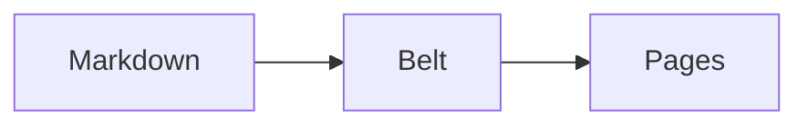

# Syntax

This is the authority on what you can write in a BelType document. The [guide](#the-beltype-guide) teaches the tool with a running example and is the friendlier door; the [reference](#the-beltype-reference) holds the command line, the configuration schema and the module APIs. Everything about *syntax* lives here.

**This chapter is part of a BelType document: the manual you are reading.** So nearly every construct below appears twice: its source in a code fence, then the construct itself, live, immediately after. The exceptions are the few whose live form would disturb the manual itself, like a stray heading, an `@include`, or a second contents page from a stray `@toc`. Read on GitHub, that second half shows as plain text. For a syntax manual that is not a defect, because plain text is exactly what you would type. Read as the built site, it renders. The `assets/syntax.css` this manual links carries the running head and figure styling (ordinary CSS, nothing BelType invented), because in BelType that is what it is.

## How to read this

Every entry below is tagged with one of four content models. The model says what happens to the construct's body:

| Content model | What happens to the body | Written as |
| :--- | :--- | :--- |
| **void** | there is no body | `::name{…}` |
| **phrasing** | parsed as inline content | `:name[text]{…}` |
| **flow** | parsed as blocks | `:::name{…}` … `:::` |
| **raw text** | not parsed at all | ```` ```name ```` … ```` ``` ```` |

Two constructs are outside the table. The at-rules, `@include` and `@toc`, mark a place whose content is not written there: `@include` brings in other files' text, `@toc` a listing derived from the whole document. Why the four models are HTML's own, and why the at-rules carry a different sigil, is in [the belt, stage by stage](#the-belt-stage-by-stage).

## Text

Ordinary Markdown works, and several conveniences are on top of it.

### Emphasis and strikethrough

```markdown
*emphasis*, **strong**, `inline code`, ~~struck through~~
```

*emphasis*, **strong**, `inline code`, ~~struck through~~

Strikethrough needs **two** tildes. A single tilde is reserved for subscript, so `~text~` is never struck here. GFM itself calls single-tilde strikethrough "technically prohibited", so nothing standard is lost.

### Highlighting

```markdown
==highlighted== and =r=red== and =b=blue== and =y=yellow==
```

==highlighted== and =r=red== and =b=blue== and =y=yellow==

A bare `==text==` produces `<mark class="flexible-marker flexible-marker-default">` and is left the browser's yellow. A letter key before the text picks a colour class: `=r=` gives `flexible-marker-red`, `=b=` blue, `=y=` yellow. All twenty-six letters are mapped, almost always by initial: amber, blue, cyan, brown, espresso, fuchsia, green, hotpink, indigo, jade, kiwi, lime, magenta, navyblue, orange, purple, pink, red, silver, teal, umber, violet, white, gray, yellow, black. The alphabet has four compromises worth knowing before you guess: `d` is brown, `q` is pink, `x` is gray, `z` is black. Every one has a rule in the default stylesheet.

### Subscript and superscript

```markdown
H~2~O and x^2^
```

H~2~O and x^2^

Single tilde, single caret. This is why strikethrough is double-tilde only.

### Abbreviations

```markdown
*[WYSIWYM]: What You See Is What You Mean

A WYSIWYM editor shows a document's structure, not its pages.
```

*[WYSIWYM]: What You See Is What You Mean

A WYSIWYM editor shows a document's structure, not its pages.

Every whole-word occurrence of the term becomes `<abbr title="…">`, anywhere in the document, including headings, table cells and list items. Matching is case-sensitive, and where two definitions could apply the longer term wins. One rule about the definition block: a paragraph counts as definitions only if *every* line in it is a definition, so keep them together and away from prose.

### Emoji and typography

```markdown
:rocket: :compass:
```

:rocket: :compass:

Smart typography (curly quotes, en and em dashes, ellipses) is **off** by default. Turn it on per document with `markdown: { smartypants: true }`.

## Blocks

Headings, lists, quotes and tables are ordinary Markdown and behave as you expect. What follows is what is worth knowing beyond that.

### Headings

```markdown
## A section
### A subsection
```

Every heading gets an `id` derived from its text, which is what cross-references and the contents page point at. **Never type a number into a heading**: `## 1. Scope` is the single most likely way to break a document, and [how to number headings without breaking the document](#how-to-number-headings-without-breaking-the-document) explains what to do instead.

**Every heading also opens a real `<section>`** in the rendered document, holding the heading and everything beneath it until the next heading of equal or higher rank. Sections nest: this very subsection sits inside the Headings section's element, which sits inside the one for Blocks. The section itself carries nothing: no class, no id. The heading keeps both, so anchors and any `h2.classname` rule keep working. The section changes nothing visually until your CSS addresses it. Addressing it is one standard selector:

```css
section:has(> h2.keep-together) { break-inside: avoid; }
```

That rule, inexpressible over a flat document, keeps a whole section on one page in print. Content written before a document's first heading belongs to no section and stays where it was. And only headings in the document's own flow articulate. A heading *inside* anything (a container directive, a literal `<h2>` typed as HTML, a Pug fragment) opens no section, exactly as the HTML-born ones get no `id` and no contents entry. Raw HTML that opens a tag before a heading and closes it after will fight the nesting; wrap such content in a directive instead, whose heading then belongs to the directive.

### Lists and tasks

```markdown
- an ordinary item
- [ ] an open task
- [x] a finished task
```

- an ordinary item
- [ ] an open task
- [x] a finished task

### Tables

Tables are **off by default**, and are switched on per document or venue with `markdown: { gfm: { tables: true } }`. A pipe table is a parse cost paid on every edit by documents that have none. Without it the rows below are an ordinary paragraph of pipes.

```markdown
| Leg        | From         | To           |
| :--------- | :----------- | -----------: |
| Northbound | Weddell Sea  | Arctic coast |
```

| Leg        | From         | To           |
| :--------- | :----------- | -----------: |
| Northbound | Weddell Sea  | Arctic coast |

Alignment comes from the colons in the divider row. These are GFM tables, which is an honest limit worth stating: there is no column spanning, no row spanning and no `<caption>`. A table needing any of those is written as HTML, which passes through untouched.

### Links

`[text](https://example.com)` and the angle-bracket form `<https://example.com>` always work; the latter is a CommonMark autolink, not a GFM one. A **bare** `https://example.com`, `www.example.com` or email address becomes a link only when the document or venue opts in with `markdown: { gfm: { autolinks: true } }`. That is GFM's "autolink literal", off by default because its tokenizer is tried at every letter and digit of the source.

### Definition lists

```markdown
Chase
: The frame a forme is locked into before it goes to press.
```

Chase
: The frame a forme is locked into before it goes to press.

### Footnotes

```markdown
A claim that needs support.[^src]

[^src]: The supporting note, collected at the end of the document.
```

A claim that needs support.[^src]

[^src]: The supporting note, collected at the end of the document.

Footnotes are collected into a section at the end of the document, the way the web does it: HTML §4.14.4's own recommended pattern, and the default output. Bottom-of-page footnotes are reachable, and they are CSS, not syntax: GCPM's `float: footnote` on any inline element the author places at the point of attachment (inline HTML, a `directives:` text directive, a `[[…]]{.footnote}` span). Every inline door is already a footnote syntax. For this dialect's end-of-document definitions, the opt-in relocation `markdown: { inlineFootnotes: true }` moves each note to its call, where the property needs it. The pairing with the author's own `float: footnote` rule is [how to put the notes at the foot of the page](#how-to-put-the-notes-at-the-foot-of-the-page). BelType grows no footnote feature of its own: the property is the feature.

### Code

````markdown
```js
const belt = one(pass);
```
````

```js
const belt = one(pass);
```

The language name drives syntax highlighting. A fence can also carry attributes: see [Nomination](#nomination).

## Nomination

*Content model: not a construct, an annotation on one.* {.model}

Nomination is the quietest and most useful thing in the dialect. It does not create anything; it *names* something that already exists, so that CSS can find it. BelType puts the class or id on the element and your stylesheet decides what it means.

```markdown
## A pull-quote heading {#pq .lead}

A paragraph that wants a class. {.callout}
```

The braces attach to the **heading or paragraph they trail**, and they must nominate something: an `#id`, a `.class`, or a `key=value`. A trailing brace that nominates nothing is left alone as literal text, so ordinary prose braces are safe.

**What it attaches to, precisely.** Headings and paragraphs, images, and code fences. It does **not** attach to blockquotes, list items, tables or horizontal rules: `> quoted {.q}` puts the class on the inner paragraph, not on the `<blockquote>`, and a list item takes nothing at all. When you need a class on one of those, write the HTML.

On a fence, attributes ride the info string and the language class survives:

````markdown
```js {#snip .wide}
const x = 1;
```
````

produces `<code class="hljs language-js wide" id="snip">`.

For a run of text inside a paragraph, use **double** brackets:

```markdown
The [[important part]]{.lead} of the sentence.
```

The [[important part]]{.lead} of the sentence.

Double brackets are not a style choice. A single `[` already opens a link, a reference and a footnote in CommonMark, so a single-bracket span would collide with all three; `[[ ]]` is claimed by nothing and stays literal when it nominates nothing. Inner formatting still parses: `[[**bold** run]]{.x}` works.

**An author id beats the generated one.** Because nomination runs before heading slugs are generated, `## Scope {#scope}` keeps your id. That is the escape hatch from the numbered-heading trap.

## Callouts and custom syntax

### The built-in directives

*Content model: flow.* {.model}

```markdown
:::tip
Terns navigate partly by the sun.
:::
```

:::tip
Terns navigate partly by the sun.
:::

| Written | Element | Class | Default title |
| :--- | :--- | :--- | :--- |
| `:::tip` | `div` | `alert alert-tip` | Tip |
| `:::warning` | `div` | `alert alert-warning` | Warning |
| `:::danger` | `div` | `alert alert-danger` | Danger |
| `:::info` | `div` | `alert alert-info` | Info |
| `:::aside` | `aside` | `sidebar` | — |

Give your own title with `title=`, which is consumed to render a heading rather than emitted as an HTML attribute:

```markdown
:::warning{title="Unverified"}
The figure is an estimate, not a measurement.
:::
```

:::warning{title="Unverified"}
The figure is an estimate, not a measurement.
:::

Every *other* attribute you write is passed straight through onto the element, so `:::tip{data-kind=field}` emits that attribute.

There is no built-in fold-out (`:::details`) and that is a position, not a gap: BelType syntax is document content, so every block is imagined readable: in print, on screen, anywhere. Interactive re-presentation is an engine's business (see the architecture's engine-seam section), and a project that wants a raw `<details>` can bind one itself through the custom `directives:` map.

**Nesting needs more colons on the outside.** A `:::` closes at the first `:::` it meets, so a three-colon container cannot hold a three-colon container. Use four for the outer one:

```markdown
::::warning{title="Check the units"}
The samples disagree.

:::tip
Convert both to SI before comparing.
:::
::::
```

::::warning{title="Check the units"}
The samples disagree.

:::tip
Convert both to SI before comparing.
:::
::::

### The other two arities

*Content model: void, and phrasing.* {.model}

A bodyless block-level directive is written with two colons, and an inline one with a single colon and square brackets:

```markdown
::sidenote{ref="12"}

An :highlight[inline run] inside a sentence.
```

A name BelType does not know still renders, so nothing is silently lost. It becomes a `div.directive.directive-<name>` for a container, a `span.directive.directive-<name>` for a void one, and a `span.directive-text.directive-<name>` for an inline one. Your CSS can select any of them without configuring anything.

### Naming your own

Bind a name to a rendering in the document's frontmatter:

```yaml
directives:
  theorem: { tag: section, className: theorem }
  kbd:     { tag: kbd,     className: key }
```

A venue binds the same names for every document under it. It spells them the schema's way, because `beltype.config.yaml` is a schema and refuses a bare `directives:` at its top level:

```yaml
$adopts: beltype:document

keys:
  directives:
    provide:
      theorem: { tag: section, className: theorem }
```

`:::theorem{title="Pythagoras"}` then produces `<section class="theorem">` with a `.directive-title` heading, and `:kbd[Ctrl+C]` produces `<kbd class="key">Ctrl+C</kbd>`. This is the whole extension mechanism for prose: covering the HTML elements Markdown has no syntax for (`<kbd>`, `<cite>`, `<dfn>`, `<var>`, `<samp>`, `<q>`, `<time>`) is a table of names, not code.

For something a tag and a class cannot express, give the entry a `render` instead. The config is data, so `render` names an ES module, resolved from `extensions/<name>.js` in your project, then installed packages. Its default export receives the directive's content already flattened to plain text and its attributes. Whatever HTML it returns replaces the directive. A `:val` inside the content is resolved before the flatten, so a hook that parses `key: value` lines sees the value, not the key's name:

```yaml
directives:
  metrics: { render: metrics }    # → extensions/metrics.js
```

```js
// extensions/metrics.js
export default (text, attrs) =>
  `<dl class="metrics">${text.split('\n')
    .map((l) => l.split(/:\s*/))
    .map(([k, v]) => `<dt>${k}</dt><dd>${v}</dd>`)
    .join('')}</dl>`;
```

What `text` contains depends on the arity. For a **flow** directive it is one line per block child with inline formatting collapsed, so a lean `key: value` syntax parses without touching the syntax tree. For a **phrasing** directive it is the whole run joined with nothing, since it is one continuous span. A `render` returning a block element from an inline directive produces invalid nesting. Keep the shapes matched.

Two directive names cannot be redefined, `:ref` and `:val`, and the two at-rules are reserved by the same rule. The rule is worth stating because it is derivable rather than arbitrary: **the belt reserves a name when the rendering needs something only the belt holds**. `:ref` needs the layout engine's counters, `:val` needs the value chain, `@include` needs the file merge, and `@toc` needs every heading in the finished document. A `render` hook receives none of those, so shadowing one would not customize it: it would silently break it.

## Figures, references and numbering

### Figures

*Content model: not a construct, a promotion.* {.model}

An image alone in a paragraph **with a title** becomes a numbered figure:

```markdown

```


The quoted string is the caption. The trailing `{#fig:id}` inside it becomes the figure's id and is stripped from the visible caption. An image with no title stays inline, and an image sharing its paragraph with other text is left alone.

Nomination reaches figures too: `{title="A caption"}` promotes the image the same way, which is the way to caption an image whose title you would rather write as an attribute.

### Cross-references

*Content model: phrasing.* {.model}

```markdown
The route in :ref[fig:route] is longer than the equator.
```

The route in :ref[fig:route] is longer than the equator.

`:ref[fig:route]` becomes `<a class="xref" href="#fig:route">` with **no text of its own**. Every visible character comes from CSS, because the number cannot be known until the document is laid out. `:ref{to=fig:route}` is the same thing written as an attribute, for labels that are awkward in brackets.

Author attributes pass through: `:ref[deployment]{.sec}` emits `<a class="xref sec" href="#deployment">`. That class is how a reference to something other than a figure gets its own rendering: the author's CSS answers it with the counter of their choice. The recipe is styling, not syntax: [how to refer to a section by its number](#how-to-refer-to-a-section-by-its-number). `to` and `id` stay consumed as label spellings; everything else lands on the link. A bare `:ref` keeps meaning figure.

The belt also stamps every resolvable reference with its target's **text** as `data-ref-text` (a heading's text, a figure's caption), so CSS can print the target's *name* (`content: attr(data-ref-text)`) with no layout-time lookup. The site engine reads it only where Cicero is not served; otherwise the site reads `target-counter()` and `target-text()` like any engine. A reference whose target is neither a heading nor a captioned figure warns at build time and carries no stamp. The number is never stamped: text is a written fact, a number a realized one.

### Where the numbers come from

The document ships these rules. The rendering engine counts at display time (the site engine reads the same rules, borrowing Cicero's reads), so a figure inserted anywhere renumbers everything after it:

```css
body { counter-reset: figure; }
figure { counter-increment: figure; }
figcaption::before { content: "Figure " counter(figure) ". "; }
.xref::after { content: target-counter(attr(href url), figure); }
```

The word "Figure" is English and hardcoded in those rules. A document in another language overrides both, caption and reference: [how to caption figures in another language](#how-to-caption-figures-in-another-language).

The contents page works the same way: each entry's page number is `target-counter(attr(href url), page)`, resolved during pagination.

## Mathematics and diagrams

### Mathematics

*Content model: raw text.* {.model}

```markdown
Inline $a^2 + b^2 = c^2$, and on its own line:

$$
30 \times 90{,}000 = 2{,}700{,}000 \text{ km}
$$
```

Inline $a^2 + b^2 = c^2$, and on its own line:

$$
30 \times 90{,}000 = 2{,}700{,}000 \text{ km}
$$

A fenced block tagged `math` is display mathematics too, which is convenient when the formula contains dollar signs:

````markdown
```math
E = mc^2
```
````

Rendering is KaTeX, at build time, with its stylesheet and fonts vendored. Nothing is fetched while a document is previewed or printed. The markup carries **both** a MathML branch, for accessibility and for copy-paste, and an HTML branch of positioned spans. The HTML branch is what you actually see; the MathML is there for machines.

### Diagrams

*Content model: raw text.* {.model}

````markdown

````


A rendered diagram is always described: the fence's own text goes into the drawing as its `<desc>`, a caption on an enclosing figure becomes its `<title>`, and a Mermaid `accTitle:` line inside the fence is a title the author wrote. That description is what a screen reader and the printer's structure tree read. Mermaid is different from everything else here in one way worth knowing: it renders **in the browser**, when the page loads, before pagination begins, so the engine measures real diagram sizes rather than guessing. If the runtime has not finished within eight seconds the document paginates anyway and the diagram appears as its source text, on the principle that a late diagram must never cost you the whole document.

### Pug fragments

*Content model: raw text.* {.model}

A `pug` fence is authored in [Pug](https://pugjs.org), structure by indentation, and rendered to HTML **at build time**. Its one law is the equivalence principle: the output behaves in every respect as if you had written the HTML inline at that site. Use it where a dense structural fragment would drown in closing tags. Structure the document is indexed on (headings, the material of the contents page) stays in Markdown, exactly as it would with inline HTML.

````markdown
```pug
.specimen-card
  strong Structure by indentation:
  ul
    each n in [1, 2]
      li Specimen #{n}
```
````

```pug
.specimen-card
  strong Structure by indentation:
  ul
    each n in [1, 2]
      li Specimen #{n}
```

Pug may loop and branch. The fragment computes **only over the document's own values**: the locals are the cascade's `params`, the same values `:val` reads, and nothing else, ever. Pug's own `include`/`extends` are refused (assembly has one door: `@include`). Rendering needs the `pug` package installed; a fence present without it fails the build with the install hint, and `markdown: { pug: false }` turns the fence back into a literal code block. The editing tools render a fence live in the tab, over the same `params`. A whole document can also be authored in Pug (`beltype page.pug`); the reference chapter covers that under [what a target's extension selects](#what-a-targets-extension-selects).

## Assembly

*The assembly at-rule.* {.model}

```markdown
@include{src="./chapters/route.md"}
```

`@include` splices another Markdown file in, recursively. It must sit **alone on its own line**: at most three spaces of indentation, nothing after the closing brace. A mid-line `@include` is prose.

**Paths** resolve against the file that wrote them, so a chapter including its own sub-chapter works wherever the chapter lives. A leading slash means the *document root* (the folder holding your entry file), not the filesystem root.

**Attribute values must be quoted.** `src=./x.md` is not parsed; `src="./x.md"` is.

**`shift` re-ranks the included file's headings**, by a signed offset written at the include site so the fitting is readable in the document:

```markdown
@include{src="./chapters/history.md" shift="+1"}
```

A standalone chapter written from `# History` down lands as `## History` with its internal hierarchy intact. Its sections nest at the depth the include site chose. Shifts compose: a `+1` include inside a `+1` include lands at `+2`. Only the file's own top-level headings move: a heading quoted inside a blockquote keeps its written rank. A shift that would push a heading past `h6` or above `h1` fails the build naming the file and the heading, because a silently flattened hierarchy is a wrong document. Setext headings (`===` underlines) are rewritten as `#` headings at the new rank. There is deliberately no automatic mode: the offset is always written, never guessed from context.

An `@include` inside a code fence is left alone, which is what lets this manual print the example above.

BelType refuses two things loudly rather than guessing: a file that cannot be found, and a cycle where two files include each other.

**Why the merge happens before parsing**, which is otherwise an odd implementation detail to expose: link reference definitions and footnote definitions belong to a *document*, not to a block. Merging the files as text first makes them genuinely one document, so a `[link][ref]` in one chapter resolves a `[ref]: …` defined in another. Splicing parsed trees together would quietly break that.

## The contents page

*The derivation at-rule.* {.model}

A table of contents cannot be written, only derived: its entries are the document's own headings, and no single place in the document can see them all. So it is the second at-rule. Where `@include` assembles content written elsewhere, `@toc` derives content written by nobody:

```markdown
@toc
```

Write it **alone on its own line**, where the contents page should appear: after a foreword, behind a half-title, wherever the book wants it. The same block rules as `@include` apply: at most three spaces of indentation, nothing else on the line, and a fenced `@toc` stays literal (which is how this manual shows you one without growing a second contents page).

**Parameters** ride the at-rule's one grammar, quoted values in braces:

```markdown
@toc{depth="2" title="Indice"}
```

`depth` sets how deep the listing goes. Defaults to 3. `title` sets the heading above it. Defaults to "Contents".

**The `toc:` frontmatter key carries parameters; it never summons.** If you prefer conf out of the text, name the instance and address it:

```markdown
@toc{id="summary"}
```

```yaml
toc:
  depth: 3          # flat defaults, for every @toc in the document
  summary:          # conf for the instance whose id matches
    depth: 1
    title: Summary of Contents
```

The `id` also lands on the emitted `<nav>`, so your stylesheet can select it. When the same parameter is set in more than one place, the nearest wins: inline attributes beat the instance's conf, which beats the flat defaults (the same caller-beats-callee rule values already follow).

**More than one `@toc` is legal**, and each resolves its own parameters. The classic use is a one-level *Summary of Contents* up front and the full listing behind it.

Two things follow from `@toc` being derivation rather than writing. Page numbers are not BelType's: the entries link to their headings, and the layout engine fills the numbers at pagination time with standard CSS (`target-counter`). A screen engine drops them and re-presents the same nav its own way, which is why the site engine may seat it as a sidebar, and carry it on every page when it cuts the site into pages. And a `toc:` key with no `@toc` in the document **fails the build** with a message saying exactly that. A summons that silently produced nothing would ship a document missing its contents page, and a PDF cannot be re-checked after it ships.

## Values

*Content model: phrasing.* {.model}

A document can take parameters, which is what lets one file serve twice.

```markdown
@include{src="./warranty.md" entity="Acme EU" jurisdiction="Ireland"}

@include{src="./warranty.md" entity="Acme US"}
```

Inside `warranty.md`, place each value with `:val`:

```markdown
## Warranty — :val[entity]

Governed by the laws of :val[jurisdiction].
```

The two copies come out different. That is the point: the values belong to the *call*, not to the file.

### Where a value comes from

A value is looked up along the chain of includes that produced it, nearest first, out to the project itself. So a value set once at the top reaches a chapter three levels down, and the files in between never forward anything they do not use.

| Set here | Written as | Strength |
| :--- | :--- | :--- |
| the call site | `@include{… owner="Acme"}` | strongest, for that subtree |
| the included file's own defaults | `params:` in its frontmatter | weaker than its caller |
| any ancestor include | an `@include` further up | inherited where nothing nearer supplies it |
| the document | `params:` in the entry frontmatter | the root |
| the project | `keys.params.provide` in the venue's `beltype.config.yaml` | the root, under the document |

The caller always beats the file it calls, which is what lets a reusable chapter ship a sensible default:

```yaml
---
params:
  jurisdiction: Delaware
---
```

`params` is a default for what the caller did not supply. A **demand**, a value the document must supply rather than may, is not written here at all. It belongs to the schema that governs the document, as `keys.<name>.demand: { required: true }`, and a missing one fails the build naming the file and the line. A chapter's frontmatter cannot state one: `requires:` and `schema:` are refused by name. A demand governs the document at its entry, not each chapter against its own keyscope.

It is the same `params` key at every level, deliberately, so a chapter asking for `:val[brand]` neither knows nor cares which level answered.

If a file's frontmatter is shared with other tools, these keys may sit under one `beltype:` mapping instead; see the reference's namespace paragraph for the rule. The keys themselves are unchanged.

### When a value is missing

An optional value nobody supplied does **not** stop the build. It renders a loud marker naming the key, and the build warns. The asymmetry is on purpose: a document you are still drafting should stay readable, but a PDF cannot be re-checked once you have sent it, so a hole must never leave quietly. One CSS rule removes the marker if you want it gone.

### What values are not

Values substitute. Nothing computes. There is no arithmetic, no conditionals, no loops, no filters, and `:val` cannot be used inside another construct's attributes: `@include{src=":val[which]"}` is not resolved. BelType binds values to places you name, and stops there; the reason is in [the belt, stage by stage](#the-belt-stage-by-stage).

## The CSS vocabulary

The default stylesheet gives every construct above a legible appearance without asking whether you brought your own CSS. It never disables itself: it *loses*, because it sits in a cascade layer and any unlayered rule of yours beats it regardless of specificity. There is nothing to switch off and no theme to remember.

The cost of that bargain is real and worth naming: because the defaults always apply, **a design must sometimes unsay what it does not want**. This manual's own stylesheet does exactly that, turning off the default underline under `h1`. Here is the vocabulary to select, and to unsay:

| Class | Emitted for | Styled by default |
| :--- | :--- | :--- |
| `alert`, `alert-tip`, `alert-warning`, `alert-danger`, `alert-info` | callouts | yes |
| `directive-title` | a callout's title line | yes |
| `sidebar` | `:::aside` | yes |
| `directive directive-<name>` | an unknown container or void directive | no |
| `directive-text directive-<name>` | an unknown inline directive | no |
| `xref` | `:ref` | numbering only, no look |
| `val-missing` | a value nobody supplied | yes, loudly |
| `mermaid` | a diagram block | yes |
| `flexible-marker`, `flexible-marker-<colour>` | `==mark==` | yes, all 26 |
| `toc-page`, `toc-title`, `toc-list`, `toc-entry`, `toc-level-1`…`6`, `toc-text` | the contents page — `toc-list`s nest (the hierarchy is in the markup; indentation comes from nesting, the level classes are a selector affordance) | yes |
| `page-break`, `no-break`, `no-print` | your own use — force a break, keep a block whole, hide in print | mechanics (always present) |
| `contains-task-list`, `task-list-item` | task lists | yes |
| `footnotes`, `sr-only` | footnotes | yes |
| `hljs`, `hljs-*` | highlighted code | yes |
| `katex`, `katex-display` | mathematics | vendored KaTeX stylesheet |

---

:val[edition] · Every construct in this manual was verified against the compiler that renders it.
